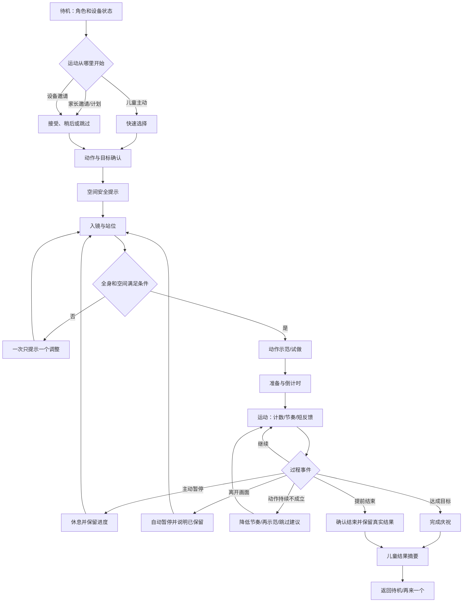

# Document Control

| 字段 | 内容 |
|---|---|
| Document Type | Project Documentation |
| Current Version | v0.2.1 |
| Status | Draft |
| Owner | 待确认（项目协调：魏子奇；不等同文档审批责任人） |
| Reviewer | 待指派 |
| Created Date | 2026-09-23 |
| Last Updated | 2026-10-12 |

> 文档控制版本以本表为准；原文件名和正文版本标识保留为历史业务版本。Draft/Review 为本次治理提交状态，非产品审批结论。创建日期取自原标识，待 Owner 核实。

# AI 运动伙伴｜C 端用户流程与一体换装硬件框架 V0.2

> 日期：2026-09-23  
> 状态：独立产品推演稿；不把既有 PRD 当作已验证需求，不自动修改现行 PRD  
> 范围：家庭消费端；家长手机 App + 儿童硬件本体；暂不设计学校端  
> 目标：先证明真实家庭中的使用闭环，再反推设备构成、比例、尺寸与屏幕规格。

---

## 0. 先纠正问题定义

### 产品关系定义

> **孩子拥有运动过程，家长参与亲子关系，而不是观看和监视过程。**

产品应增加家长和孩子一起决定、一起参与、互相鼓励和共同回顾的机会，但不把儿童运动过程转化成家长可随时查看的家庭监控画面。Camera 是设备理解动作的传感器，不是家长端的远程摄像头。

这条原则优先于“实时在线”“更多数据”和“家长掌控感”。当功能发生冲突时：

1. 优先保护儿童的身体图像、声音、空间和自主选择；
2. 优先促进家长与孩子发生积极互动，而不是增加远程检查；
3. 只向家长提供支持孩子所必需的事实，不提供满足好奇但无助于支持的细节；
4. 把异常解释为设备/环境/任务共同问题，不把儿童变成被审查对象；
5. 家长需要介入时，由设备邀请“来帮助孩子”，而不是悄悄开放观察入口。

本产品不是“家长发布任务、孩子完成任务”的单一路径。家庭里至少同时存在四种启动原因：

1. 孩子自己想运动；
2. 家长希望孩子运动，但不一定需要创建正式任务；
3. 家长提前设定了计划或提醒；
4. 设备在合适时间发出克制邀请，孩子可以拒绝。

因此，家长端与儿童端不是遥控器和被控设备的关系：

- **家长 App**负责购买后的开通、家庭边界、轻量安排、理解结果和处理异常；
- **儿童硬件**负责当下的邀请、选择、站位、教学、识别、反馈、恢复和完成；
- 一次运动是否成立，以硬件真实识别和本地记录为准；
- 家长不应持续盯着实时画面，也不应成为远程裁判；
- 没有家长任务时，儿童仍然可以完成一次自主运动。

### 本轮保留的事实与待验证假设

| 类型 | 内容 |
|---|---|
| 保留的事实 | 用户是家庭中的家长与 6–15 岁儿童；设备需看见全身、完成动作识别和即时反馈；视频默认不持久化；儿童和家长使用不同终端 |
| 待验证假设 | 是否需要正式“任务”；是否需要宠物成长；孩子是否愿意主动使用；提醒由谁发起最合适；一块屏能否同时承担陪伴和运动反馈 |
| 本轮不假设 | 学校一定会参与；家长会每天创建任务；儿童会长期接受同一种萌宠语气；排行榜或游戏化能提升真实运动 |

---

## 1. 两端的职责边界

| 能力 | 家长手机 App | 儿童硬件本体 | 设计理由 |
|---|---|---|---|
| 首次配网、绑定、监护同意 | 主责 | 显示绑定码与状态 | 长输入和授权更适合手机 |
| 儿童资料与年龄模式 | 主责 | 读取并适配表达 | 避免孩子改动监护边界 |
| 发起运动 | 可安排/建议 | 必须支持自主开始 | 不让产品沦为家长遥控器 |
| 运动选择和目标 | 设置默认范围 | 儿童在安全范围内选择 | 保留儿童自主性，又不突破家长边界 |
| 入镜、教学和计数 | 不承担 | 主责 | 当下反馈必须在运动现场闭环 |
| 实时状态 | 只给粗粒度阶段与明确求助 | 主责 | 家长知道是否需要帮助即可，不做持续进度监控 |
| 暂停、继续、提前结束 | 原则上不远程控制 | 主责 | 避免远程干预造成困惑或安全问题 |
| 结果与趋势 | 家庭可理解的摘要与共同回顾 | 简短总结 | 复杂信息放手机，但不建立儿童身体监控档案 |
| 摄像头物理隐私 | 显示/管理授权 | 物理遮挡和硬件指示 | 软件开关不能替代物理可理解性 |
| 换装与角色 | 管理已拥有主题、语气偏好 | 识别装饰并呈现对应角色 | 装饰不应改变基础运动能力 |
| OTA、网络、售后诊断 | 主责 | 显示不可忽略的状态 | 复杂设备管理不交给儿童 |

### 不应跨端复制的功能

- App 不复制硬件的实时大计数界面；
- 硬件不复制 App 的趋势图、家庭管理和隐私设置；
- App 不提供家庭摄像头直播；
- App 不展示动作视频回放、连续截图、实时骨架画面和带时间戳的细粒度行为轨迹；
- 硬件不承载购买、订阅和促销；
- 两端都可以展示结果，但信息密度不同、数据必须同源。

---

## 2. 从家庭生活出发的完整生命周期

### 2.1 购买与首次开通

**家长路径**

下载安装 App → 登录/创建家庭 → 扫描设备码 → Wi-Fi 配网 → 阅读并确认摄像头与数据规则 → 创建儿童档案/选择年龄表达 → 完成摆位测试 → 设置可运动时段与提醒强度 → 交给孩子。

**儿童路径**

看到设备“醒来” → 选择角色称呼/声音强度 → 跟随一次站位小游戏 → 试做 3 次简单动作 → 得到“我已经能看见并数清你的动作”的确认。

**为什么首测不能只是配网成功**

技术连接成功不代表产品可用。首次开通必须验证：设备摆在哪里、能否看到完整身体、孩子是否听得懂提示、家长是否理解摄像头何时工作。

### 2.2 每日使用的四个入口

| 入口 | 触发者 | 儿童看到什么 | 是否需要家长在场 |
|---|---|---|---|
| 自主运动 | 儿童 | “今天想动一动吗”→动作/时长的少量选择 | 否 |
| 快速邀请 | 家长 | App 点击“邀请运动”，设备温和邀请；儿童可稍后/拒绝 | 否 |
| 计划提醒 | 预设规则 | 到点显示今天建议；允许稍后、跳过 | 否 |
| 设备建议 | 设备 | 在允许时段、满足频率限制时邀请短运动 | 否；必须可关闭 |

这四条路径最终进入同一条硬件运动主流程，避免建立四套交互。

### 2.3 运动结束后的分工

- 儿童端：先确认完成或真实结束，再给一句鼓励、核心结果和下一步；
- 家长端：解释发生了什么、是否完整完成、是否存在识别/同步异常、相对自己是否进步；
- 家长可追加一句私密鼓励，但不能修改真实次数或把未完成改成完成；
- 设备下一次唤醒可播放家长鼓励，但频率受控，不成为消息终端。

### 2.4 亲子互动不是“家长发任务”

亲子价值应通过五类机制建立：

| 机制 | 家长做什么 | 孩子做什么 | 设备扮演什么角色 | 隐私边界 |
|---|---|---|---|---|
| 一起选择 | 与孩子商量今天想动多久、选哪种活动 | 表达偏好并确认 | 给出少量可行选项，不替家长命令 | 不记录对话原音 |
| 一起运动 | 选择“双人热身/亲子挑战”并走到设备前 | 与家长共同完成 | 识别共同开始和完成，可只记录家庭共同结果 | 不做人脸身份比较，不生成家长/儿童身体影像 |
| 隔空鼓励 | 发送预设或短文本鼓励 | 在完成前后听到/看到 | 在合适节点转达，不在动作中打断 | 默认私密；不支持公开动态 |
| 共同回顾 | 晚上一起看简短结果 | 选择心情或说“哪里难” | 用事实和问题引导对话 | 不把身体外观和动作失败做成评价 |
| 共同庆祝 | 设定家庭共同目标或周末活动 | 参与完成 | 展示共同累计和仪式感 | 不做公开排名、连续签到惩罚 |

建议首版只实现其中三项：**一起选择、一起运动、共同回顾**。它们最能形成真实亲子互动，也最不依赖消息、社区和复杂成长系统。

### 2.5 低频但必须完整的流程

- 更换 Wi-Fi / 搬家后重新摆位；
- 增加第二个孩子并在设备端识别当前使用者；
- 摄像头物理关闭、授权撤回与数据删除；
- 断网运动、恢复补传、重复记录处理；
- 更换装饰组件、识别失败、装饰不兼容；
- 清洁、充电、升级、设备过热和售后诊断；
- 孩子长大后从“萌宠表达”切换到更克制的运动伙伴模式。

---

## 3. 家长 App 用户旅程

| 阶段 | 家长真实问题 | 应提供的动作 | 系统反馈 | 不应出现 |
|---|---|---|---|---|
| 开通 | 它安全吗、会不会一直拍？ | 绑定、授权、查看物理遮挡演示 | 明确摄像头状态与数据去向 | 先索取大量儿童信息 |
| 摆位 | 放哪才能看到孩子？ | 手机辅助检查机位和运动区域 | 可用/需调整及具体方向 | 只显示抽象 FOV 参数 |
| 日常确认 | 今天有没有运动，需要我做什么？ | 看今日摘要、设备异常、可选邀请 | “无需处理”或一个明确 CTA | 信息流、课程商城占据首屏 |
| 轻量安排 | 我想给一个方向，但不想填表 | 选运动目的/时长/可选动作 | 生成可理解建议，可一键发送 | 每天重复录入设备和儿童 |
| 运动进行 | 孩子是否正常开始？ | 查看阶段摘要 | 准备中/运动中/暂停/完成/异常 | 实时摄像头画面、远程纠错 |
| 结果理解 | 做了什么、是否真实、有没有异常？ | 查看单次结果和趋势 | 事实、置信边界、同步状态 | 伪科学综合评分和焦虑营销 |
| 支持孩子 | 我能怎样鼓励而不施压？ | 发送一句私密鼓励、调整提醒 | 下次在合适节点呈现 | 公开排名、连胜断签压力 |
| 管理边界 | 谁能看、何时拍、数据如何删除？ | 权限、时段、导出/删除、设备日志 | 明确生效范围和结果 | 隐藏在“关于”深层菜单 |

### 3.1 家长 App 信息架构

建议底部只保留四个一级入口：

1. **今天**：今日状态、是否需处理、最近结果、快速邀请；
2. **运动**：安排、动作范围、历史与趋势；
3. **孩子**：档案、年龄表达、鼓励与家庭成员；
4. **设备**：连接、摆位、摄像头/隐私、换装、升级和售后。

“创建任务”不是一级导航；它是“今天”和“运动”中的动作。若用户研究证明家庭并不采用正式任务概念，应改名为“安排一次运动”或“邀请孩子运动”。

家长端不建议显示实时 `12/20` 这类秒级进度。默认只显示“孩子已开始运动”“已完成”“孩子请求帮助”。只有儿童在硬件端主动发起求助时，家长才收到明确通知；求助仍不附带画面。

### 3.2 家长端关键流程

#### 首次绑定

```text
扫码绑定 → 连接 Wi-Fi → 摄像头与数据说明 → 物理遮挡演示
→ 创建儿童档案 → 选择摆放位置 → 现场全身覆盖测试 → 完成
```

#### 快速安排一次运动

```text
今天 → 邀请运动 → 选“动一动/完成固定动作/自定义”
→ 选择 5/10/15 分钟或次数 → 发送 → 等待设备确认
```

默认不要求家长选择设备；单设备家庭自动使用当前设备。默认不要求精确选择开始时间；“现在邀请”和“稍后提醒”足够。

#### 查看结果

```text
完成通知 → 单次结果 → 事实结果/异常说明 → 与自己上次比较
→ 发送鼓励或结束
```

#### 亲子一起运动

```text
家长或孩子选择“我们一起动” → 选择 3/5/10 分钟
→ 设备说明站位与安全空间 → 两人共同完成热身/协作动作
→ 设备给家庭共同结果 → 两人在设备端选择今天的感受
→ App 保存“共同完成”摘要，不保存运动视频
```

首版不要做亲子比分。重点是共同开始、共同完成和交流感受，而不是设备判定谁赢。

---

## 4. 儿童硬件端用户旅程

### 4.1 硬件主流程



### 4.2 每个阶段儿童真正需要知道的事

| 阶段 | 屏幕只回答 | 声音负责 | 可操作方式 |
|---|---|---|---|
| 待机 | 我是谁、是否可用、有没有邀请 | 克制问候 | 大实体键唤醒/触摸可选 |
| 选择 | 我现在可以做哪几件事 | 读出选项 | 旋钮/实体键或近距离触摸 |
| 入镜 | 它是否看见完整的我 | 给方向性提示 | 儿童移动身体，不操作菜单 |
| 示范 | 这个动作怎么做 | 节奏和安全要点 | 看一次、试做一次 |
| 运动 | 当前多少、目标多少、是否有效 | 节奏、少量鼓励、关键纠错 | 暂停实体键；不要求触屏 |
| 暂停 | 已完成多少、怎样继续 | 告知进度已保存 | 继续/结束 |
| 完成 | 我完成了什么 | 祝贺和一句总结 | 返回/再来一个 |
| 异常 | 发生什么、还能不能继续 | 原因和下一步 | 重试/结束/找家长 |

### 4.3 儿童端交互原则

- 站在 1.5–3 m 时不要求点击小控件；运动中主要靠自动状态、声音和一个大实体键；
- 选择发生在靠近设备的 0.4–0.8 m，运动反馈发生在远距，两种界面不能共用同一字号密度；
- 年龄越大，角色语气越克制；装饰可以可爱，但 UI 不强制幼龄化；
- 设备不能因识别失败责备孩子，应先检查入镜、光线和节奏；
- 任何恢复都先告诉孩子“刚才的次数还在”；
- 家长邀请不是强制命令，孩子可以稍后或拒绝，App 只记录状态而不制造惩罚。
- 孩子可以在硬件端查看 Camera 是否开启、关闭 Camera，并知道关闭后哪些能力不可用；
- 孩子有“需要家长帮助”按钮，但触发的是求助通知，不是开放 Camera；
- 结果页优先邀请孩子选择“轻松/刚好/有点难”等主观感受，为亲子回顾提供入口；
- 儿童的主观感受默认可以与家长共享，但涉及私密备注时需要明确选择。

### 4.4 儿童隐私状态机

| 状态 | Camera | 本地处理 | 家长 App 可见 | 硬件端表达 |
|---|---|---|---|---|
| 待机 | 默认关闭或硬件休眠 | 无视频流 | 设备在线/离线，不显示房间情况 | 遮挡状态清楚，工作灯关闭 |
| 准备运动 | 经儿童确认后开启 | 入镜与人体检测 | “准备中” | 工作灯常亮，屏幕说明 Camera 正在用于运动 |
| 运动中 | 开启 | 动作识别和结构化计数 | “运动中”；默认无秒级次数 | 工作灯常亮，随时可暂停/关闭 |
| 暂停 | 依据恢复需要短时开启或休眠 | 不计数 | “已暂停” | 明确是否仍在看见人体 |
| 完成 | 关闭或在短延时后关闭 | 保存结构化结果 | 完成摘要 | 显示 Camera 已关闭 |
| 求助 | 不因求助自动开放远程画面 | 可停止识别 | “孩子请求帮助” | 等待家长，不上传画面 |
| 调试/售后 | 仅家长与儿童共同显式授权 | 限时诊断 | 授权状态和倒计时 | 高可见提示，可随时终止 |

### 4.5 最小数据原则

- 默认不保存、上传或提供原始视频、连续截图、儿童声音和实时骨架回放；
- 长期保存仅限：运动类型、目标、实际、时长、完成状态、设备异常与儿童主动选择的感受；
- 算法改进需要样本时，必须另行取得家长同意，并让儿童端同时看见正在采集；不能把服务使用同意等同于训练数据同意；
- 家长看到的是支持孩子所需的结构化结果，而不是儿童何时离开、每次失误、每秒姿态等可用于审查的轨迹；
- 摄像头工作灯必须由硬件控制，应用不能关闭；物理遮挡关闭后 Sensor 断电或进入硬件不可采集状态；
- 数据删除应覆盖 App、云端和设备缓存，并清楚说明无法删除的合规日志范围。

---

## 5. 一体可更换装饰版：产品结构定义

### 5.1 推荐形态

推荐采用**一体式核心机身 + 非功能性可更换角色装饰件**，而不是让每个动物角色拥有不同整机外壳。

核心机身固定：Camera、屏幕、麦克风、扬声器、主板、电池/配重、隐私遮挡、实体键、USB-C、散热、天线和承力骨架。  
可更换部分限定为：耳朵/角、侧翼/手臂、额头饰片、底部色环或背部尾饰。

这样做的原因：

- 更换装饰不改变 Camera 光轴、FOV、麦克风拾音、扬声器声腔和天线性能；
- 核心机身可共用模具、认证和跌落测试，角色 SKU 只增加低风险小件；
- 年龄增长后可从萌宠换成中性运动主题，不必更换整机；
- 装饰件损坏不会让基础运动功能失效；
- App 与硬件可识别主题，但主题不得改变计数、公平性和基础能力。

### 5.2 各部分与工程边界

| 部位 | 功能 | 初步尺寸/占比 | 不可侵入区 |
|---|---|---|---|
| 前脸黑色面罩 | 屏幕、Camera、隐私状态形成统一视觉 | 机身正面宽度约 68–74%；高度约整机 38–43% | Camera 光路、状态灯、屏幕可视区 |
| Camera 眉区 | 全身采集；独立物理遮挡 | 模组结构预留约 40×30×30 mm；中心在整机高度 76–82% | 上方耳饰不得进入 120°–130° DFOV |
| 主显示区 | 角色、站位、计数和结果 | 可视区建议 88–102 mm，约 4.0–4.5 英寸级 | 不被装饰边框裁切数字 |
| 上装饰接口 | 耳朵、角、运动头带 | 单件高度建议不超过机身高 20%；左右不超机身宽 12% | Camera 上/侧视锥、天线净空 |
| 侧装饰接口 | 手臂、翅膀或护腕 | 单侧外扩建议 ≤25 mm | 扬声器出音孔、散热、握持区 |
| 下腹操作区 | 大实体键/灯环 | 键帽直径约 28–38 mm | 不与屏幕交互语义冲突 |
| 底座/下壳 | 配重、防滑、电池、USB-C | 约整机高度 22–28%；最宽处形成稳定支撑 | 防滑圈、散热、跌落受力路径 |
| 背部 | 扬声器、提手/握持、维护口 | 预留成人单手握持区 | 天线、声腔和儿童夹手风险 |

### 5.3 换装接口建议

- EVT 阶段使用隐藏卡扣 + 防呆定位；量产可评估封闭式磁吸辅助，但磁体必须永久包封，不能成为可吞咽小件；
- 装饰更换不需要工具，但儿童不能直接接触螺钉、电池、FPC 和主机开孔；
- 每个接口只有唯一装配方向，错误装配不能遮住 Camera、隐私灯和散热孔；
- 可用无源 NFC/电阻编码识别主题，但不是 MVP 必需；识别失败时仍按默认主题工作；
- 毛绒、长耳、绳带和披风不作为第一批量产装饰：易挡镜头、积灰、影响散热并产生缠绕风险；
- 首批建议只做三套：低龄动物耳饰、中性运动护环、无装饰极简版。

---

## 6. 整机尺寸与部位比例建议

### 6.1 工程基线尺寸

推荐第一轮 1:1 泡沫/3D 打印模型使用：

| 项目 | 建议值 | 首轮可探索范围 |
|---|---:|---:|
| 整机高度（不含高耳饰） | **235 mm** | 220–260 mm |
| 整机最大宽度 | **180 mm** | 170–200 mm |
| 整机最大深度 | **150 mm** | 135–175 mm |
| 底部接地宽度/深度 | **约 180×150 mm** | 不小于约 170×135 mm |
| 前脸屏幕可视区 | **约 101.5 mm 直径** | 95–105 mm |
| Camera 中心距机身底面 | **约 195–210 mm** | 185–230 mm |
| 主体圆角 | **R35–R55 mm** | 避免尖角与过强玩具颗粒感 |
| 目标重量 | **0.9–1.3 kg** | 以稳定、防搬倒和成人可移动平衡 |

这不是量产冻结尺寸，而是同时容纳约 4 英寸屏、Camera 遮挡结构、主板/扬声器/配重，并保持可见角色比例的验证基线。首轮按**落地摆放**验证：固定摆放高度比兼容任意桌高更可控。

### 6.2 正面比例

```text
总高 100%
┌────────────────────┐
│ 上装饰/头顶  0–12%   │  可更换；不得遮 Camera
│ Camera 眉区  12–24% │  Camera 中心约在 80% 总高处
│                    │
│ 屏幕/脸区   24–61%  │  正面视觉中心；可视区约 95 mm
│                    │
│ 操作/腹部   61–76%  │  一个大实体键或灯环
│ 底座/稳定区 76–100% │  电池/配重/防滑/接口
└────────────────────┘
```

### 6.3 为什么不做得更小

- 1.43 英寸屏在近处能显示表情，但运动中的有效数字高度有限；
- 设备需要在 1.5–3 m 仍被当成“现场伙伴”，过小会退化成摄像头配件；
- 物理遮挡、扬声器声腔、稳定底座和可维修内部空间不能全部挤压；
- 装饰接口需要与 Camera、天线和声学区域保持安全间距。

### 6.4 为什么不直接做成 60–70 cm 落地机器人

- 包装运输、跌倒、攀扶、模具和家居占地成本显著上升；
- 家庭对长期摆放大型儿童设备的接受度尚未验证；
- 当前算法链路可先通过“桌面/电视柜 + 安装高度指引”验证；
- 若实测证明多数家庭无法把 Camera 放到合适高度，再进入落地底座或可选增高支架，而不是一开始固定成大体积整机。

### 6.5 首轮只承诺落地，不同时承诺桌面

- 设备放地面，Camera 光心约 195–210 mm，并设置 +12°、+15°、+18°三档上仰台架；
- 儿童主要站位先测试 1.5、1.8、2.0、2.5、3.0 m；
- 覆盖三身高组，以及开合跳最大展臂、深蹲最低点、跳绳和近地动作；
- 落地可消除家庭桌高差异，但增加踢碰、低头观看和电源线绊倒风险，必须一起测试；
- 若落地视场或可读性不成立，再评估增高底座/落地灯塔；
- 若未来支持桌面摆放，必须重新定义 Camera 俯仰、摆位识别和站位提示，不能默认同一固定镜头自动兼容。

---

## 7. 屏幕需求与初步选型

### 7.1 屏幕承担的四种任务

| 观看距离 | 场景 | 必须看清 | 不能依赖屏幕完成 |
|---|---|---|---|
| 0.4–0.8 m | 选择、设置、完成后查看 | 角色表情、2–4 个大选项、短文案、动作示范 | 长表单、复杂趋势 |
| 1.0–1.5 m | 入镜、准备 | 人体位置、方向箭头、3/2/1 | 小按钮、细字 |
| 1.5–3.0 m | 运动中 | 当前次数、目标、有效/暂停/完成状态 | 导航、详细教学、多个指标 |
| 任意距离 | 隐私/错误 | Camera 是否工作、设备是否异常 | 只用软件图标表达物理隐私 |

### 7.2 推荐规格

| 参数 | 建议 | 理由 |
|---|---|---|
| 尺寸 | **4.0 英寸级** | 兼顾 3 m 大数字和 0.5 m 角色表情；1.43 英寸只适合近距状态 |
| 形状 | **EVT 优先 4 英寸真圆屏；量产保留方形/圆角方形备选** | 现成 720×720 圆屏适合快速验证角色脸与远距计数；若接口、良率、交期或成本不成立，不能为外观执着真圆屏 |
| 分辨率 | **≥720×720**；降级可评估 480×480 | 表情边缘、数字和简化动作示范需要足够像素；不需要手机级高密度 |
| 面板 | **首选 IPS LCD 工程基线；AMOLED 作高配对照** | IPS 成本、寿命和静态界面烧屏风险更可控；AMOLED 黑面融合更好但需评估成本/烧屏 |
| 亮度 | **基线 350–450 nit，靠窗优选 450–500 nit，支持调光** | 需以真实客厅实测；夜间不能刺眼 |
| 对比度 | IPS ≥1000:1；AMOLED 以黑位和低亮表现验收 | 黑色面罩内的角色脸需要稳定黑位 |
| 刷新率 | **50/60 Hz**；动画实际稳定 ≥30 fps | 低于 30 fps 的角色与计数反馈显得迟钝 |
| 视角 | 水平/垂直 ≥160° | 儿童不会始终站在正轴 |
| 接口 | MIPI DSI 优先；RGB/SPI 只作为低配评估 | 720×720 动画与刷新需要足够带宽 |
| 触控 | **EVT 可使用现成电容触控，但主流程不得依赖触控** | 运动中触控无价值；先验证近距选择价值，再决定量产是否取消；始终用实体键补足 |
| 盖板 | 2 mm 左右强化玻璃或耐刮光学 PC，防眩/低反射评估 | 儿童触碰、清洁和家庭反光环境 |

### 7.3 UI 尺寸反推

- 运动中主数字在物理屏上的字高建议 **45–60 mm**；
- 目标数字和状态字高建议 **18–28 mm**；
- 3 m 状态主要依赖数字、色块、节奏和声音，不依赖长中文；
- 入镜箭头和人体轮廓占可视区至少 60%；
- 近距按钮最小触控区域建议约 14–16 mm，但若无触控则改用实体键与焦点选择；
- 屏幕只显示最关键的一个纠错信息，其他原因通过声音补充。

### 7.4 为什么不直接锁 1.43 英寸 466×466 圆形 AMOLED

- 它证明了小型桌面视觉终端可行，但不证明适合儿童远距运动；
- 屏幕直径约 36 mm，扣除边距后主数字、目标和状态难同时保持运动中可读；
- 小屏迫使大量反馈依赖声音，嘈杂家庭或听觉敏感儿童体验不稳定；
- 真圆屏会裁掉站位箭头、简化人体示范和横向中文；
- 可以把 1.43 英寸方案保留为“低成本小屏 + 大灯环 + 纯语音”的对照样机，但不作为默认产品方案。

### 7.5 两档样机建议

| 样机 | 屏幕方案 | 用途 |
|---|---|---|
| A：功能基线 | 4.0 英寸圆形、720×720、IPS；开发模组可带触控 | 验证远距数字、入镜和角色能否共存；量产接口另行冻结 |
| B：成本对照 | 约 2.1–3.0 英寸圆/方屏 + 大面积状态灯 + 强语音 | 验证能否在明显降低成本时仍完成运动闭环 |

不建议首轮同时做 AMOLED、触控、曲面盖板和复杂动画；先验证可读性，再决定显示溢价。

---

## 8. Camera、屏幕与换装的空间关系

1. Camera 必须位于装饰系统之外的固定核心件上；换耳朵/角后不重新标定。
2. Camera 光轴服务全身采集，屏幕角度服务观看；两者可共用前脸但不应被同一装饰面强绑定。
3. 前脸建议轻微后仰约 5°–10°作为屏幕观看起点；Camera 另保留约 -10°至 +20°的结构调节或两档固定角验证。
4. Camera 物理遮挡必须从 2–3 m 也能看出开/关状态，颜色和位置固定，不随主题变化。
5. 屏幕黑色面罩不能充当未经验证的 Camera 深色光学窗；Camera 使用独立光学窗口。
6. 上装饰件需建立 FOV 禁入锥；最大装配公差下仍不能进入画面边缘。
7. 扬声器优先放侧后方，装饰件不得覆盖出音孔；麦克风远离扬声器并保留算法回声消除条件。

---

## 9. 需要做出的产品决策，而不是继续画外观

### 决策 1：家庭主入口

通过 8–12 个家庭访谈/情境测试确认：用户更自然地理解“任务”“邀请”“计划”还是“自由运动”。在证据前，界面优先使用“邀请运动/安排一次运动”，不要把“任务”写死为核心心智。

### 决策 2：主要摆放位置

记录目标家庭真实电视柜、边桌、书桌高度和可用运动空间。若 70% 以上家庭无法在 1.5–3 m 完整入镜，桌面一体机需要配增高支架或转向落地形态。

### 决策 3：屏幕溢价是否值得

用 1.43、约 3、约 4 英寸三档假屏/实屏在 0.5/1.5/3 m 做任务测试：读数时间、错误率、孩子视线回看次数、对语音依赖和主观伙伴感。

### 决策 4：换装的真实价值

验证换装是帮助不同年龄建立归属感，还是增加成本和玩具化。若 13–15 岁拒绝动物装饰，必须确保“无装饰/运动主题”仍是完整且好看的主体。

### 决策 5：亲子互动是否真的改善关系

分别测试“家长发布任务”“一起选择”“一起运动”“完成后共同回顾”。观察孩子的自主开始、拒绝压力、家长催促次数和双方交流质量。不能仅用 App 打开次数或家长查看次数判断亲子价值；若某项功能提高家长查看频率却让孩子感到被监视，应判定失败。

---

## 10. 下一轮应交付的验证物

1. 家长 App 与儿童硬件两套独立 Journey/Flow 的可点击低保真；
2. 235×190×155 mm 一体机 1:1 泡沫模型，带 95 mm 假屏和 Camera FOV 标记；
3. 三档屏幕尺寸的 0.5/1.5/3 m 可读性测试板；
4. 核心机身 + 三组换装件的爆炸示意与 FOV 禁入区；
5. 低柜/高柜/地面三种摆位的全身覆盖测试；
6. 家长与儿童各 5–8 个关键任务的可用性脚本。

### 进入 ID/结构深化的 Gate

- 儿童能在没有家长现场指导时开始并完成一次运动；
- 家长能理解设备状态和结果，但不会寻找实时摄像头；
- 3 m 能在 1 秒左右识别当前次数和暂停/完成状态；
- 三身高组在主要家具高度与距离内完成全身入镜；
- 换装后 Camera、天线、声学、散热和稳定性无明显退化；
- 裸机主体在没有动物装饰时仍具有完整品牌识别和跨年龄接受度。
- 家长无法从 App 获取实时画面、动作回放或细粒度行为轨迹；
- 孩子能说清 Camera 什么时候开启、如何关闭，以及求助不会自动开启远程画面；
- 至少一条亲子共同路径能在不增加催促和比较压力的情况下完成。

---

## 11. 与 V0.1 的关系

本稿替代 `AI运动伙伴_MVP用户旅程与交互框架_V0.1.md` 中以下未经验证的前提：

- “家长创建任务”不再是唯一入口；
- 家长端不围绕实时运动监控设计；
- 儿童自主运动与拒绝/稍后权利进入主流程；
- 首次配网必须包含摆位、隐私和识别校准；
- 硬件屏幕从既有 1.43 英寸参考中解耦，按观看距离反推；
- 外观从“动物造型整机”调整为“稳定核心机身 + 非功能性换装件”。

V0.1 可作为需求翻译过程留档，但不应直接用作下一轮 UI 页面清单。

## 12. 配套工程证据

尺寸、屏幕候选、同类设备尺度与官方规格的证据另见：`AI运动伙伴_硬件尺寸与屏幕选型研究_20260923.md`。其中包含 4 英寸 720×720 圆形 IPS 开发模组、5/7 英寸矩形对照屏，以及 Lenovo、Google、Amazon、Peloton 官方资料。网页开发模组只用于 EVT 快速验证，不能直接视为量产定点；量产前仍需屏厂 RFQ、目标 SoC 接口/驱动确认和整机实测。

---

## 13. 4G 物联网卡与端云模型原则

### 13.1 目标不是“设备有 4G”，而是“开机不等网”

内置物联网卡可以减少首次配网和家庭 Wi-Fi 变化造成的失败，但不能单独保证快速开机。蜂窝模组仍需要上电、搜网、注册和建立数据通道，弱信号或运营商异常时仍可能等待。因此启动体验必须与联网过程解耦：

```text
按下开机
→ 0–1 秒：硬件灯/短音确认已响应
→ 1–3 秒：屏幕出现角色和“正在准备”
→ 本地服务、Camera 和动作模型就绪
→ 设备已可进入基础运动
→ 4G/Wi‑Fi 在后台注册
→ 云模型可用后悄然补全自然语言、内容和同步能力
```

任何时候都不能把空白屏幕、旋转 Loading 或“等待联网”作为默认开机首页。

### 13.2 推荐连接策略

| 优先级 | 连接方式 | 作用 | 用户感知 |
|---|---|---|---|
| 1 | 内置 4G Cat.1/Cat.1 bis 物联网连接 | 首次开通、状态同步、云模型请求、推送、OTA 小包 | 出厂即可联网，不要求先输入 Wi-Fi 密码 |
| 2 | 家庭 Wi‑Fi | 大版本更新、较大内容包、稳定家庭带宽 | App 可选配置，不阻断首次使用 |
| 3 | 本地离线 | 基础动作识别、计数、暂停恢复、结果缓存 | 弱网仍能完成一次运动 |

建议系统自动选择网络，用户只看到“在线 / 网络较弱 / 离线仍可运动”，不要求儿童理解 4G 与 Wi‑Fi 的区别。家长 App 可看到当前网络、信号、当月流量和是否允许蜂窝下载大更新。

### 13.3 模型不是一个模型

| 能力 | 推荐位置 | 原因 | 断网时表现 |
|---|---|---|---|
| 人体检测、关键点、动作阶段、有效计数 | **设备本地** | 低延迟、视频不出设备、弱网仍可运动 | 完整可用 |
| 入镜、暂停、离画、状态机 | **设备本地** | 属于安全和基础闭环 | 完整可用 |
| 固定动作示范、基础提示语、庆祝 | **设备本地资源包** | 开机即用、语义稳定 | 完整可用 |
| 自然语言理解、个性化表达、故事化陪伴 | **云模型** | 需要更强模型和持续迭代 | 降级为本地固定表达 |
| 家长文本鼓励审核/改写 | **云模型** | 可保证儿童适宜表达 | 延迟发送或使用预设语 |
| ASR/TTS | **本地唤醒 + 云端理解/合成，保留本地基础 TTS** | 平衡响应、自然度和成本 | 支持少量固定指令与提示 |
| 结果总结与家庭周报 | **云模型读取结构化运动数据** | 不需要儿童视频即可生成 | 待联网后生成 |
| 原始视频云端推理 | **默认禁止** | 隐私、流量、时延与可靠性均不适合基础闭环 | 不适用 |

所谓“模型用网络”，应主要指语言理解、内容组织和个性化陪伴使用云模型，而不是把 Camera 视频持续上传到云端做动作计数。云模型收到的默认输入应是结构化事件，例如：`开合跳 / 目标20 / 实际20 / 用时48秒 / 儿童感受=刚好`。

### 13.4 4G 对硬件结构的新增要求

- 增加 Cat.1/Cat.1 bis 模组、SIM/eSIM、蜂窝天线、ESD 与电源域；
- 天线需远离屏幕金属背板、电池、扬声器磁体、Camera FPC 和可换装饰中的金属件；
- 蜂窝发射存在峰值电流，PMIC、电池/适配器和大电容需按模组原厂参考设计验证；
- 换装件不能含未经射频验证的大面积金属箔、磁体或导电涂层；
- 结构中为天线保留固定净空区，所有角色 SKU 共用同一射频外壳条件；
- 物联网卡应从生产、激活、实名/套餐、停机、换机和售后全生命周期设计，不能只留 SIM 卡槽。

### 13.5 启动与网络状态机

| 状态 | 真实系统能力 | 儿童硬件 UI | 家长 App |
|---|---|---|---|
| 冷启动 | 显示/音频先起，网络后台注册 | 立即亮灯/表情；“我在准备，很快就好” | 可显示设备正在启动 |
| 本地就绪、云未就绪 | 本地动作与缓存可用 | 可直接开始运动；云能力不占主入口 | “基础运动可用，智能陪伴连接中” |
| 4G 在线 | 同步和云模型可用 | 不弹成功提示，正常使用 | 网络状态正常 |
| 弱网 | 本地运动可用，云请求可能慢 | 不反复转圈；使用本地表达 | 明确“结果将在网络恢复后同步” |
| 完全离线 | 本地闭环和结果缓存可用 | 显示小型离线标识，不遮挡开始 | 可看到最后在线时间 |
| 恢复联网 | 补传去重、恢复云能力 | 静默恢复；必要时短提示 | 更新同步状态，不重复记录 |
| SIM/套餐异常 | Wi‑Fi 与本地仍可用 | 不把运营问题抛给儿童 | 家长端说明原因和处理入口 |

---

## 14. UI 必须由真实功能和状态推导

### 14.1 页面准入规则

每个 UI 元素进入设计前必须填写：

| 字段 | 必须回答的问题 |
|---|---|
| 用户任务 | 它帮助家长或孩子完成什么？ |
| 数据来源 | 来自本地 Camera、动作状态机、4G、云模型、App 设置还是人工输入？ |
| 触发条件 | 什么真实事件让它出现？ |
| 成功条件 | 系统怎样确认操作真的成功，而不是只播放动画？ |
| 等待状态 | 延迟超过 300 ms / 1 s / 5 s 时分别显示什么？ |
| 失败状态 | 网络、算法、权限或硬件失败时如何解释？ |
| 降级路径 | 没网、云模型超时或传感器不可用时还能做什么？ |
| 隐私影响 | 是否需要 Camera、声音、儿童数据或家长授权？ |
| 跨端结果 | 家长 App 与儿童硬件分别显示什么，哪些信息不能跨端？ |

无法回答这些问题的按钮、卡片、动画和状态，不进入 UI。

### 14.2 典型功能—UI 对应

| UI 表达 | 背后必须存在的真实功能 | 不允许的假实现 |
|---|---|---|
| “已看到你” | 本地人体检测且完整度达到阈值 | 倒计时后固定显示成功 |
| “设备已收到邀请” | 设备端返回带任务 ID 的确认 | 服务端接到请求就显示送达 |
| 当前 `12/20` | 本地动作状态机确认 12 个完整动作 | App 按时间推算、动画自动加数 |
| “Camera 已关闭” | 物理遮挡到位或 Sensor 断电/PWDN 可验证 | 仅隐藏预览画面 |
| “4G 在线” | 模组已注册且数据链路/服务探测通过 | 只检测到 SIM 卡 |
| “智能陪伴可用” | 云模型鉴权、网络和服务均可响应 | 网络图标亮起就默认模型可用 |
| “结果已保存” | 本地记录落盘成功 | 结果页出现即视为已保存 |
| “已同步” | 云端确认并完成幂等写入 | 已发出上传请求就显示同步完成 |
| “正在生成建议” | 云模型请求已发起并有超时/取消机制 | 无限 Loading 或假进度条 |
| “离线也能运动” | 动作、状态、提示和缓存确实本地可运行 | 只有首页能打开，点击开始仍要求联网 |

### 14.3 云模型交互规则

- 先显示本地确定事实，再请求云模型补充表达；不能为了等一句更自然的话延迟计数和完成；
- 超过约 1 秒还未响应时，先使用本地短反馈；云结果晚到时不能打断正在运动的孩子；
- 云输出必须经过儿童安全约束，不允许给出未经专业规则约束的运动处方或羞辱性评价；
- 对同一状态只保留一个主反馈，避免本地语音与云语音同时播放；
- 页面明确区分“事实数据”和“AI 建议”，AI 不能修改真实次数和完成状态；
- 任何云端失败都要有静默降级或明确恢复操作，不能把技术错误码展示给儿童。

### 14.4 原型验收新增项

- 从按键到首次可见/可听反馈的目标应接近即时，不能等待蜂窝注册；
- 无 SIM、弱 4G、云模型超时、Wi‑Fi 切换时均可完成基础运动；
- 断网完成的记录恢复联网后只同步一次；
- 所有页面状态均可映射到明确的设备/网络/算法事件；
- 原型不得用定时器伪装人体检测、计数、设备确认或云模型成功；
- 4G 状态、云模型状态和基础运动可用状态必须分开，不能合并为一个“在线”。

4G 模组候选、功耗/天线/流量与端云边界的官方资料研究另见：`AI运动伙伴_4G物联网与端云模型架构研究_20260923.md`（完成后作为本节的工程证据）。


---

# Version History

| Version | Date | Author | Status | Change Summary |
|---|---|---|---|---|
| v0.2.0 | 待核实 | 原作者待核实 | 待核实 | 登记导入前现存正文基线；已有版本标识，既有版本记录仍保留在正文；不推断历史修改或批准 |
| v0.2.1 | 2026-10-12 | Codex（AI，执行用户指令） | Draft | 新增 Document Control、标准 Version History、Change Impact 与 Decision Log；保留既有业务正文及历史记录 |

> 本表仅登记已验证的现存基线与本次修改。历史日期、作者和状态待核实；原有版本记录是补录证据入口，不能据文件名编造缺失版本。

# Change Impact

### Modified Sections

- Section: 文档顶部与治理附录。
- Before: 缺少统一的文档控制表和标准版本记录。
- After: 增加控制表、基线与 Patch 历史、影响分析和决策记录入口；原业务正文保留。

### Impact Scope

Affected:
- 本文及引用本文的项目文档；本次无业务要求变更。
- 逐文件版本、备份和修改报告见 docs/governance/CHANGELOG-20261012.md。

### Risk

Low。Owner、Reviewer、历史审批状态仍待确认；本次结构治理不冻结产品需求。

# Decision Log

本次未修改产品方向、功能取舍或系统架构。既有决策及待决事项保留在正文，尚未逐条验证迁入；后续涉及这些事项时按 docs/governance/DOCUMENT_VERSION_POLICY.md 记录，建议与已批准决策必须区分。
