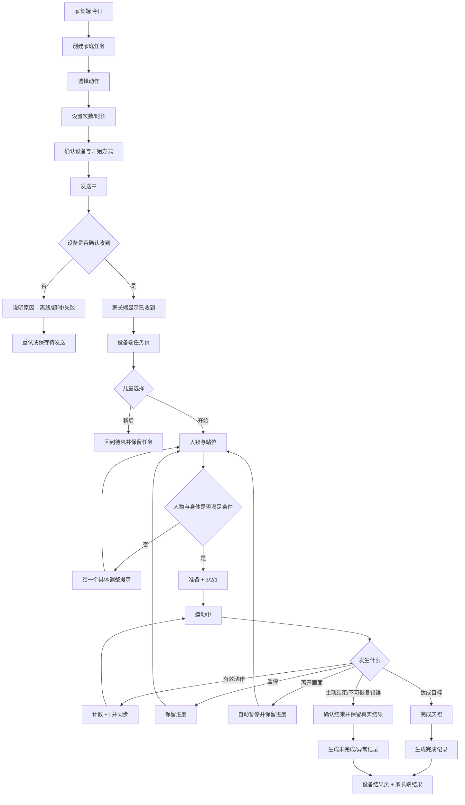
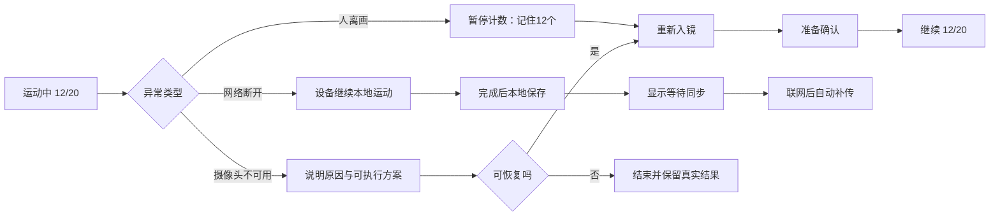

# AI 运动伙伴 MVP 用户旅程与交互框架 V0.1

> 日期：2026-09-23  
> 状态：UX 讨论稿，不自动修改既有 PRD / UE Demo  
> 适用范围：家庭场景 MVP；设备端 + 家长端  
> 权威输入：`CONTEXT.md`、产品定义定位与边界规范 V1.0、MVP PRD V1.2  
> 核心验证：家长发出一次任务，儿童在设备端独立完成，可信结果回到家长端。

---

## 0. 一句话设计命题

让家长用尽可能少的操作发出一次明确任务，让儿童不依赖家长现场监督完成“看懂任务—站好位置—开始运动—被正确计数—异常后恢复—确认完成”，并让双方看到一致、可理解的结果。

设计优先级：安全与隐私 > 能否开始和恢复 > 计数与结果可信 > 再次运动意愿 > 家长省心 > 视觉与扩展能力。

---

## 1. 原始需求翻译：从系统功能到用户任务

| 原始需求 | 角色 | 情境 | 用户目标 | 用户动作 | 系统必须给出的结果 |
|---|---|---|---|---|---|
| 创建家庭运动任务 | 家长管理者 | 希望孩子今天完成一次运动，但不能持续陪同 | 快速说明“做什么、做多少” | 选择动作、目标和设备，发送 | 明确告知设备是否收到；避免重复发送 |
| 查看今日状态 | 家长管理者 | 打开家长端想确认今天是否需要干预 | 一眼知道任务和设备状态 | 查看今日页 | 展示未开始/准备/运动中/暂停/完成/异常；以设备状态为准 |
| 查看运动结果 | 家长管理者 | 孩子完成或提前结束后 | 理解是否真实完成 | 打开最近记录/结果 | 展示动作、目标、实际、用时、完成状态和同步状态 |
| 查看并开始任务 | 儿童使用者 | 设备收到家长任务 | 不需要家长解释也能开始 | 打开任务，点击开始 | 用短文案、图形和语音说明动作与目标 |
| 入镜与站位 | 儿童使用者 | 准备运动但设备看不全身体 | 知道自己该往哪里移动 | 根据提示调整位置 | 区分未看到人、过近、过远、身体不完整和已就绪 |
| 自动识别和计数 | 儿童使用者 | 正在完成重复动作 | 不用自己记数，努力被正确记录 | 连续运动 | 只对完整有效动作 +1；明显显示当前/目标，不用虚假精确评分 |
| 暂停与继续 | 儿童使用者 | 累了、被打断或主动暂停 | 休息后继续，不丢失已完成次数 | 暂停、重新入镜、继续 | 保留已确认次数；继续前重新确认入镜与准备状态 |
| 离开画面后恢复 | 儿童使用者 | 运动中短暂离开摄像头范围 | 回来继续而不是从 0 开始 | 回到画面并站好 | 自动暂停计数、温和提示、恢复后承接原进度 |
| 完成与庆祝 | 儿童使用者 | 达到目标 | 确认自己完成并获得积极反馈 | 查看完成反馈和结果 | 先庆祝，再显示简短可信结果；生成一次运动记录 |
| 网络/同步异常 | 家长与儿童 | 运动中或完成后网络中断 | 确认运动不会白做 | 继续运动或等待恢复 | 本地保留结果，明确“已保存，等待同步”，恢复后去重补传 |
| 摄像头/识别异常 | 儿童使用者 | 无法满足识别条件 | 知道发生什么、如何恢复 | 调整、重试或结束 | 说明原因与下一步；不责备儿童；结束时保留真实结果 |

### MVP 明确不进入本次页面主线

- 完整七动作、六维评分和雷达图；
- AI 食谱、复杂训练计划、体态陪伴；
- 学校后台、排行榜、PK、社区和商城；
- 开放聊天、复杂宠物养成和儿童付费；
- 以内容消费、签到或在线时长驱动的成长体系。

---

## 2. User & Scenario

### Persona A：儿童使用者（主角色）

- 年龄：MVP 先以 8–12 岁验证，仍需分别覆盖 6–9、10–12、13–15 岁理解差异。
- 核心目标：快速开始、知道设备是否看见自己、无需记数、努力不丢失、完成后被肯定。
- 主要阻力：不知道站哪里、提示看不懂、漏计/误计、被迫重来、反馈太频繁、幼龄化语气不适合较大儿童。
- 设计要求：短流程、大数字、图形/语音互补、单屏单任务、错误可恢复、不羞辱。

### Persona B：家长管理者（辅助角色）

- 核心目标：少催促、少现场监督，快速布置任务并理解真实结果。
- 主要阻力：创建步骤过多、不知道设备是否收到、状态不同步、结果过度包装、异常通知制造焦虑。
- 设计要求：结果与行动优先；创建任务尽量三步完成；不让家长远程操控摄像头或自行修改设备计数。

### Persona C：学校影响者（后续角色）

- MVP 只保留任务来源和结果回传的扩展字段。
- 不建立教师后台，不默认开放家庭数据，不进入本次核心页面树。

### 核心场景 S1：家长布置、孩子独立完成

晚饭前，家长在手机上发出“开合跳 20 次”。设备确认收到；孩子看到新任务，独立完成入镜、倒计时和运动。中途离画后返回继续，完成后设备庆祝并展示结果，家长端同步显示实际次数、用时和完成状态。

### 补充场景 S2：儿童自主开始

没有待完成任务时，儿童主动选择已开放动作与目标，沿用同一套入镜—计数—完成流程；自主运动仍生成可信记录。

### 异常场景 S3：运动已完成但网络断开

设备本地保存记录并提示“结果已保存，等待同步”；家长端显示最后已知状态和同步异常，不将任务误判为未完成。恢复联网后自动补传且不重复计数或发奖励。

---

## 3. User Journey Map

### 3.1 跨端主旅程

| 阶段 | 主角色 | 用户想法 | 用户动作 | 系统反馈 | 情绪风险 | UI 机会 |
|---|---|---|---|---|---|---|
| 触发 | 家长 | 今天需要运动，但我不想反复催 | 打开今日页 | 展示设备连接、今日任务和最近结果 | 信息太多，不知道先做什么 | 首页仅突出“创建/查看任务”与异常 |
| 布置 | 家长 | 让孩子做什么、做多少 | 选动作、目标、设备并发送 | 即时显示发送中、已收到或失败 | 不确定是否重复发送 | 明确命令确认，发送期间禁重复提交 |
| 接收 | 儿童 | 这是要我做什么？ | 打开新任务 | 播报动作与目标，突出开始 | 被任务压迫、信息看不懂 | 伙伴式邀请；只给开始/稍后两个选择 |
| 入镜 | 儿童 | 设备看见我了吗？ | 调整距离与位置 | 单一、具体、实时站位提示 | 反复失败导致放弃 | 每次只纠正一个最重要问题，准备好后自动推进 |
| 准备 | 儿童 | 现在开始了吗？ | 站稳等待 | 明确“准备好”与 3/2/1 | 提前动作被漏计 | 倒计时前不计数，边界清楚 |
| 运动 | 儿童 | 做了多少？动作算数吗？ | 完成动作 | 大数字计数、低频鼓励、必要纠错 | 漏计、提示太吵、被责备 | 有效动作强反馈；无效动作只给可执行提示 |
| 中断/恢复 | 儿童 | 我回来后还要重做吗？ | 暂停或回到画面 | 保留次数，重新入镜后继续 | 努力丢失最伤信任 | 明示“记住了 12 个”，恢复到原进度 |
| 完成 | 儿童 | 我完成了吗？ | 查看反馈 | 庆祝、结果摘要、返回主页 | 结果太复杂或过度评价 | 先肯定完成，再显示动作/实际/用时 |
| 理解结果 | 家长 | 是否真实完成，需要处理什么？ | 打开今日/记录 | 与设备一致的结果和同步状态 | 伪评分、异常引发焦虑 | 事实优先；未完成也如实说明，不包装成完成 |
| 再次运动 | 儿童/家长 | 下次还愿意做吗？ | 返回首页或稍后再练 | 显示个人进步或上次结果 | 奖励盖过运动 | 只展示由真实运动产生的进步和鼓励 |

### 3.2 关键体验时刻

1. **任务确认**：家长必须知道“设备已收到”，不能只看到“发送成功”。
2. **入镜成功**：儿童第一次确认“它真的看见我”，决定后续信任。
3. **首次有效计数**：动作—数字—声音应形成清楚因果。
4. **中断恢复**：回来后次数不丢，是可信闭环的底线。
5. **跨端一致**：设备 20/20，家长端必须也是 20/20；无法同步时要诚实显示。

---

## 4. 核心 User Flow

### 4.1 家庭任务端到端主流程



### 4.2 家长端创建任务流

原则：一次只做一个决策，默认值减少输入，最终确认页可完整复核。

1. 今日页点击“创建任务”。
2. 选择动作：只显示本版本已验证可用动作；未开放动作不以可点击卡片出现。
3. 设置目标：次数/时长跟随动作类型，不让用户选无效组合。
4. 确认：儿童、设备、动作、目标、开始方式。
5. 发送状态：发送中 → 设备已收到 / 设备离线 / 超时未确认。
6. 成功后返回今日页，任务卡显示真实状态，而不是立即标为“待孩子完成”之外的推测状态。

### 4.3 儿童端异常恢复流



---

## 5. 页面架构 / Screen List

### 5.1 设备端（儿童主体验）

| 编号 | 页面/状态 | 核心目的 | 主要内容 | 主操作 |
|---|---|---|---|---|
| D01 | 待机/首页 | 最快开始运动 | 今日任务、快速运动、设备/摄像头状态、上次结果 | 查看任务 / 快速开始 |
| D02 | 任务详情 | 看懂做什么 | 来源、动作、目标、伙伴短提示 | 开始；次操作“稍后” |
| D03 | 动作选择 | 无任务时自主开始 | 已开放动作 | 选择动作 |
| D04 | 目标设置 | 设置自主运动目标 | 合法目标类型与推荐默认值 | 确认开始 |
| D05 | 入镜 | 帮儿童站到可识别位置 | 人体轮廓/位置反馈、单条站位提示 | 自动进入准备；可返回 |
| D06 | 准备/倒计时 | 建立开始边界 | 已就绪、3/2/1 | 无需操作 |
| D07 | 运动中 | 清楚计数和状态 | 当前/目标大数字、动作、状态、低频提示 | 暂停；次操作“结束” |
| D08 | 暂停 | 休息且不丢进度 | 已确认次数、继续条件 | 继续；结束 |
| D09 | 离开画面 | 安心恢复 | “记住了 X 个”、站位提示 | 自动恢复 |
| D10 | 完成庆祝 | 明确完成并获得肯定 | 完成反馈、轻量角色表达 | 查看结果 |
| D11 | 结果 | 理解单次真实结果 | 动作、目标、实际、用时、完成/未完成、同步状态 | 返回首页 |
| D12 | 错误/不可恢复 | 说明原因和出路 | 发生什么、数据是否保留、如何恢复 | 重试；结束 |

### 5.2 家长端（轻量管理）

| 编号 | 页面 | 核心目的 | 主要内容 | 主操作 |
|---|---|---|---|---|
| P01 | 今日 | 回答“今天完成了吗” | 设备连接、今日任务、当前状态、最近结果、异常 | 创建任务 / 查看当前运动 |
| P02 | 任务列表 | 查看待完成与已完成 | 家庭任务，状态与来源 | 查看任务 / 创建任务 |
| P03 | 创建任务 | 三步布置任务 | 动作、目标、设备/开始方式 | 确认发送 |
| P04 | 发送结果 | 确认设备是否收到 | 发送中、已收到、离线或失败 | 完成 / 重试 |
| P05 | 当前运动 | 远程理解，不远程指挥 | 动作、设备状态、当前/目标、用时、同步时间 | 仅查看；必要时进入异常说明 |
| P06 | 成长/记录 | 查看真实历史 | 单次运动记录列表 | 查看结果 |
| P07 | 结果详情 | 理解一次运动 | 动作、目标、实际、用时、完成状态、同步状态 | 返回记录 |
| P08 | 我的/设备与隐私 | 管理连接和边界 | 儿童档案、设备、摄像头授权、网络、数据删除 | 设置/授权 |

### 5.3 首页信息优先级

设备端：首页只回答“今天要不要运动、怎样最快开始、上次努力带来了什么”。  
家长端：首页只回答“今天完成了吗、现在是否需要处理、最近发生了什么”。

---

## 6. Screen × State Map

图例：● 必须设计；○ 可复用局部状态；— 不适用。

### 6.1 设备端

| 页面 | Normal | Empty | Loading/确认中 | Recoverable Error | Blocking Error | Offline | Permission |
|---|---:|---:|---:|---:|---:|---:|---:|
| D01 待机/首页 | ● | ● 无任务 | ○ | ● | ● | ● | ● 摄像头关闭 |
| D02 任务详情 | ● | — | ○ | ● 任务过期/取消 | ● 数据损坏 | ● 可本地打开已缓存任务 | — |
| D03 动作选择 | ● | ● 无可用动作 | ○ | ● | ● | ● 仅本地可用动作 | — |
| D05 入镜 | ● | ● 未看到人 | ● 检测中 | ● 过近/远/不完整 | ● 摄像头不可用 | ○ | ● 未授权/关闭 |
| D06 准备/倒计时 | ● | — | — | ● 离画返回入镜 | ● 摄像头异常 | ○ | ● |
| D07 运动中 | ● | — | ○ 识别不确定 | ● 离画/暂停 | ● 摄像头异常 | ● 继续本地运动 | ● |
| D08 暂停 | ● | — | — | ● 恢复失败 | ● | ● | ● |
| D11 结果 | ● | — | ● 保存中/同步中 | ● 同步失败可重试 | ● 本地保存失败 | ● 已保存待同步 | — |
| D12 错误 | ● | — | ○ | ● | ● | ● | ● |

### 6.2 家长端

| 页面 | Normal | Empty | Loading | Error | Offline/Last known | Permission |
|---|---:|---:|---:|---:|---:|---:|
| P01 今日 | ● | ● 今日无任务/无记录分别表达 | ● | ● | ● 显示最后同步时间 | ● 未绑定设备 |
| P02 任务列表 | ● | ● 从未创建 vs 筛选无结果 | ● | ● | ● 缓存列表只读 | ○ |
| P03 创建任务 | ● | ● 无可用设备/动作 | ● | ● 字段级错误 | ● 保存草稿/待发送 | ● 无管理权限 |
| P04 发送结果 | ● 已收到 | — | ● 发送中 | ● 超时/失败 | ● 设备离线 | — |
| P05 当前运动 | ● | — | ● | ● | ● 最后已知状态，不伪造实时 | ● |
| P06 记录 | ● | ● 尚无记录 | ● | ● | ● 缓存只读 | ○ |
| P07 结果详情 | ● | — | ● | ● | ● 等待同步/最后同步 | ○ |
| P08 设备与隐私 | ● | ● 未绑定 | ● | ● | ● 部分设置不可变更 | ● 家长验证 |

### 空状态必须区分

- “今天没有任务”：可以创建任务或让孩子自主运动。
- “还没有运动记录”：说明完成运动后会在这里出现。
- “筛选后没有结果”：建议清除筛选，不引导创建任务。
- “设备未绑定”：引导绑定设备，而不是显示泛化空白页。
- “结果待同步”：不是无记录，也不能显示为未完成。

---

## 7. Interaction Spec

### 7.1 入口与定位

- 设备唤醒后，待完成任务为最高优先级；无任务时才突出“快速运动”。
- 家长端今日页首屏优先展示今日状态和设备异常，不展示商城、内容流或复杂推荐。
- 设备端不使用深层导航；运动主流程中不出现与本次任务无关入口。

### 7.2 任务创建与发送

- 动作、目标类型和可用范围由版本能力约束；无效组合不让用户提交。
- 发送按钮点击后立即进入“发送中”，禁止重复提交。
- “已发送”仅表示服务端接收；只有设备返回确认后才显示“设备已收到”。
- 设备离线时允许用户重试或保存为待发送，但不伪装成已送达。
- 任务在设备端开始后，家长端不允许直接修改目标；需要结束当前运动后另建任务。

### 7.3 入镜与准备

- 一次只显示一个最高优先级问题：未看到人 > 身体不完整 > 过近/过远 > 位置偏移。
- 文案必须描述动作方向，例如“往后一点，让我看到完整身体”，不只显示“识别失败”。
- 条件满足后给明显“准备好了”反馈，再进入倒计时；不得无提示突然计数。
- 倒计时期间提前动作不计数，并用温和提示说明开始边界。

### 7.4 运动、计数与纠错

- 当前次数为页面最大视觉信息，目标次之；其他信息不得争夺注意力。
- 只有完整有效动作触发数字变化和确认反馈；半动作、关键点不足不加数。
- 识别不确定时不猜测、不补数；提示要可执行且低频，避免连续打断。
- 家长端只展示设备状态，不能自行推算或覆盖次数。
- 语音与视觉同步但不重复堆叠长句；运动中优先短音和短句。

### 7.5 暂停、离画与结束

- 主动暂停和离画都保留已确认次数，但原因必须区分。
- 离画时自动暂停计数，并显示“记住了 X 个，回来继续”。
- 继续前重新走入镜/准备确认，避免回到画面瞬间误计数。
- “结束”是次级操作；点击后需确认“保留当前真实结果并结束”。
- 提前结束生成“未完成”记录，不删除努力，也不包装成完成。

### 7.6 完成与结果

- 达成目标后先给简短庆祝，再进入结果；庆祝可跳过且不阻塞记录保存。
- 结果字段固定：动作、目标、实际、用时、完成状态、同步状态。
- 评分或成长表达不得覆盖事实结果；MVP 不展示未经验证的六维评分。
- 设备保存成功但云同步失败时，明确显示“结果已保存，等待同步”。

### 7.7 反馈语义

| 类型 | 使用时机 | 表达原则 | 示例 |
|---|---|---|---|
| 进行中 | 发送、检测、保存 | 告诉用户系统正在做什么 | “正在等待设备确认” |
| 成功 | 任务送达、动作有效、记录生成 | 说明成功对象，不用模糊“成功” | “设备已收到任务” |
| 可恢复错误 | 离画、过近、网络短断 | 原因 + 下一步 + 已保留内容 | “记住了 12 个，站回来继续” |
| 阻断错误 | 摄像头不可用、本地保存失败 | 说明影响、可选出口、求助方式 | “摄像头暂不可用，无法继续计数” |
| 权限 | 摄像头关闭、未授权 | 说明为何需要和如何开启，不诱导越权 | “开启摄像头后才能识别动作” |

### 7.8 返回与状态保持

- 家长从任务/记录列表进入详情再返回时，保留 Tab、筛选和滚动位置。
- 从创建任务成功返回今日页时，定位并高亮刚创建的任务卡一次。
- 设备端运动中返回必须等价于“暂停/结束”决策，不允许浏览器式误退出。
- 异常恢复后返回原运动进度和原任务，不重新创建任务。

### 7.9 儿童安全与隐私

- 摄像头工作状态持续可见；摄像头关闭后不得显示正常识别状态。
- 原始视频默认不长期保存；页面不暗示家长可远程观看实时家庭画面。
- 儿童端不展示广告、促销、充值、公开排名和陌生人互动。
- 提示不使用“你做错了”“太差了”等责备表达；只描述可调整行为。

---

## 8. 核心页面低保真骨架

### 8.1 设备端首页 D01

```text
┌──────────────────────────────┐
│ 伙伴状态/眼睛      在线 · 摄像头开启 │
│                              │
│ 今天有 1 个运动任务              │
│ 开合跳 · 20 次 · 来自家长          │
│                              │
│          [ 查看并开始 ]           │
│                              │
│ [ 快速运动 ]                     │
│                              │
│ 上次：深蹲起 15/15 · 已完成         │
└──────────────────────────────┘
```

### 8.2 设备端入镜 D05

```text
┌──────────────────────────────┐
│             开合跳 20 次          │
│                              │
│        [实时人体位置反馈区域]        │
│                              │
│     往后一点，让我看到完整身体       │
│           ○ ○ ○ ○              │
│                              │
│             [ 返回 ]             │
└──────────────────────────────┘
```

### 8.3 设备端运动中 D07

```text
┌──────────────────────────────┐
│ 开合跳                    运动中 │
│                              │
│              12              │
│             / 20             │
│                              │
│          动作有效，继续！          │
│                              │
│        [ 暂停 ]     结束          │
└──────────────────────────────┘
```

### 8.4 家长端今日 P01

```text
┌──────────────────────────────┐
│ 今天                           │
│ 客厅运动伙伴 · 在线                │
│                              │
│ 当前任务                         │
│ 开合跳 20 次 · 运动中 · 12/20       │
│ [ 查看当前运动 ]                   │
│                              │
│ [ + 创建家庭任务 ]                 │
│                              │
│ 最近结果                         │
│ 深蹲起 · 15/15 · 2分10秒 · 已完成   │
└──────────────────────────────┘
```

### 8.5 家长端创建任务 P03

```text
步骤 1/3 选择动作
  开合跳 / 深蹲起
        ↓
步骤 2/3 设置目标
  次数  [ − ] 20 [ + ]
        ↓
步骤 3/3 确认
  儿童 / 设备 / 动作 / 目标 / 开始方式
  [ 发送到设备 ]
        ↓
  发送中 → 设备已收到 / 离线 / 超时
```

---

## 9. 设计验证清单

### 可用性任务

1. 家长能否在不解释术语的情况下完成“开合跳 20 次”任务发送，并正确理解设备是否收到。
2. 儿童能否在没有家长指导时完成入镜与开始。
3. 儿童能否理解一次有效动作为何被计数，以及未计数时如何调整。
4. 在 12/20 离开画面后，儿童能否恢复并继续到 20/20。
5. 断网后，儿童与家长能否理解结果已保存但尚未同步。
6. 家长能否从结果页准确复述动作、目标、实际、用时和完成状态。

### 原型通过标准

- 主任务无死路，主流程和三类异常均能回到明确状态；
- 儿童端每一屏只有一个主要目标和一个主操作；
- 所有“成功”均说明成功对象，所有错误均给出下一步；
- 暂停、离画、断网、返回后已确认次数不丢失；
- 设备端与家长端字段和状态语义一致；
- 无 MVP 范围外入口干扰核心闭环。

---

## 10. 与既有 UE V7.4 的关系

既有 UE Demo V7.4 可作为完整产品的历史交互输入，但本 MVP 低保真阶段应隐藏或后置以下入口：AI 训练计划、AI 食谱、体态提醒、学校任务、复杂设备管理与其他非核心能力。保留并优先验证：家庭任务、设备自主运动、入镜、准备、计数、暂停、离画、完成、结果、设备连接与隐私状态。

若后续要把本稿结论合入 PRD 或正式 UE，应按“旧口径—新证据—建议修改”形成变更单，经产品评审后再修改权威文档。
