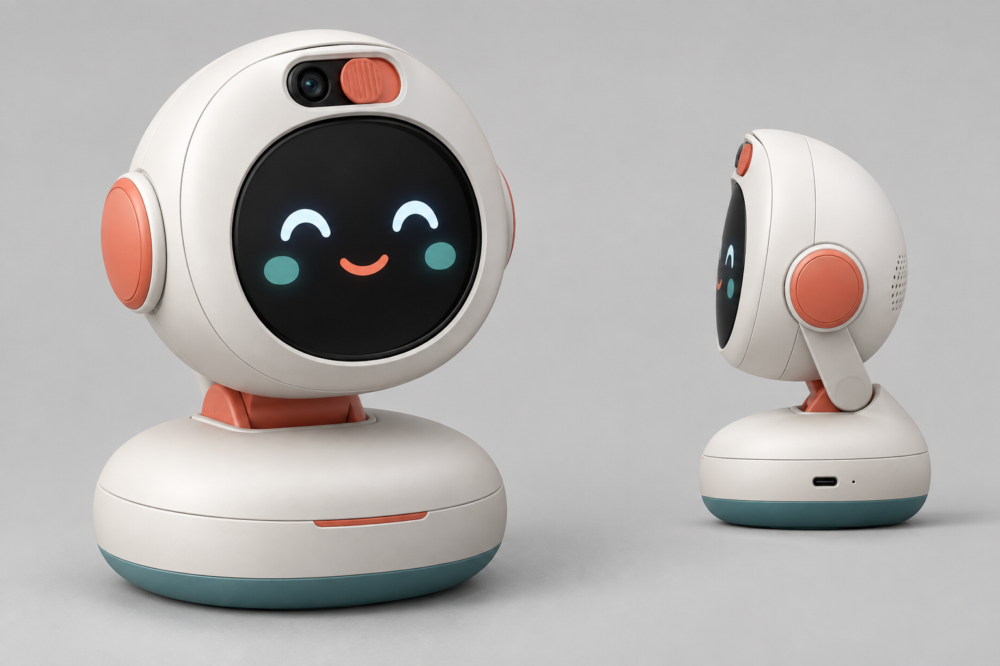
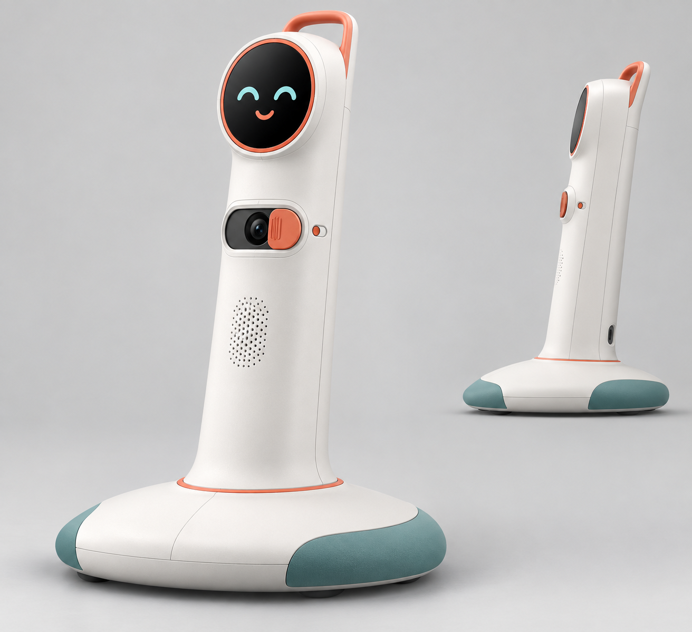

# 儿童 AI 运动伙伴｜摄像头需求与产品形态初稿 V0.1

> 日期：2026-09-21  
> 用途：摄像头方案评审、模组 RFQ、ID/结构概念评审  
> 状态：需求初稿，尚未完成样机实测与供应商确认

## 1. 今天需要形成的决定

**推荐冻结“需求方案”，暂不冻结具体 Sensor 料号：**

- 主方案：单目 5MP、1/2.7–1/2.8 英寸、BSI、2.0 μm 级像素、MIPI CSI-2、RAW10、25/30 fps。
- 镜头：优先 120°–130°对角 FOV，而不是照抄 BodyPark 的 160°超广角；目标水平 FOV 105°–115°、垂直 FOV 75°–90°。
- 运行链路：5MP 采集 → ISP 输出 1080p/720p → 640×384 或 640×640 Pose 输入；不让 NPU 全程处理 5MP。
- 接口：首版 2-Lane CSI-2，24-pin FPC 保留 4-Lane 与供电兼容余量；主板按 MIPI 100 Ω 差分阻抗设计。
- 隐私：物理遮挡片 + 硬件状态指示 + 软件授权三者同时具备；关闭后 Sensor 断电或进入硬件 PWDN，视频默认不持久化。
- 当前不建议：160°鱼眼、8MP、双摄、ToF、红外补光。它们会增加畸变标定、功耗、BSP、结构和儿童隐私成本，但尚未证明能改善 MVP 三动作识别。

**一句话需求：**在普通家庭客厅中，设备距儿童 1.5–3.0 m、环境照度 100–800 lux 时，能够持续获得完整人体、低拖影、边缘可用的画面，支撑开合跳、深蹲、跳绳的本地计数和动作质量判断。

## 2. 竞品证据如何转化为我们的需求

| BodyPark 观察 | 证据状态 | 对本项目的处理 |
|---|---|---|
| 5MP、1/2.8 英寸、160°超广角、MIPI CSI-2 | 拆机资料确认到规格层；Sensor 型号、Lane 未闭环 | 继承 5MP / MIPI / 大底方向，不照抄 160° |
| RV1106B + Camera → ISP → NPU | 架构同构 | 直接沿用“高分辨率采集、低分辨率推理”链路 |
| 2-Lane 起步、接口留 4-Lane | 现有工程路线建议 | 写入 EVT 接口冻结项 |
| 摄像头形态与屏幕同机 | 实机产品形态 | 保留同机闭环，但增加儿童场景的物理隐私遮挡 |

160°的主要价值是缩短入镜距离，但它会带来明显的边缘拉伸、人体比例变化和标定负担。对儿童动作识别而言，**“边缘关节仍可用”比“标称角度最大”更重要**。因此第一轮镜头建议从 120°–130°对角范围打样，并用同一 Sensor 比较 120°、130°和 150°三组镜头后再定版。

## 3. 摄像头 PRD / RFQ 参数表

### 3.1 必须项（P0）

| 项目 | 目标要求 | 验收方式 |
|---|---|---|
| 有效分辨率 | ≥ 5MP，优先 2688×1944 或 2592×1944 | 驱动枚举 + RAW/YUV 实拍 |
| 帧率 | 5MP 模式 ≥25 fps；1080p 模式稳定 30 fps | 连续运行 30 min，无掉帧尖峰 |
| Sensor 尺寸 | 1/2.7–1/2.8 英寸 | 模组规格书/BOM |
| 像素与工艺 | BSI，像素尺寸优先 ≥2.0 μm | Sensor 原厂资料 |
| 输出 | RAW10 必须；RAW12 可选 | 驱动与 ISP 验证 |
| 接口 | MIPI CSI-2，首版 2-Lane；接口保留 4-Lane | 原理图/Layout/FPC 检查 |
| 镜头视场 | DFOV 120°–130°；HFOV 105°–115°；VFOV 75°–90° | 标定板与实景测量，不采用供应商口头值 |
| 畸变 | 矫正后画面边缘 15% 区域人体关键点可用；需提供标定参数 | 标定板 + 边缘动作集 |
| 对焦 | 定焦，1.2–4.0 m 内人体清晰 | ISO 12233/人体实拍 |
| 曝光 | 支持手动限制曝光时间与增益；运动模式优先曝光 ≤1/120 s | 跳绳/开合跳拖影测试 |
| 防闪烁 | 50 Hz 环境可配置防闪烁 | LED 灯、日光灯场景测试 |
| ISP/BSP | 必须有 RV1106/RV1106B 可交付驱动和 IQ 调参支持 | 在目标板完成 Camera→ISP→AI 闭环 |
| 隐私 | 物理遮挡；相机工作指示不可被应用关闭；关闭时硬件 PWDN/断电 | 黑盒测试 + 电流测试 |
| 数据 | 视频默认不持久化；调试录制需家长显式授权且可删除 | 产品流程与日志检查 |

### 3.2 期望项（P1）

- 2-exposure HDR 或等效宽动态能力，用于窗边逆光；不以 HDR 标称替代实测。
- 模组自带稳定供货镜头座、IR-cut 和可追溯 IQ 版本。
- 正常工作功耗目标 ≤300 mW（Sensor + 模组，不含 SoC ISP）。
- 模组温升不导致 30 分钟后焦点漂移或噪声明显恶化。
- 供应商能够提供三档镜头样件：约 120° / 130° / 150° DFOV。

### 3.3 首轮候选与结论

| 路径 | 定位 | 结论 |
|---|---|---|
| 5MP BSI 方案（如 OS05A20 级） | 主选能力标杆 | 原厂公开参数符合 5MP、1/2.7 英寸、2.0 μm、RAW10/12、MIPI；但必须确认 RV1106B 驱动、2-Lane 工作模式、模组供货与成本后才能锁料 |
| 国产 5MP AI Sensor（如 SC530AI 系列） | 主选备选 | 优先向已有 RV1106B 量产经验的模组厂询价；需要拿到完整模组规格、驱动版本与 IQ 支持承诺 |
| 4MP 成熟模组 | 降级备选 | 若 5MP 驱动/交期失败，可用成熟 4MP 模组做 PoC；不得因此降低整机入镜和识别验收标准 |

**器件冻结门槛：**不是“拿到规格书”就算完成，而是同一块 RV1106B 目标板上完成 30 分钟连续采集、三动作识别、边缘入镜、逆光、低照、温升和恢复测试。

## 4. 算法与场景验收口径

### 4.1 使用包络

- 人群：6–15 岁，身高分组建议 115–135 cm、136–155 cm、156–175 cm。
- 人数：MVP 单人；背景中短暂经过第二人时，主目标不可频繁切换。
- 距离：目标 1.5–3.0 m；1.2 m 为过近提示边界，3.5 m 为过远提示边界。
- 机位：桌面形态镜头中心建议离地 0.75–1.20 m；落地形态建议 0.55–0.75 m。
- 光照：100–800 lux 为必须稳定区；50 lux 为可用性观察区；窗边逆光单独评估。
- 动作：开合跳、深蹲、跳绳；至少覆盖正面、±20°偏转、画面边缘和宽松衣物。

### 4.2 Go / No-Go 指标

| 指标 | Go 条件 |
|---|---|
| 完整入镜率 | 在目标距离与身高分组中，头、手、脚同时完整入镜 ≥95% 帧 |
| 关键点可用率 | 核心关节置信度达算法阈值的帧占比 ≥95% |
| 边缘退化 | 人体中心落在画面左右 70%–85% 区域时，计数误差相对中心区增加不超过 3 个百分点 |
| 计数误差 | 每组 30 次：开合跳/深蹲绝对误差 ≤1；跳绳绝对误差 ≤2（首轮建议值，需评测集冻结） |
| 反馈延迟 | 动作完成到设备反馈 P95 ≤300 ms |
| 连续稳定 | 30 min 不崩溃、不花屏；掉帧率 <1%；异常后 5 s 内恢复 |
| 隐私状态 | 遮挡后不得得到可识别图像；相机开启时硬件指示始终可见 |

## 5. 两个产品形态初稿

### 形态 A：桌面陪伴型“抬头伙伴”——建议优先做 EVT

- 摆放：电视柜、边桌、书桌，镜头中心离地约 0.75–1.20 m。
- 结构：圆屏表情在下、摄像头独立窗口在上；俯仰关节约 -10°至 +25°；加重防滑底座。
- 摄像头：HFOV 约 110°，通过俯仰调整覆盖不同桌高，不依赖 160°鱼眼补偿摆位。
- 优点：与 BodyPark 架构最接近，主板/圆屏/电池复用度高，体积和 BOM 更容易控制。
- 风险：家庭桌高差异大，孩子跳跃会出画；必须做一键机位引导和防倾倒验证。
- 适合：开发板 PoC、自研主板 EVT、可演示工程样机。

### 形态 B：落地运动灯塔型——建议并行做泡沫模型

- 摆放：客厅地面，镜头中心离地约 0.55–0.75 m；适合无电视柜或桌面高度不稳定的家庭。
- 结构：60–70 cm 软边立柱、低重心宽底座、顶部提手；摄像头与圆屏分离，物理遮挡直接可见。
- 摄像头：较稳定的儿童躯干高度机位，可减少俯拍比例变化；同样使用 120°–130° DFOV。
- 优点：机位一致、全身入镜更可控、摆放引导简单，角色存在感强。
- 风险：体积、跌倒/绊倒、运输和模具成本更高；需要倾倒角、冲击和儿童攀扶测试。
- 适合：验证“常驻家庭运动伙伴”价值，不建议首轮直接开模。

### 形态选择建议

第一阶段选择 **A 桌面陪伴型** 完成电子和算法黄金链路；同时用低成本泡沫/3D 打印验证 **B 落地运动灯塔型** 的视场和稳定性。两者共用同一 Camera FPC、镜头模组和核心板，可避免形态探索拖慢摄像头与算法验证。

## 6. 未来 7 天最小行动清单

1. 向 3 家模组厂发同一份 RFQ：5MP BSI、RV1106B 驱动、120°/130°/150°镜头、2-Lane/4-Lane、价格/交期/IQ 支持。
2. 采购或借用 2 个 5MP 模组 + 1 个成熟 4MP 模组，不等最终料号再开始 PoC。
3. 用纸胶带在客厅标记 1.5/2.0/2.5/3.0 m，拍摄三身高组全身入镜样张。
4. 建立 120°/130°/150°同场景 A/B 测试，记录完整入镜率、边缘关键点和计数误差。
5. 形态 A 做可调俯仰支架；形态 B 先做 1:1 泡沫模型，不开模。
6. 评审后只冻结“摄像头需求 V1.0 + 接口”，待驱动和样张通过再冻结具体 Sensor/镜头料号。

## 7. 证据与限制

- 项目内部依据：`BodyPark拆解/路线.md`、`参考与拆解/归档与分析报告.md`。
- Rockchip 官方资料显示 RV1106 支持 5MP ISP、MIPI Camera 输入及 0.5 TOPS NPU；不同 RV1106/RV1106B 子型号能力与 SDK 支持仍需按最终采购型号复核。
- OMNIVISION 官方 OS05A20 资料支持其 5MP、1/2.7 英寸、2.0 μm、RAW10/12、MIPI 等参数；本文仅把它当能力标杆，不等同于已完成选型。
- 产品形态图片为 AI 概念初稿，仅用于方向评审，不代表结构、CMF、尺寸或可制造性已冻结。

## 8. 评审结论栏

- 摄像头需求：通过 / 修改后通过 / 不通过
- 首轮镜头样件：120° / 130° / 150° / 其他
- EVT 形态：A / B / A+B
- 评审人：
- 截止时间：
- 待补证据：
