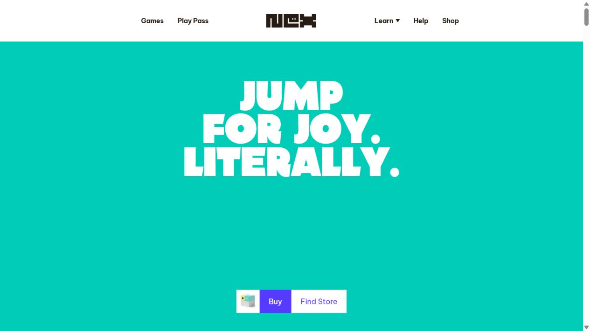
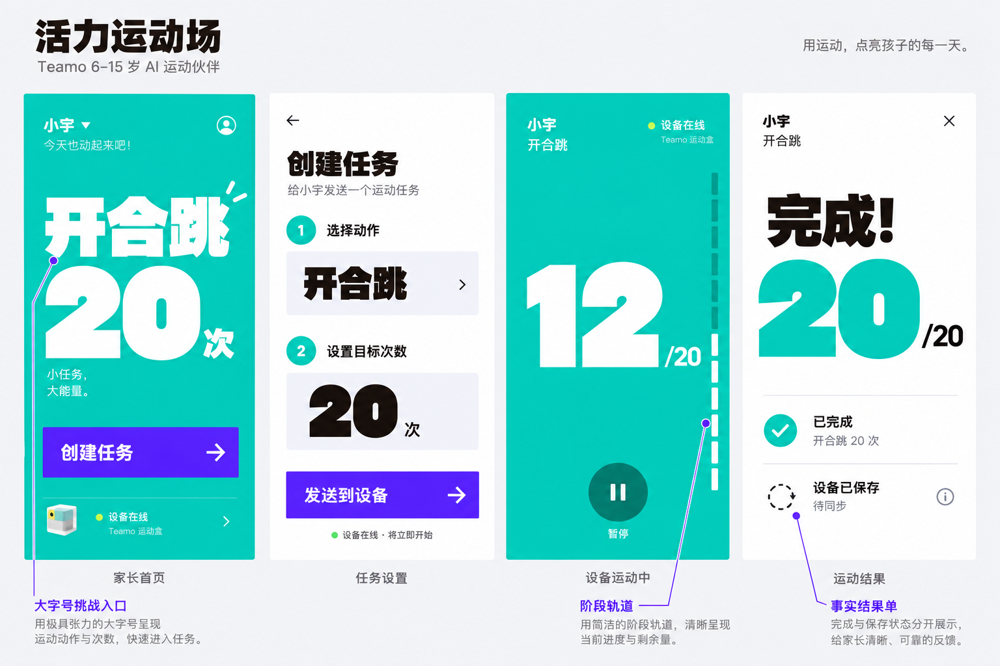
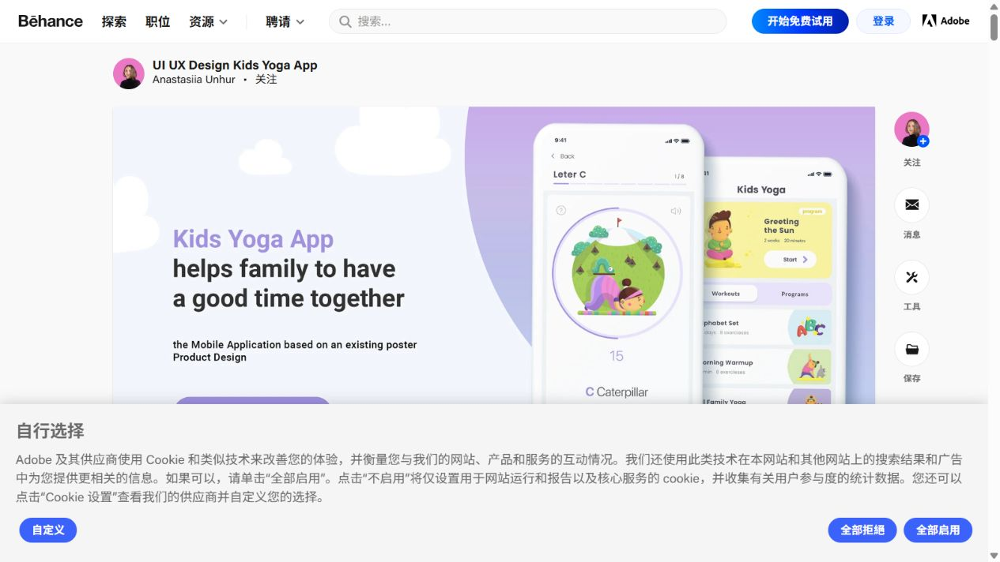
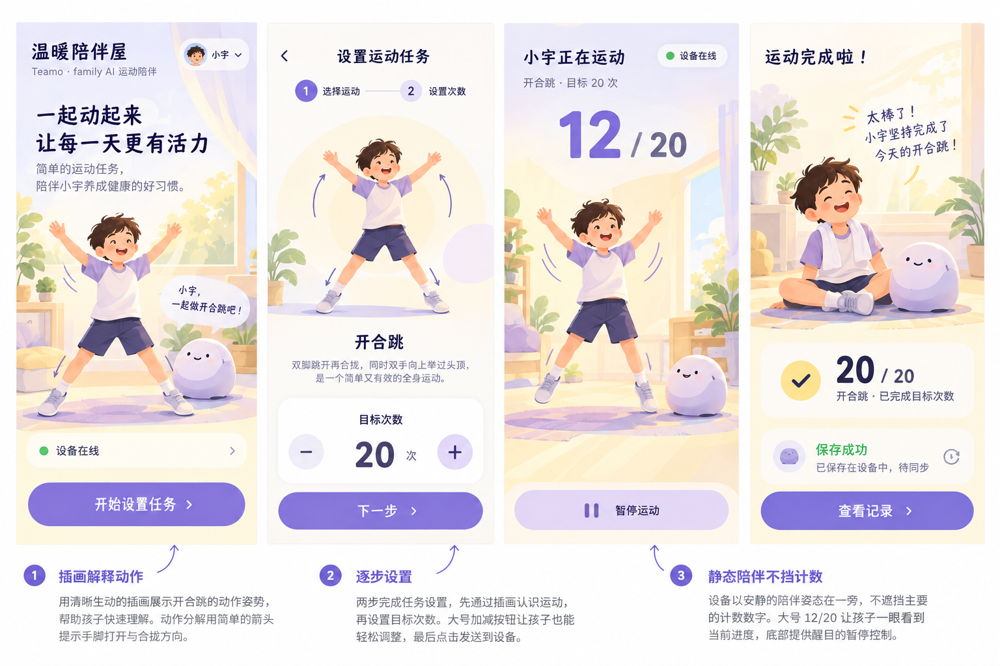
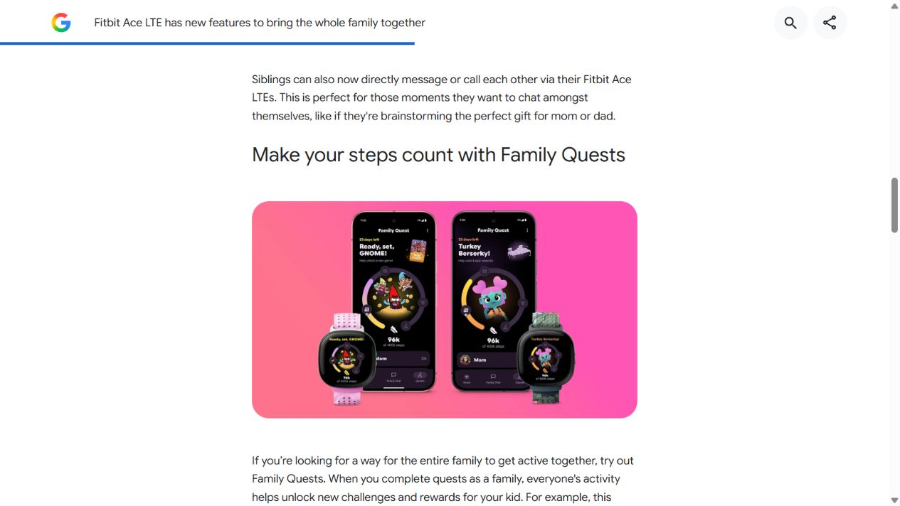
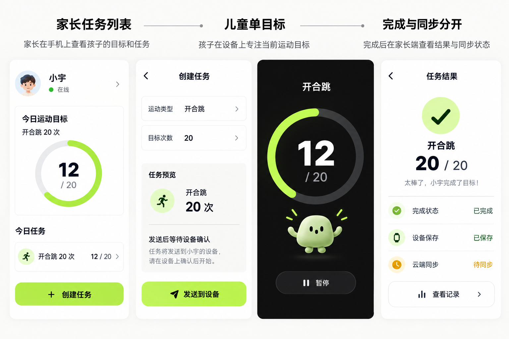

# 参考原图 → 特征 → Teamo转译 → 同四屏方案

2026-10-08 · V0.2视觉探索。针对“参考与示意联系不清”的批注重做。下列三个独立图稿已分别附真实截图生成，序号按本轮聊天显示顺序。旧评审板仅是内容线框，不能用于风格选型。本页是设计证据，不是可点击原型或已实现软件。

共同业务内容：家长首页、任务设置、设备运动中、运动结果；开合跳20次，运动中12/20，结果20/20。设备保存与云端同步独立。硬件屏幕和输入未冻结，矩形画面表达内容排布，不作为物理屏幕形状结论。设备页须实机重排与远距校准。图片中的操作和动效都只是设计意图。

## 1 活力运动场

[原始来源：Nex产品页](https://www.nexplayground.com/playground)。本轮浏览器截图如下；用于研究，不复用其品牌标识或素材。

| 原图可见特征（定位） | 提取原则 | 本项目转译（对应新稿位置） |
|---|---|---|
| 主画面整块青绿；中上部白色巨字，文字分行形成节奏 | 用面积和字号建立一个焦点 | 家长首页整块运动主题面，大“开合跳20”；运动页大“12”，不是普通卡片内小数字 |
| 视线底部紫色矩形Buy按钮与少量辅助入口 | 主操作对比强、入口少 | 家长创建任务与发送任务用紫色矩形按钮；低优先状态在底部 |
| 白色导航与彩色主画面分开 | 内容区职责清楚 | 设置与结果回到白底；运动阶段采用色块与边缘轨道 |

**生成稿需修正：** 设置页“设备在线·将立即开始”与回执契约冲突，下一版改“发送后等待设备确认”；底部小设备图似参考产品，应替换已核验Teamo资产，不能当作真实产品形态。巨字不能遮挡必要操作；箭头和轨道仅设计表达，尚非状态实现。

交互意图：直接选择挑战，表单短且集中；运动状态以阶段轨道和数字呈现。需要验证：中文字重、标题尺度、强色与长时间观看，以及高年龄段接受度。

## 2 温暖陪伴屋

[原始来源：Kids Yoga / Anastasiia Unhur / 2021](https://www.behance.net/gallery/111451045/UI-UX-Design-Kids-Yoga-App)。原图右侧手机展示：黄色运动主题卡、浅紫分组、圆形插画演示、底部控制；截图底部有网站浮层，不是作品的一部分。

| 原图可见特征（定位） | 提取原则 | 本项目转译（对应新稿位置） |
|---|---|---|
| 右前手机中央插画演示运动 | 图形解释动作而非纯装饰 | 任务设置中动作示范和短说明；插画为新生成候选，不复制原作者角色 |
| 紫/黄柔和分区，黑色标题承担阅读 | 柔和气氛与清晰文字并存 | 暖白、浅紫、深墨；标题与计数保持深色，不沿用低对比小标签 |
| 演示页底部Back/Pause/Next控制 | 控件位置稳定 | 运动页固定底部暂停；设置用步骤提示与连续下一步 |

**生成稿需修正：** 运动中全幅人物与室内景偏重，必须缩为静态小角色/简化背景，保留远距计数；设置页同时有两步提示与目标控件，实际点击版需明确当前步骤与发送确认页，不能把一张概念图认作完整流程。6–8岁可保留图形引导，13–15岁应测试弱角色版。动作示范的姿态要经算法/动作负责人确认，不能把AI绘图当规范动作。

交互意图：用短步骤和动作示范降低理解成本，陪伴在准备/结果时出现。需要验证：插画加载与离线资源、年龄适配、注意力分配、语音替代。

## 3 目标与成长

[原始来源：Google官方Fitbit Family Quests文章 / 2024](https://blog.google/products-and-platforms/devices/fitbit/fitbit-ace-lte-holiday-updates-2024/)。这是历史产品示例，不宣称最新功能或本项目需要家庭排行榜。

| 原图可见特征（定位） | 提取原则 | 本项目转译（对应新稿位置） |
|---|---|---|
| 中部手机与手表显示同任务，手机多一层家庭信息 | 双端同事实、不同密度 | 家长页有任务摘要与列表；儿童运动页只保留当前动作、目标、计数与暂停 |
| 深色设备底、亮色环形目标与小角色 | 主目标明确，角色辅助 | 运动页黑底白数字与亮色环；角色在环外下方 |
| 任务和目标分层，而非多个同权卡片 | 状态可解释、结果分事实 | 结果分别列完成、设备保存、云端待同步；琥珀状态不伪装成功 |

**生成稿需修正：** 首页把儿童姓名旁“在线”放得太近，须明确写“设备在线”，避免被理解为儿童在线；首页显示12/20代表正在执行的示例状态，不与尚未开始的任务混用。生成稿仍使用较多边框，下一版把普通表单/列表收束成分隔行；角色体积要实机确认。环形进度不能仅靠颜色，数字仍是主要信息。

交互意图：任务预览后发送，等待设备确认；家长追踪任务与同步，儿童专注单目标。需要验证：家长能否区分完成/保存/同步；儿童能否迅速找到暂停；小屏与远距可读性。

## 为什么这次不是换色

| 维度 | 方案1 | 方案2 | 方案3 |
|---|---|---|---|
| 主视觉构成 | 巨字与大色块 | 动作插画与短步骤 | 任务层级与单目标 |
| 家长入口 | 运动挑战海报 | 陪伴邀请 | 任务列表与当前进度 |
| 设置组织 | 紧凑两段选择 | 渐进引导候选 | 表单＋任务复核 |
| 设备焦点 | 数字＋边缘阶段轨道 | 数字＋固定底栏 | 黑底数字＋环形进度 |
| 结果表达 | 事实结果单 | 简短陪伴记录 | 完成/保存/同步三层 |

这些是产品转译假设，不是来源作品的既有功能。尚未做儿童用户测试、可点击原型或生产实现。三套图稿各有生成错误与待修正点，选型不是直接照图上线。

## 下一轮

选择或指定要混合的特征后，先修正选定稿，再交互实现。继续复用已审计页面结构；命令/回执/会话/保存/补传遵循前轮审计，不因视觉变化改变。MVP范围由PM确定，不在本轮美化中删改产品承诺。
