# 软件全量状态框架与分轮设计 V0.1
日期：2026-10-08。状态：第一轮设计候选，待PM、算法、硬件与软件共同评审。
可运行原型：`prototype/state-design-lab-prototype.html`。双击打开；无安装依赖。所有动作、识别、通信与存储是内存模拟，刷新即重置。
## 设计原则与本轮范围
先建立完整逻辑框架，再由PM决定11月15日实现和验收范围。完整框架是当前已知功能族的设计覆盖，不宣称穷尽所有未来组合；未知场景继续登记，不为未验证扩展制造产品承诺。家长、设备、后台、学校的权限不同；运动状态、任务状态、网络状态、同步状态和授权状态并行建模，不能把断网等同运动停止。
本次沿用截图的圆角浅紫模块、箭头和分层布局。截图表达模块协作，真正的状态转移需明确触发与守卫，本文件补充这层设计。
## 已有资产与来源
现行产品边界、PRD V3.0、UE V7.4、硬件V2.0、9/29原始会议纪要、八周任务池、双端原型，以及新发现的 `AI运动伙伴/小程序MVP_V0.1/` 共同作为输入。小程序 api.js 为 USE_MOCK=true，现有页面与接口建议可参考，不能视为真实联网。既有自动计划中存在超出七动作池的内容，示例分数无冻结依据，不直接纳入新设计。
## 三种组织方式
|方向|主要信息架构|优点|需要验证|
|---|---|---|---|
|A任务与结果优先|今日、任务、记录、我的|主链直接、家长确认方便|成长/分析发现性|
|B陪伴与成长优先|伙伴、运动、成长、我的|陪伴清晰、鼓励表达自然|不能挡住开练，青少年接受度|
|C家庭设备优先|家庭、设备、记录、设置|设备与隐私故障易找、多设备可扩展|单设备可能增加路径|
推荐以A作为第一轮主链基准，比较B的年龄语气和C的设备入口，但尚未收束。原型可选择讨论方向，并导出给评审。三个方案共享业务逻辑，下一轮分别设计同一组关键页，避免以不同内容密度干扰比较。
## 分轮出口与实施节奏
|轮次|输出|进入下一轮的条件|
|---|---|---|
|1全量逻辑框架|12张图、状态转移、16个场景、未决问题、范围讨论表|团队核对状态与PM标记展示范围|
|2交互与视觉方向|A/B/C关键页、2–3套简约风格、屏幕/输入适配|张羽西等设计评审确认方向，硬件约束明确|
|3完整可点击UI|家长与设备页面、异常恢复、组件/资源、范围标记|PM范围内页面状态和协议可交接，分批实现|
|4真实设备验证|主链回归、弱网/断电、年龄理解、展示包|11/15已冻结范围有真实证据，限制透明|
11/15是会议展示节点。各轮可重叠，不先等待全量视觉定稿才开发；会话核心、协议和模拟适配器先行。完整框架不删，MVP切片通过标记和功能能力控制；未实现入口明确不可用，不能伪装已实现。
## 状态图与转移目录
### 全软件协同
责任真源：产品 / 软件 / UI。
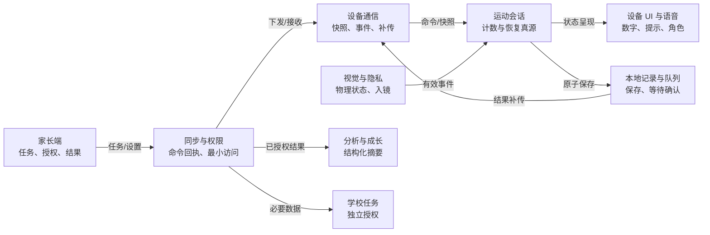
规则：每个模块拥有清楚的真源；完整框架与本轮交付范围分开。
未决问题：PM 决定模块是否进入11/15，不以原型页面数量判断已实现。
|状态ID|状态|含义|进入触发|退出触发|
|---|---|---|---|---|
|overview0|家长端|任务、授权、结果|起点/外部触发|任务/设置 → 同步与权限|
|overview1|同步与权限|命令回执、最小访问|家长端 → 任务/设置|下发/接收 → 设备通信；已授权结果 → 分析与成长；必要数据 → 学校任务|
|overview2|设备通信|快照、事件、补传|同步与权限 → 下发/接收；本地记录与队列 → 结果补传|命令/快照 → 运动会话|
|overview3|运动会话|计数与恢复真源|设备通信 → 命令/快照；视觉与隐私 → 有效事件|状态呈现 → 设备 UI 与语音；原子保存 → 本地记录与队列|
|overview4|视觉与隐私|物理状态、入镜|起点/外部触发|有效事件 → 运动会话|
|overview5|设备 UI 与语音|数字、提示、角色|运动会话 → 状态呈现|终态/上层返回|
|overview6|本地记录与队列|保存、等待确认|运动会话 → 原子保存|结果补传 → 设备通信|
|overview7|分析与成长|结构化摘要|同步与权限 → 已授权结果|终态/上层返回|
|overview8|学校任务|独立授权|同步与权限 → 必要数据|终态/上层返回|

### 运动主状态
责任真源：设备会话模块。
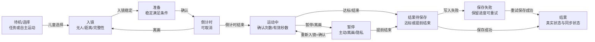
规则：只有有效动作事件可计数；暂停/低置信度/离画不盲目计数；退出保留真实努力。
未决问题：Ready稳定时间、高抬腿计数口径、低置信度持续暂停策略需联合冻结。
|状态ID|状态|含义|进入触发|退出触发|
|---|---|---|---|---|
|session0|待机/选择|任务或自主运动|起点/外部触发|儿童选择 → 入镜|
|session1|入镜|无人/距离/完整性|待机/选择 → 儿童选择；倒计时 → 离画|入镜稳定 → 准备|
|session2|准备|稳定满足条件|入镜 → 入镜稳定|确认 → 倒计时|
|session3|倒计时|可取消|准备 → 确认|倒计时结束 → 运动中；离画 → 入镜|
|session4|运动中|确认次数/有效秒数|倒计时 → 倒计时结束；暂停 → 重新入镜+确认|暂停/离画 → 暂停；达标/结束 → 结果待保存|
|session5|暂停|主动/离画/隐私|运动中 → 暂停/离画|重新入镜+确认 → 运动中；提前结束 → 结果待保存|
|session6|结果待保存|达标或提前结束|运动中 → 达标/结束；暂停 → 提前结束|写入失败 → 保存失败；保存成功 → 结果|
|session7|保存失败|保留进度可重试|结果待保存 → 写入失败|重试保存成功 → 结果|
|session8|结果|真实状态与同步状态|保存失败 → 重试保存成功；结果待保存 → 保存成功|终态/上层返回|

### 任务与计划
责任真源：发布方 + 设备执行事实。
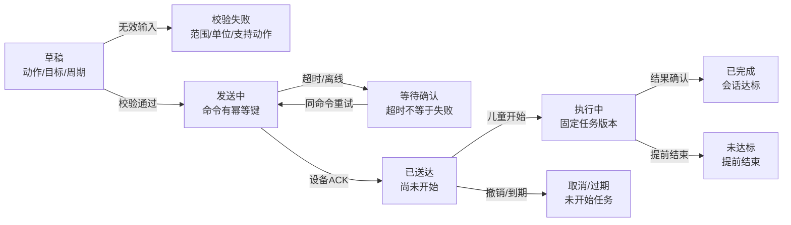
规则：收到、接受、开始与完成分别记录；计划每步独立会话，聚合完成与奖励去重。
未决问题：周期任务跳过/补做、执行中取消、计划调整与截止政策需PM确认。
|状态ID|状态|含义|进入触发|退出触发|
|---|---|---|---|---|
|task0|草稿|动作/目标/周期|起点/外部触发|无效输入 → 校验失败；校验通过 → 发送中|
|task1|校验失败|范围/单位/支持动作|草稿 → 无效输入|终态/上层返回|
|task2|发送中|命令有幂等键|草稿 → 校验通过；等待确认 → 同命令重试|超时/离线 → 等待确认；设备ACK → 已送达|
|task3|等待确认|超时不等于失败|发送中 → 超时/离线|同命令重试 → 发送中|
|task4|已送达|尚未开始|发送中 → 设备ACK|儿童开始 → 执行中；撤销/到期 → 取消/过期|
|task5|执行中|固定任务版本|已送达 → 儿童开始|结果确认 → 已完成；提前结束 → 未达标|
|task6|已完成|会话达标|执行中 → 结果确认|终态/上层返回|
|task7|未达标|提前结束|执行中 → 提前结束|终态/上层返回|
|task8|取消/过期|未开始任务|已送达 → 撤销/到期|终态/上层返回|

### 账号与设备绑定
责任真源：家长身份与设备确认。
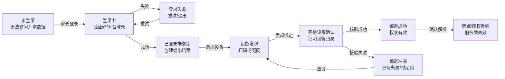
规则：不通过设备ID直接获得权限；切换儿童不串会话；登录失效不终止本地安全运动。
未决问题：微信登录、配网、扫码/按键确认方式需目标硬件PoC；多人权限后续另评审。
|状态ID|状态|含义|进入触发|退出触发|
|---|---|---|---|---|
|binding0|未登录|无法访问儿童数据|起点/外部触发|家长登录 → 登录中|
|binding1|登录中|验证码/平台登录|未登录 → 家长登录；登录失败 → 重试|失败 → 登录失败；成功 → 已登录未绑定|
|binding2|登录失败|重试/退出|登录中 → 失败|重试 → 登录中|
|binding3|已登录未绑定|创建最小档案|登录中 → 成功|添加设备 → 设备发现|
|binding4|设备发现|扫码或配网|已登录未绑定 → 添加设备；绑定冲突 → 重试|发起绑定 → 等待设备确认|
|binding5|等待设备确认|证明设备归属|设备发现 → 发起绑定|核验成功 → 绑定成功；核验失败 → 绑定冲突|
|binding6|绑定成功|权限有效|等待设备确认 → 核验成功|确认解绑 → 解绑/授权撤销|
|binding7|绑定冲突|已有归属/过期码|等待设备确认 → 核验失败|重试 → 设备发现|
|binding8|解绑/授权撤销|旧令牌失效|绑定成功 → 确认解绑|终态/上层返回|

### 网络与结果同步
责任真源：设备结果 → 接收确认。
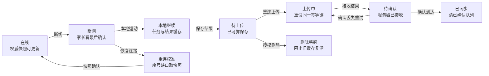
规则：上传确认前不删除队列；重复/乱序不回退计数；业务完成与同步成功分离。
未决问题：队列容量、重试间隔、快照频率、断电持久化粒度和时钟校正需软件评审。
|状态ID|状态|含义|进入触发|退出触发|
|---|---|---|---|---|
|sync0|在线|权威快照可更新|重连校准 → 快照确认|断线 → 断网|
|sync1|断网|家长看最后确认|在线 → 断线|本地运动 → 本地继续；恢复连接 → 重连校准|
|sync2|本地继续|任务与结果缓存|断网 → 本地运动|保存结果 → 待上传|
|sync3|待上传|已可靠保存|本地继续 → 保存结果|重连上传 → 上传中；授权删除 → 删除墓碑|
|sync4|上传中|重试同一幂等键|待上传 → 重连上传；待确认 → 确认丢失重试|接收结果 → 待确认|
|sync5|待确认|服务器已接收|上传中 → 接收结果|确认到达 → 已同步；确认丢失重试 → 上传中|
|sync6|已同步|清已确认队列|待确认 → 确认到达|终态/上层返回|
|sync7|重连校准|序号缺口取快照|断网 → 恢复连接|快照确认 → 在线|
|sync8|删除墓碑|阻止旧缓存复活|待上传 → 授权删除|终态/上层返回|

### 采集与隐私
责任真源：物理状态 + 家长授权。
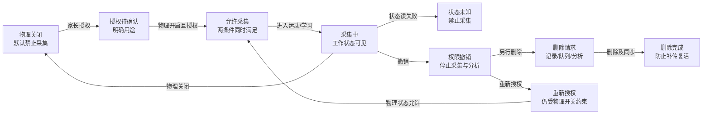
规则：原始视频不持久化；相机状态未知即停；学校无权限远程开相机。
未决问题：删除周期、解绑留存、跨端撤销确认和调试日志最小字段需明确。
|状态ID|状态|含义|进入触发|退出触发|
|---|---|---|---|---|
|privacy0|物理关闭|默认禁止采集|采集中 → 物理关闭|家长授权 → 授权待确认|
|privacy1|授权待确认|明确用途|物理关闭 → 家长授权|物理开启且授权 → 允许采集|
|privacy2|允许采集|两条件同时满足|授权待确认 → 物理开启且授权；重新授权 → 物理状态允许|进入运动/学习 → 采集中|
|privacy3|采集中|工作状态可见|允许采集 → 进入运动/学习|物理关闭 → 物理关闭；状态读失败 → 状态未知；撤销 → 权限撤销|
|privacy4|状态未知|禁止采集|采集中 → 状态读失败|终态/上层返回|
|privacy5|权限撤销|停止采集与分析|采集中 → 撤销|另行删除 → 删除请求；重新授权 → 重新授权|
|privacy6|删除请求|记录/队列/分析|权限撤销 → 另行删除|删除及同步 → 删除完成|
|privacy7|删除完成|防止补传复活|删除请求 → 删除及同步|终态/上层返回|
|privacy8|重新授权|仍受物理开关约束|权限撤销 → 重新授权|物理状态允许 → 允许采集|

### 动作与入镜
责任真源：算法适配器。
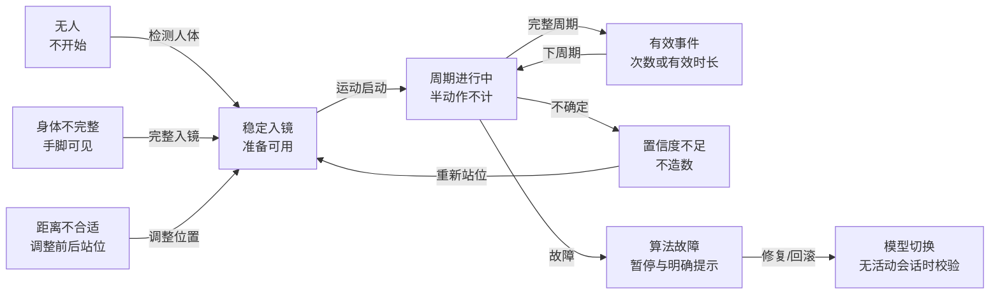
规则：七种动作统一接入，平板支撑使用有效秒数；计数规则需体育与算法评审。
未决问题：准确度、延迟、弱光、遮挡、多人入镜与地面动作机位评测未冻结。
|状态ID|状态|含义|进入触发|退出触发|
|---|---|---|---|---|
|algorithm0|无人|不开始|起点/外部触发|检测人体 → 稳定入镜|
|algorithm1|身体不完整|手脚可见|起点/外部触发|完整入镜 → 稳定入镜|
|algorithm2|距离不合适|调整前后站位|起点/外部触发|调整位置 → 稳定入镜|
|algorithm3|稳定入镜|准备可用|无人 → 检测人体；身体不完整 → 完整入镜；距离不合适 → 调整位置；置信度不足 → 重新站位|运动启动 → 周期进行中|
|algorithm4|周期进行中|半动作不计|稳定入镜 → 运动启动；有效事件 → 下周期|完整周期 → 有效事件；不确定 → 置信度不足；故障 → 算法故障|
|algorithm5|有效事件|次数或有效时长|周期进行中 → 完整周期|下周期 → 周期进行中|
|algorithm6|置信度不足|不造数|周期进行中 → 不确定|重新站位 → 稳定入镜|
|algorithm7|算法故障|暂停与明确提示|周期进行中 → 故障|修复/回滚 → 模型切换|
|algorithm8|模型切换|无活动会话时校验|算法故障 → 修复/回滚|终态/上层返回|

### 分析与训练计划
责任真源：授权摘要 + 规则审核。
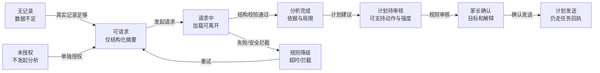
规则：分析不写回计数或完成状态；不生成医疗判断；计划不能加入未确认动作。
未决问题：AI自由问答、计划审核主体、年龄强度与多日规则需PM和专业评审。
|状态ID|状态|含义|进入触发|退出触发|
|---|---|---|---|---|
|analysis0|无记录|数据不足|起点/外部触发|真实记录足够 → 可请求|
|analysis1|未授权|不发起分析|起点/外部触发|单独授权 → 可请求|
|analysis2|可请求|仅结构化摘要|无记录 → 真实记录足够；未授权 → 单独授权；规则降级 → 重试|发起请求 → 请求中|
|analysis3|请求中|加载可离开|可请求 → 发起请求|结构校验通过 → 分析完成；失败/安全拦截 → 规则降级|
|analysis4|分析完成|依据与局限|请求中 → 结构校验通过|计划建议 → 计划待审核|
|analysis5|规则降级|超时/拦截|请求中 → 失败/安全拦截|重试 → 可请求|
|analysis6|计划待审核|可支持动作与强度|分析完成 → 计划建议|规则审核 → 家长确认|
|analysis7|家长确认|目标和解释|计划待审核 → 规则审核|确认发送 → 计划发送|
|analysis8|计划发送|仍走任务回执|家长确认 → 确认发送|终态/上层返回|

### 学习体态提醒
责任真源：独立采集模式。
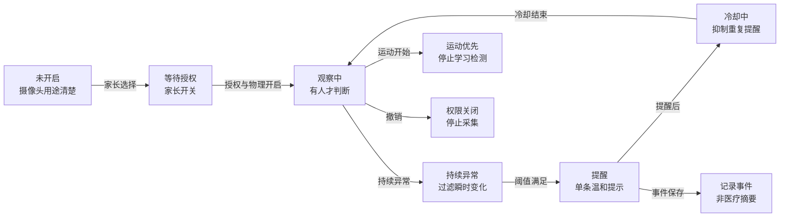
规则：运动与学习模式互斥；不为了学习检测默认全天拍摄，不输出医疗评分。
未决问题：连续时长、冷却、安静时段、待机主动邀请及日历冲突待确认。
|状态ID|状态|含义|进入触发|退出触发|
|---|---|---|---|---|
|posture0|未开启|摄像头用途清楚|起点/外部触发|家长选择 → 等待授权|
|posture1|等待授权|家长开关|未开启 → 家长选择|授权与物理开启 → 观察中|
|posture2|观察中|有人才判断|等待授权 → 授权与物理开启；冷却中 → 冷却结束|持续异常 → 持续异常；运动开始 → 运动优先；撤销 → 权限关闭|
|posture3|持续异常|过滤瞬时变化|观察中 → 持续异常|阈值满足 → 提醒|
|posture4|提醒|单条温和提示|持续异常 → 阈值满足|提醒后 → 冷却中；事件保存 → 记录事件|
|posture5|冷却中|抑制重复提醒|提醒 → 提醒后|冷却结束 → 观察中|
|posture6|运动优先|停止学习检测|观察中 → 运动开始|终态/上层返回|
|posture7|记录事件|非医疗摘要|提醒 → 事件保存|终态/上层返回|
|posture8|权限关闭|停止采集|观察中 → 撤销|终态/上层返回|

### 学校任务与权限
责任真源：学校发布 + 家长独立授权。
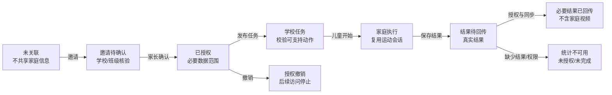
规则：学校不能成为默认家庭数据所有者；任务权限与家庭档案权限分开。
未决问题：此次MVP是否交付、教师账号/班级核验、补交与截止策略由PM决定。
|状态ID|状态|含义|进入触发|退出触发|
|---|---|---|---|---|
|school0|未关联|不共享家庭信息|起点/外部触发|邀请 → 邀请待确认|
|school1|邀请待确认|学校/班级核验|未关联 → 邀请|家长确认 → 已授权|
|school2|已授权|必要数据范围|邀请待确认 → 家长确认|发布任务 → 学校任务；撤销 → 授权撤销|
|school3|学校任务|校验可支持动作|已授权 → 发布任务|儿童开始 → 家庭执行|
|school4|家庭执行|复用运动会话|学校任务 → 儿童开始|保存结果 → 结果待回传|
|school5|结果待回传|真实结果|家庭执行 → 保存结果|授权与同步 → 必要结果已回传；缺少结果/权限 → 统计不可用|
|school6|必要结果已回传|不含家庭视频|结果待回传 → 授权与同步|终态/上层返回|
|school7|授权撤销|后续访问停止|已授权 → 撤销|终态/上层返回|
|school8|统计不可用|未授权/未完成|结果待回传 → 缺少结果/权限|终态/上层返回|

### 陪伴与成长
责任真源：真实结果派生。
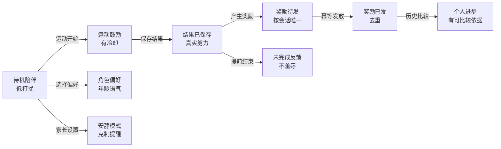
规则：奖励不能来自在线时长、充值或广告；不展示公开儿童身体排名。
未决问题：积分规则、未达标奖励、删除奖励影响、皮肤/角色是否进入展示需PM确认。
|状态ID|状态|含义|进入触发|退出触发|
|---|---|---|---|---|
|growth0|待机陪伴|低打扰|起点/外部触发|运动开始 → 运动鼓励；选择偏好 → 角色偏好；家长设置 → 安静模式|
|growth1|运动鼓励|有冷却|待机陪伴 → 运动开始|保存结果 → 结果已保存|
|growth2|结果已保存|真实努力|运动鼓励 → 保存结果|产生奖励 → 奖励待发；提前结束 → 未完成反馈|
|growth3|奖励待发|按会话唯一|结果已保存 → 产生奖励|幂等发放 → 奖励已发|
|growth4|奖励已发|去重|奖励待发 → 幂等发放|历史比较 → 个人进步|
|growth5|个人进步|有可比较依据|奖励已发 → 历史比较|终态/上层返回|
|growth6|未完成反馈|不羞辱|结果已保存 → 提前结束|终态/上层返回|
|growth7|角色偏好|年龄语气|待机陪伴 → 选择偏好|终态/上层返回|
|growth8|安静模式|克制提醒|待机陪伴 → 家长设置|终态/上层返回|

### 设备故障与升级
责任真源：设备运行与版本。
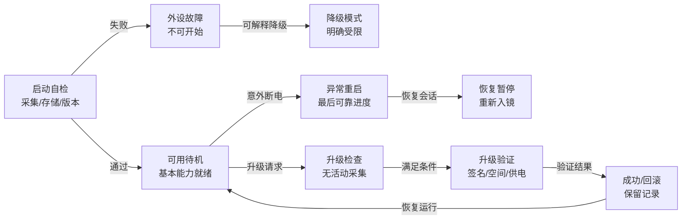
规则：故障不伪造正常识别；升级不能中断运动；诊断不泄露视频或身份。
未决问题：温升/低电保护、恢复方式、升级失败与售后诊断权限需技术评审。
|状态ID|状态|含义|进入触发|退出触发|
|---|---|---|---|---|
|maintenance0|启动自检|采集/存储/版本|起点/外部触发|通过 → 可用待机；失败 → 外设故障|
|maintenance1|可用待机|基本能力就绪|启动自检 → 通过；成功/回滚 → 恢复运行|意外断电 → 异常重启；升级请求 → 升级检查|
|maintenance2|外设故障|不可开始|启动自检 → 失败|可解释降级 → 降级模式|
|maintenance3|降级模式|明确受限|外设故障 → 可解释降级|终态/上层返回|
|maintenance4|异常重启|最后可靠进度|可用待机 → 意外断电|恢复会话 → 恢复暂停|
|maintenance5|恢复暂停|重新入镜|异常重启 → 恢复会话|终态/上层返回|
|maintenance6|升级检查|无活动采集|可用待机 → 升级请求|满足条件 → 升级验证|
|maintenance7|升级验证|签名/空间/供电|升级检查 → 满足条件|验证结果 → 成功/回滚|
|maintenance8|成功/回滚|保留记录|升级验证 → 验证结果|恢复运行 → 可用待机|

## 可运行场景与覆盖边界
|编号|场景|观察重点|
|---|---|---|
|P01|正常闭环|完成20次目标；观察“已送达”与“已开始”、保存与同步分别发生。|
|P02|离画与恢复|确认12次后离画；错误继续和错误计数应被阻止；重新入镜下一次为13。|
|P03|断网与补传|家长数字停在最后快照，设备继续；确认前队列保留。|
|P04|重复与乱序|任务重放不创建第二条，动作事件重放不加次数。|
|P05|隐私关闭|运动中关闭物理相机，不能继续；重新开启、入镜、确认后恢复。|
|P06|存储失败|先出现保存失败，再修复重试；不能提前庆祝已保存。|
|P07|断电恢复|这是内存模拟恢复策略，观察中断而非虚假完成；真实持久化需另验。|
|P08|取消/版本冲突|未执行任务可修改；执行中的任务不可无声改目标或远程结束。|
|P09|删除后旧缓存|结果先保存在队列；删除同时删除分析，旧补传不能复活。|
|P10|AI分析降级|先展示数据不足；真实结果同步后请求，超时只能降级到事实。|
|P11|学习与运动互斥|体态提醒冷却抑制重复；进入运动停止学习采集。|
|P12|学校独立授权|没有授权不能回传；完成后仅发送必要结果。|
|P13|计划步骤|两步计划使用独立会话；第一步记录不被第二步覆盖。|
|P14|升级与解绑|运动中升级/解绑被阻止；结束后升级失败保留结果。|
|P15|登录失效|家长不能继续访问或发送；设备安全运动可以继续。|
|P16|倒计时被打断|倒计时离画回入镜，不能直接开始。|

以下仅列候选场景，尚未全部实现为交互模拟；需在下一轮补充，不把图节点当已完成页面：
|场景族|待补场景|验收层|
|---|---|---|
|首次使用|微信登录取消、验证码超时、隐私拒绝、游客、未成年误进家长设置|小程序/权限|
|设备绑定|二维码过期、被他人绑定、配网失败、换路由、蓝牙不可用、解绑离线设备|硬件/身份/网络|
|多儿童/多设备|错误档案、共享设备抢占、同时来任务、权限冲突|产品/会话/权限|
|运动准备|多人入镜、宠物/背景干扰、弱光逆光、长时间无人、空间不足|算法/入镜UI|
|动作差异|跳绳遮挡、俯卧撑侧面、仰卧地面角度、平板有效时长暂停、高抬腿左右周期|体育/算法/设备|
|计划与周期|休息跳过、步骤失败、跨日截止、周期跳过/补做、时区/时钟误差|任务/PM规则|
|通信|过期指令、认证失败、断续网络、拥塞、序号缺口、重复确认、客户端后台挂起|通信/协议|
|持久化|磁盘满、写入半途断电、队列溢出、数据迁移失败、重启恢复|真实存储/升级|
|设备异常|相机断流、触控失效、音频故障、低电/过热、关机保护、状态灯不一致|硬件/运行时|
|分析|跨儿童摘要污染、撤权时请求在途、字段缺失、服务超时、安全拦截、结果过期|授权/分析|
|学校|邀请核验失败、退班撤权、截止后补交、学生归属变更|学校/PM|
|成长激励|重复领奖、删除记录奖励处理、跨设备重复积分、年龄语气不适配|奖励/设计|
|维护售后|错误升级包、供电不足、降级回滚、日志脱敏、设备转让|运行时/权限|
## 状态真源与交接不变量
设备拥有当前会话计数与有效时长；发布方拥有任务配置版本；结果先可靠保存，再确认同步。父母视图只能展示最近确认快照；离线不把旧状态说成实时。删除须移除分析与队列，并阻止旧补传复活。物理状态未知/关闭优先于远程命令。会话中不能换儿童、动作、升级或无声改目标。
原型中重启、服务器接收、删除墓碑和积分均为内存策略演示；真实断电事务、网络认证、授权隔离、可靠队列、积分规则与七动作算法仍需实现和验收。绑定、多儿童等部分动作仅说明守卫，不构成完整页面实现。
## 第一轮技术核对
已检查两段脚本语法，并在Node隔离环境逐步执行16条引导场景，记录结果和非法动作拒绝。未增加生产测试，也未验证真实设备。应用浏览器安全策略不允许打开file协议，本次未通过浏览器检查布局、点击与下载行为；用户可双击单文件进行视觉评审。后续评审意见应登记在本原型上，方向确认后再固化实现。
