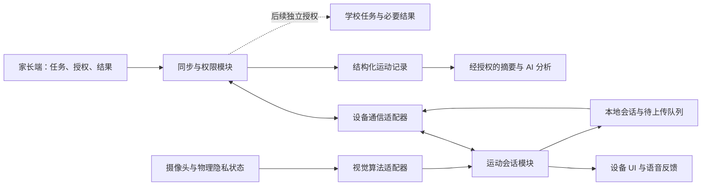

# Document Control

| 字段 | 内容 |
|---|---|
| Document Type | Product Planning |
| Current Version | v1.0.1 |
| Status | Draft |
| Owner | 待确认（项目协调：魏子奇；不等同文档审批责任人） |
| Reviewer | 待指派 |
| Created Date | 2026-10-08 |
| Last Updated | 2026-10-12 |

> 文档控制版本以本表为准；原文件名和正文版本标识保留为历史业务版本。Draft/Review 为本次治理提交状态，非产品审批结论。创建日期取自原标识，待 Owner 核实。

# AI运动伙伴：软件架构与 UI 交付路线 V1.0

> **2026-10-08 补充复核：9 月 29 日会议约束优先用于当前交付规划。** 原始智能纪要要求 2026-11-15 交付展示、约一个月开发，四人核心团队加外围支持，交付小程序/APP、后台、设备屏幕交互和实体原型机；硬件先用开发板。本文下方八周路线仅保留为旧台账对齐参考，不再作为当前交付建议。实际启动日期、动作数量、三端范围、圆/方屏与支持人员容量仍需核实。详见 [会议约束下的软件与UI路线修订](软件与UI路线_依据0929会议修订_V1.1_20261008.md)。

日期：2026-10-08。性质：基于本地资料与源码的评估建议，供 M0/M1 评审；不替代既有 PRD、硬件规格和甘特图。本次仅新增文档，未改写历史输入、任务状态或部署目录。

## 1. 结论与证据范围

现有项目足以启动软件架构评审和 UI 流程设计，但不能据此认定产品软件已开发完成。可复用资产集中在交互路径、演示状态、角色素材、图标、前端展示工程和部署脚本；真正的设备采集、算法运行、跨端通信、持久化、身份权限与故障恢复仍需建设。

建议保留整体 W1–W8 的里程碑节奏，先做协议与可回归模拟闭环，再用真实硬件替换模拟输入。W5 验收开合跳黄金链路，W6 验收三动作，W7–W8 做稳定性和家庭验证。AI 分析、体态提醒按现有计划保留独立工作流；它们不能介入计数真值和会话完成判断。

本次检查覆盖现行产品定位规范、CONTEXT、docs 下 PRD V3.0、功能大纲、版本演进、UE V7.4、硬件需求 V2.0、原型 README、两套 React 工程源码、双端演示源码、worker 与测试源码，以及甘特图 HTML 和 JSON。未运行实机、构建或浏览器交互测试，因此 UI 判断属于源码与既有 QA 记录审阅，不能替代当前设备视觉验收。未查询外部技术资料；技术候选仅作为本项目 PoC 方向，不构成兼容性保证。

## 2. 本地已有项目：哪些能用

| 资产 | 检查所得 | 复用方式 | 必须补齐 |
|---|---|---|---|
| `docs/product/design/儿童AI运动陪伴机器人_完整产品UE_Demo_V7.4.html` | 家长与设备双端视图、任务、运动、计划、体态等交互；脚本维护共享演示状态 | 当前需求与流程参考，提取页面状态和文案 | 拆分真实数据、业务状态与渲染；剔除无依据的示例成绩、推荐值 |
| `prototype/儿童AI运动陪伴机器人_可运行原型_V1.0.html` | 单文件演示，包含本地状态、调试入口及运动流程 | 演示与验收脚本起点；不直接搬成生产应用 | 真正的识别、通信、存储、权限及恢复；演示功能与正式包隔离 |
| `prototype/teamo-live-demo/index.html` | 设备与手机在同一脚本状态中联动，计数有定时器与人工触发 | 提炼邀请、接受、稍后、暂停、继续、结果的交互契约 | 独立进程间协议、真实 ACK、乱序和重复消息处理；计数不能由演示定时器产生 |
| `prototype/teamo-ui-flow-html/` | React/Vite 展示站，当前源码与 QA 已围绕体验、产品、验证依据组织；内嵌 Live | 对外评审展示壳、图标与字体候选、产品素材、演示入口 | 不等于家长 App；iframe 同页联动不等于设备联网 |
| `prototype/teamo-form-explorer/` | 形态比较、摄像头概念、外壳与角色方案，含 React 演示 | 硬件/UI 方案讨论与资产来源 | 收敛为硬件 V2.0 的固定摄像头方案；移动、弹出、分体概念不得默认成为当前承诺 |
| 两工程的 `worker/index.js` | 调用 `env.ASSETS.fetch`，404 时回退首页 | 静态站托管逻辑与构建交接脚本 | 不具备账号、数据库、任务通信或 AI 后端能力 |
| 既有测试 | Sites 交接测试，以及部分源码正则交互契约检查 | 工具链检查参考 | 不能证明真实计数、离线补传、权限或跨端恢复正确 |
| `public/assets/`、Live assets、icon 实验文件 | 角色图、产品图、家庭场景、手机框、图标方案 | 选定一套角色与图标，建立资产清单 | 适配真实屏幕、离线字体/资源、不同年龄语气；确认素材使用范围 |

仓库工程清单中发现的产品演示工程主要是上述两套 React 项目与单文件 HTML；冻结快照仅用于追溯。未发现可据以认定生产设备工程、生产后端或 Android/iOS/小程序工程已经完成的工程清单证据。不要把可运行网页、演示通过或部署 worker 等同于研发完成度。

README 的“7 board 展示站”描述与当前展示站源码/QA 的三锚点组织不完全一致，今后以实际源码核对，不能仅凭目录说明估算复用量。

## 3. 启动前必须对齐的现状

| 问题 | 现有口径 | 对路线的影响与建议 |
|---|---|---|
| MVP 与第一版混用 | PRD 第一版要求七动作、家校完整能力；八周计划主线是开合跳、深蹲、高抬腿 | 区分“八周验证样机”与“完整第一版”；七动作与学校端保留后续交付路径，不能宣称三动作样机已满足 PRD 全量验收 |
| 屏幕与交互未统一 | 硬件 V2.0 强调像素屏；计划/UE 使用触控与左右滑动；展示素材还有圆屏方案 | W2 冻结屏幕尺寸、形状、分辨率、触控/按键、观看距离；必要时提供像素屏简化 UI。圆屏 82% 安全区来自展示 QA，不能直接作为硬件规格 |
| 总量不同步 | JSON 与 HTML masterTasks 均为 149 项、3392h；summary 保留 148 项、3376h | 新增 16h 后汇总未同步。资源判断采用明细重算；由计划维护者统一刷新汇总，不静默覆盖历史文件 |
| 依赖难以自动检查 | 明细 149 项中 115 项 `depIds` 为空，仍有文本依赖 | 文本依赖不等于无依赖。W1/W2 补齐关键链 ID，再检查先后与跨团队容量 |
| UI 工作量不独立 | 设计协作出现在多项依赖中，未见独立 UI 交付工作包 | 增加设计、评审、状态矩阵、设备适配、验收职责映射；新增工时单列，不能当作已包含 |
| M3 验收先于部分实现结束 | 5.3.6 在 W4；5.3.2/5.3.3 等延续到 W5 | 明确 W4 是接口、状态机及模拟数据的模块验收；真实持久化/通信闭环在 M4 验收，或通过变更单调整前置任务 |
| 最小化与档案字段 | 7.2.3 列头像、性别、身高体重等；产品要求数据最小化 | 每个字段说明用途与是否必需；不把全部字段默认设必填；不用档案字段构造未经验证的能力评分 |

任务“未开始”是台账状态，不能单凭它断言无人做过探索；原型证明已有探索资产，仍缺正式交付证据。

## 4. 建议软件架构与职责

采用少量深模块，把复杂规则集中在小接口后；不在 MVP 拆分大量微服务。部署位置在 M1 确定：图中的同步与权限模块是逻辑职责，不代表云方案已经批准。若 PoC 选择本地直连，必须说明三端访问、离线、身份校验及 AI 出网的能力限制。

| 模块 | 建议接口与职责 | 权威数据与规则 |
|---|---|---|
| 运动会话 | `start / pause / resume / finish`，接收算法事件，输出状态快照与结果 | 设备拥有当前会话的计数、有效时长和结束原因；UI/App 不自行递增或覆盖次数 |
| 视觉适配器 | `readiness`、完整动作事件或有效时长增量、异常原因 | 模拟输入与真实算法是两个适配器；序号/时间戳过滤过期事件，暂停时拒收计数事件 |
| 隐私与外设 | 实际隐私状态、采集开关、摄像头/音频/显示能力 | 物理关闭或状态不明时禁止采集；远程开启请求不能越过物理状态与本地授权规则 |
| 本地记录与同步 | 原子保存结果、待上传队列、确认与重试 | 同一结果唯一，确认前不删除队列；重启不生成虚假完成；持久化关键确认进度 |
| 任务与权限 | 创建/更新任务、绑定、授权、撤销、结果访问 | 发布方拥有任务配置版本；设备拥有执行事实。收到、接受、开始、完成分别记录 |
| 反馈呈现 | 业务状态到数字、图形、声音的映射与提醒仲裁 | 优先安全/隐私与暂停，其次入镜引导，再计数和鼓励；重复提醒冷却，单时刻只播一条 |
| 分析 | 从已保存且获授权记录生成摘要、分析结果或规则降级 | 不控制实时运动；模型不写回次数和完成状态，不生成医疗结论或自由训练处方 |

### 数据与协议首批产物

W1 定义 ChildProfile、Device、Consent、Task、Session、DeviceSnapshot、PostureEvent、AnalysisResult。每个对象明确字段来源、读写方、权限、保存周期和删除方式。实时帧与关键点默认只在内存处理，不进入产品数据库、消息总线或常规日志。算法评测样本另走明确授权、隔离访问及到期删除流程，不借产品隐私规范默认获得采集权。

命令封装建议包括 `protocolVersion / commandId / deviceId / taskId / taskVersion / issuedAt / expiresAt / payload`；事件包括 `eventId / sessionId / bootId / sequence / occurredAt / type / payload`。时间戳用于解释与有效期，不能单独解决排序；同设备会话内使用序号，重启使用 bootId 区分，缺口时取权威快照。

至少区分命令已接收、已接受、被拒绝与执行成功。超时显示“等待确认”，不显示成功；所有重试携带同一幂等键。任务执行后到达的修改/取消必须返回明确策略，不悄悄改写当前目标。默认建议当前会话保留启动时的任务版本，新版本用于后续执行，需在 W2 协议评审确认。

Session 至少保存动作与计数口径版本、目标与单位、实际次数/有效秒数、开始结束、状态、结束原因、算法版本和同步状态。业务状态与同步状态分开，例如“未达标但已同步”“已完成但待同步”。奖励以 sessionId 去重，重试不重复奖励。

断电恢复默认保留最后持久化确认进度，进入暂停或中断结果，重新入镜后再恢复；不能继续沿用断电前半个动作周期。写结果与入队须具有事务一致性，上传确认后标记成功。删除需阻止旧缓存补传复活：记录删除版本/墓碑并同步到离线设备，队列与分析衍生结果一并处理。

### 技术路线如何选

- 现有 React/Vite 可继续作为评审与模拟器工程。是否进入正式家长端，要用三端登录、设备配网/绑定、通信、通知、离线与发布 PoC 决定；Web 演示成功不能证明这些能力。
- Android/iOS 与小程序保留交付路径。React Native、Flutter、原生、小程序方案按 7.1.1–7.1.3 比较；业务对象、协议和设计规则可以共用，不能预设三端共用同一套 UI 代码。
- 设备框架随主控/OS、屏幕、输入与算法运行环境选择。在目标板上比较启动、内存、持续推理下的显示延迟、音频与恢复，再冻结；当前不提前锁定 WebView 或嵌入式 UI 框架。
- 设备通信在 8.1.3 验证 HTTP/长连接/消息通道候选与直连方案；选择只覆盖实际网络条件、权限和可靠性需要的最小方案。后端先模块化实现，存储方案在 9.1.2 冻结。

## 5. UI 设计路线与交付包

先统一状态与信息层级，再制作正式视觉。设备端和家长端使用同一业务状态字典，但分别适配运动当下与事后管理，不能照搬同页双端演示的布局。

**设备端**：待机/今日任务 → 选择 → 入镜 → 准备 → 倒计时 → 运动 → 暂停/重新入镜 → 结果 → 返回。计数、目标、一次明确提示是运动页的主要信息；表情不得压缩数字。滑动是否作为导航取决于触控冻结结果；暂停和退出必须有可发现入口。像素屏以大数字、状态图形、短提示和语音组合；复杂档案与设置放家长端。完成与提前结束用不同标题，避免把部分努力写成失败或虚假达标。

**家长端**：今日状态、待处理任务、最近结果和异常/授权优先；任务三步为“选动作 → 设目标 → 确认发送”，并展示等待确认/拒绝/重试。记录显示目标、实际、用时、状态与同步时间。设备设置显示上次确认状态，离线时不伪装实时摄像头状态。AI 入口是否保持原型中央强调位，作为评审项；建议首页优先运动结果，分析从结果卡进入，但不自行改写 UE。

**设计系统首包**：颜色/字体/间距/尺寸令牌、图标与资产清单、状态卡、主次按钮、任务表单、入镜引导、计数、暂停、结果、空/加载/错误/待同步/权限状态。跨平台共享语义与规则，各端做对应实现。正式包移除演示姓名、模拟成绩、调试按钮和自动计数。

**状态矩阵**：每一页面列进入条件、数据来源、允许操作、加载/空态/错误、离线、授权关闭、重启恢复、返回路径与验收脚本。至少覆盖摄像头关闭、无人、太近/远、身体不完整、低置信度、离画、重复任务、乱序、断网与结果补传。

**适配与家庭测试**：W2 将真实屏幕尺寸、分辨率、可视区、观看距离、扬声器及输入形式录入设计约束；在真实显示器上验证数字辨认和提示理解。6–9、10–12、13–15 岁分别验证文案和角色语气，青少年有克制表达候选。颜色不能成为唯一状态信号；关键提示同时有图形/文字/声音中的适当冗余。

W1–W2 交状态矩阵、关键线框与约束；W3–W4 交可实现组件、资产、主链高保真和异常页；W5–W6 做实机校准；W7–W8 根据儿童/家长观察修正。暂不投入多套皮肤、商城或完整学校后台的精修。

## 6. 与整体开发节奏对齐

W1 是启动会确认后的第一个开发周，尚无启动日期，因此不能把它自动映射为 2026-10-08 当周。以下是沿用现有计划节点的建议验收解释，不是已批准排期。

| 周/节点 | 软件交付 | UI 交付 | 前置与退出门槛 | 对应原任务 |
|---|---|---|---|---|
| W1 / M0 | 复用清单、对象和状态真源、范围差异单、平台/通信候选 | 信息架构、核心与异常线框、年龄语气候选 | Owner 与资源到位，MVP/第一版范围区分清楚 | 1.2.*、7.1.1、7.2.1、8.1.1 |
| W2 / M1 | 目标板与三端 PoC、业务协议 V1、存储/权限策略、模拟输入接口 | 设备屏幕与输入约束、主链状态矩阵、设计令牌 | 硬件主备方案、通信、平台、算法接口冻结；未过门槛不称进入全面实现 | 1.3.2、3.2.2、6.1.1、7.1.3、8.1.3–4、8.2.1、9.1.2 |
| W3 / M2 | 摄像头/显示/音频接入，状态机、本地存储、通信工程；模拟器持续可用 | 可实现组件、入镜与运动/暂停/结果首包 | 真实板基本可用；模拟器失败场景可重放；触控若延期明确替代输入 | 3.3.5、5.1.*、5.3.1、7.1.4、12.1.1 |
| W4 / M3 | 开合跳算法模块、模拟单动作闭环、接口回归、权限初验 | 主链完整与异常页面，联调标注 | 模块接口稳定；严格区分模拟闭环与真实硬件完成度 | 5.3.6、6.3.2、12.1.2、13.2.1 |
| W5 / M4 | 真实开合跳：任务→入镜→计数→暂停恢复→结果→家长记录 | 实机数字/按钮/声音校准，等待确认与补传可见 | 按原任务连续完成 10 次无致命中断；12/20 暂停恢复后下一次为 13；计数以设备为准 | 12.2.1、5.3.2–5、7.3.3–5 |
| W6 / M5 | 深蹲、高抬腿全链路；AI/体态独立联调，三端适配 | 三动作提示、数据不足/分析失败、体态授权与冷却 | 三动作现场复测，不串会话；未通过功能保持不可用而非假结果 | 12.2.2–6、6.3.3、7.3.6 |
| W6–W7 / M6 | Alpha：弱网、重复、乱序、断电、温升/内存/持续运行、权限删除测试 | 空/错/恢复一致性与跨端回归 | 缺陷、算法和环境限制可追溯；核心故障处理完后再进家庭测试 | 13.2.2–5、8.2.6 |
| W7 / M7 | 儿童家长测试包、日志与观察记录 | 三年龄段理解、开练与恢复、家长结果理解测试 | 授权明确；记录成人介入与错误理解；分清识别问题和 UI 问题 | 14.1.* |
| W8 / M8 | 关键修复、最终回归、交接包、后续池 | 复测与设计归档 | 基础闭环和隐私无阻塞缺陷；列明三端差异和未交付范围 | 13.2.6、14.2.*、1.3.5 |

算法准确度、可接受误差、反馈延迟、Ready 稳定时间、提醒冷却等量化阈值仍需 W2 联合冻结。不能把“没有明显问题”当作最终算法标准。已有硬件 4 小时跑测、黄金链路 10 次等要求沿用原任务；它们只是 MVP 检查，不是量产可靠性认证。

## 7. 资源与可行性

明细总工时 3392h / 8 周 = 424h/周，按每人每周 40h 粗算约 10.6 个全职当量。这是全项目的理想均摊，未计协调、缺陷返工与等待，并不能证明十一个人即可按期完成。

| 软件相关任务前缀 | 工时 | 含义 |
|---|---:|---|
| 5.* | 380h | 设备软件 |
| 7.* | 480h | 家长三端与相关页面 |
| 8.* | 236h | 通信协议、PoC 与双端实现 |
| 9.* | 164h | 后端/数据 |
| 10.* | 152h | AI 分析 |
| 11.* | 166h | 体态提醒，含算法实现与需求工作 |
| 合计 | 1578h | 约 4.9 个全职当量的理想均摊；含跨角色工作，不能全算软件工程师容量 |

上述合计未包含 6.* 动作算法、12.* 集成、13.* 测试、14.* 用户测试和新增 UI 工作量。按 owner 汇总，设备软件角色 616h、App 协作角色 480h；如果各只有一人，八周分别仅有约 320h 名义容量，明显超载。实际人员尚未绑定，不能宣称八周可承诺。

建议启动时至少明确设备、App/三端、后端/通信、算法、UI/UE、测试、产品集成七个责任窗口，可兼职但必须按每周任务分布核对容量。责任窗口不等于七个人；W3–W6 的峰值才是决定是否需要增援的依据。UI 工时由状态页数量、平台与实机约束核算，作为新增工作包申报，当前不虚构已批准的人天。

硬件延期时保留模拟接口开发并切换批准的开发板备选；M4 真实链路日期必须重新评估，不能用模拟演示替代。算法未达标时建议只开放已通过的开合跳路径，明确三动作验收未满足，提交范围/日期变更。三端有平台差异时保留同样的业务验收契约，差异和降级均写入评审，不自行取消 iOS 或小程序。

## 8. 提交评审的变更建议

| 变更编号 | 旧口径 | 本地证据 | 建议修改与影响 |
|---|---|---|---|
| SW-01 | 第一版七动作、家校；MVP计划三动作 | PRD §01/04/08 与 6.2.*、12.2.* | 建立“验证样机/完整第一版”双验收清单；不删除七动作承诺，后续另估算法、学校授权与后台工时 |
| SW-02 | 触控滑动、圆屏演示与像素屏并存 | 5.2.2、UE、硬件 V2.0、展示 QA | W2 冻结显示/输入；若无触控改交互与相关任务，影响 UI、外设、结构与验收 |
| SW-03 | W4 单模块验收，若干前置实现 W5 才结束 | 5.3.6 与 5.3.2/3、8.2.4/5 | 将 M3 明确为接口/模拟模块验收或前移最小实现；真实持久化闭环归 M4；需更新依赖 |
| SW-04 | 汇总 148 项、3376h | JSON/HTML 明细 149 项、3392h | 刷新派生统计并注明补录，不回写任务完成状态 |
| SW-05 | 设计散落于协作依赖，无独立交付包 | 7.2.* 与台账角色 | 添加 UI 状态矩阵、设计系统、实机校准、家庭复测工作包及 Named Owner；工时增量需核算 |
| SW-06 | 原型中央 AI 入口与丰富能力展示 | UE 与产品“结果与行动优先”原则 | 评审 AI 信息层级、示例数据、年龄语气与档案必填项；保持分析不影响基础闭环 |

这些是待评审建议，不表示已获批准。涉及 PRD、画布、大纲的修改，严格采用“旧口径—新证据—建议修改”变更单。

## 9. 下一步可执行顺序

1. 项目负责人核定 W1 起点、真实人员及每周可投入工时，确认 SW-01/02 的评审议程。
2. 软件/算法/硬件共同交接口与硬件能力清单；UI 交主链和异常状态矩阵，全部链接到原任务 ID。
3. W2 完成配网/绑定、三端通信、隐私状态、目标板推理与显示并发 PoC；以结果冻结路线，形成 M1 记录。
4. 在独立新工程中实现运动会话核心、模拟/真实适配器、本地结果与待上传队列；演示工程保留为评审工具，不进行大规模搬移。
5. 先让开合跳真实会话通过计数、恢复、补传、去重，再扩展三动作和分析/体态流程。发布或采购另走项目既有流程。

交接时必须包含工程启动与构建说明、协议与对象版本、状态矩阵、资源清单、关键验收证据、已知限制与后续池。完成度以可复现验收结果判断，不能以页面数量或视觉精修程度判断。

## 10. 本地证据入口

- [产品定义与边界规范](../../../AI运动伙伴/00_现行研究与规范_20260918/儿童AI运动陪伴机器人_产品定义定位与边界规范_V1.0.md)
- [PRD V3.0](../requirements/03_儿童AI运动陪伴机器人_PRD_V3.0.html)
- [UE V7.4](../design/儿童AI运动陪伴机器人_完整产品UE_Demo_V7.4.html)
- [硬件需求 V2.0](../../hardware/儿童AI运动陪伴机器人_MVP硬件技术需求说明书_V2.0.html)
- [MVP 任务明细](../../../AI运动伙伴/参考与拆解/gantt_tasks.json)
- [MVP 周甘特图](../../../AI运动伙伴/参考与拆解/儿童AI运动陪伴机器人_MVP周甘特图管理_V1.0.html)
- [原型导航](../../../prototype/README.md)
- [展示站源码](../../../prototype/teamo-ui-flow-html/src/App.jsx)
- [展示站 QA](../../../prototype/teamo-ui-flow-html/design-qa.md)
- [双端 Live 演示](../../../prototype/teamo-live-demo/index.html)

---

# Version History

| Version | Date | Author | Status | Change Summary |
|---|---|---|---|---|
| v1.0.0 | 待核实 | 原作者待核实 | 待核实 | 登记导入前现存正文基线；已有版本标识，既有版本记录仍保留在正文；不推断历史修改或批准 |
| v1.0.1 | 2026-10-12 | Codex（AI，执行用户指令） | Draft | 新增 Document Control、标准 Version History、Change Impact 与 Decision Log；保留既有业务正文及历史记录 |

> 本表仅登记已验证的现存基线与本次修改。历史日期、作者和状态待核实；原有版本记录是补录证据入口，不能据文件名编造缺失版本。

# Change Impact

### Modified Sections

- Section: 文档顶部与治理附录。
- Before: 缺少统一的文档控制表和标准版本记录。
- After: 增加控制表、基线与 Patch 历史、影响分析和决策记录入口；原业务正文保留。

### Impact Scope

Affected:
- 本文及引用本文的项目文档；本次无业务要求变更。
- 逐文件版本、备份和修改报告见 docs/governance/CHANGELOG-20261012.md。

### Risk

Low。Owner、Reviewer、历史审批状态仍待确认；本次结构治理不冻结产品需求。

# Decision Log

本次未修改产品方向、功能取舍或系统架构。既有决策及待决事项保留在正文，尚未逐条验证迁入；后续涉及这些事项时按 docs/governance/DOCUMENT_VERSION_POLICY.md 记录，建议与已批准决策必须区分。
