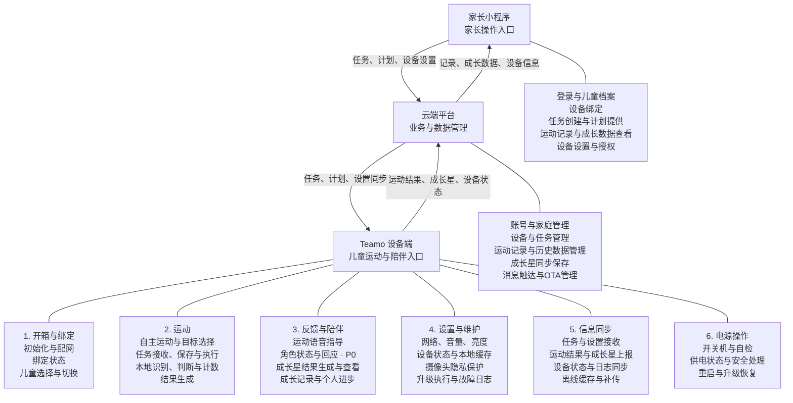

# Document Control

| 字段 | 内容 |
|---|---|
| Document Type | Function Scope Alignment |
| Current Version | v0.1.1 |
| Status | Draft |
| Owner | 待确认（项目协调：魏子奇） |
| Reviewer | 待指派 |
| Created Date | 2026-10-13 |
| Last Updated | 2026-10-13 |

# Teamo MVP 三端责任范围规范 v0.1.1

## 用途与阶段

当前阶段：MVP功能范围梳理与多端功能边界整理（Function Scope Alignment）。仅定义做什么、归属哪个端、是否重复或遗漏。数据模型、数据流、状态机、技术方案、接口、通信协议、权限架构与评分模型留待后续。

## 产品端组成

| 端 | 定位 |
|---|---|
| 设备端 | 儿童AI运动陪伴机器人 |
| 云端平台 | 设备与业务数据管理平台 |
| 家长小程序 | 家长使用入口 |

## 三端功能架构线框图

设备本地完成识别并生成运动结果和成长星结果，云端同步保存；成长星评定规则仍待设计。演示动作是**开合跳、深蹲起、高抬腿**。

不显示骨架、不保存或上传运动视频、不做视频回放、无宠物功能。投屏、手表联动、语音输入留作下一代方向。

这张图表示**功能归属和端间协作**，框的位置不代表页面布局。图中功能深度、优先级及未决范围以[设备功能大纲v2.2.0](Teamo_Device_Function_Outline.md)为准，不把成长星或成长记录改为P0。独立[软件功能架构映射](Teamo_Device_Function_Architecture_Mapping.md)继续单独维护。

## 各端功能范围

| 端 | 功能范围 |
|---|---|
| 设备端 | 设备初始化；摄像头能力与隐私保护；本地运动识别；运动执行；任务接收、保存、执行与结果返回；儿童选择与切换；运动反馈；角色状态与回应（P0）；成长星结果生成；设备状态；本地数据缓存；云端通信；OTA升级 |
| 云端平台 | 账号家庭管理；设备管理；任务管理；运动记录管理；成长星同步保存与激励数据管理；消息触达；OTA管理；数据安全 |
| 家长小程序 | 登录；儿童档案；设备绑定；任务创建与管理入口；运动记录查看；成长数据查看；设备设置；隐私授权与数据管理入口 |

## 重复与遗漏检查

| 事项 | 归属与边界 | 检查结论 |
|---|---|---|
| 账号与档案 | 小程序提供操作入口；云端管理；设备确认本次儿童 | 协作分工，设备不创建档案 |
| 任务 | 小程序安排；云端管理；设备接收执行并反馈 | 设备自主运动目标与家长任务创建区分 |
| 运动记录 | 设备产生结果和缓存；云端管理；小程序查看 | 保留缓存与同步能力，避免遗漏 |
| 激励与成长 | 设备产生成长星奖励结果并呈现反馈；云端同步保存；小程序查看 | 成长星规则设计另行开展，原优先级不变 |
| 消息与提醒 | 云端触达家长；设备提醒儿童；小程序接收查看 | 服务对象不同，非重复功能 |
| 设置与升级 | 小程序提供设置入口；云端管理；设备应用设置与执行升级 | 小程序暂不新增独立OTA管理模块 |
| 隐私 | 设备本地识别、采集提示；云端数据安全；小程序授权与数据管理 | 补齐小程序入口；视频不上云、不持久化 |
| 异常日志 | 设备记录必要故障信息并同步；云端查询管理 | 现有规格已有两项P0，保留功能归属，不定义字段 |

## 待对齐边界

学校任务、装扮、排行、体态等既有评审项不因本表未展开而被删除，也不自动纳入首发。源资料儿童年龄含3–6岁，与现行6–15岁边界冲突，按现行产品边界保留6–15岁；档案分类待统一。设备不生成AI训练建议，仅接收外部计划；是否显示外部建议另列待评审。

## 来源与关联

用户本次阶段指令；[原设备大纲](Teamo_Device_Function_Outline.md)；[云端对齐稿](Teamo_Device_Function_Outline_Cloud_Alignment.md)；[映射表](Teamo_MVP_Cloud_Device_Function_Mapping.md)；[修订清单](Teamo_Device_Function_Outline_Revision_List.md)。

# Version History

| Version | Date | Author | Status | Change Summary |
|---|---|---|---|---|
| v0.1.0 | 2026-10-13 | Codex（AI，执行用户指令） | Draft | 新增Teamo MVP 多端功能范围定义 v0.1的独立阶段资料与边界 |

| v0.1.1 | 2026-10-13 | Codex（AI，执行用户指令） | Draft | 新增三端功能架构线框图，标题明确三端责任范围规范；同步已确认成长星分工、儿童切换及角色P0 |

# Change Impact

- Section: 本文全部正文。
- Before: 无本阶段独立入口。
- After: 新增Teamo MVP 多端功能范围定义 v0.1的独立阶段资料与边界。
- Impact Scope: 功能范围评审；既有PRD、UE、规格和大纲保留。
- Risk: Low；未决功能不据本文自动批准。
- 独立变更单：[阶段对齐变更单](../../governance/CHANGE-TEAMO-FUNCTION-SCOPE-ALIGNMENT.md)。

# Decision Log

Date: 2026-10-13

Decision: 按用户指令限定为功能范围对齐；运动标准独立收集。功能取舍以正文标注为准，未决项保持待评审。

Reason: 当前仅回答有哪些功能、属于哪个端、是否重复或遗漏。

Owner: 功能评审责任待确认；阶段定位来源为用户本次指令。

Status: 阶段定位为用户明确要求；新文档内容为Draft，未批准架构或评分规则。

## Change Impact / Decision Log — v0.1.1

新增用户选定的三端功能归属与协作图示，补齐既有已确认职责，原路径保持；无新增技术架构或产品规则。Patch，状态Draft；[修改报告](../../governance/CHANGE-TEAMO-THREE-END-SCOPE-DIAGRAM.md)。
