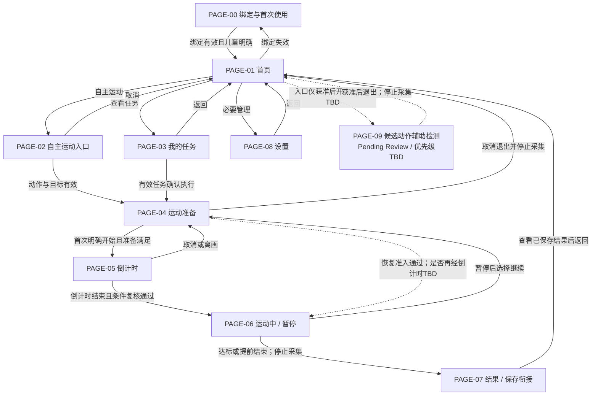

> **旧路径兼容快照（2026-10-12）**：后续维护请使用[Teamo_Device_UE_IA_v0.3.1.md](Teamo_Device_UE_IA_v0.3.1.md)。下方保留迁移前正文及历史，不作为独立维护入口。

# Teamo MVP设备端UE信息架构 v0.3.1

> Design Input Candidate / Pending Review · 2026-10-12 · v0.4功能大纲配套附录

### Document Control

|字段|内容|
|---|---|
|Document Type|UE Information Architecture|
|Current Version|v0.3.1|
|Status|Review（Design Input Candidate / Pending Review）|
|Owner|TBD；项目协调魏子奇，不等同批准人|
|Reviewer|TBD|
|Created Date|2026-10-12，沿用输入标识，待核实|
|Last Updated|2026-10-12|

## 0 文档定位与规则

本文是UE设计输入主文档，详细业务状态与异常材料进入独立工程附录，工程细则在FR阶段确认。

### 0.1 Document Boundary

|本文负责|本文不负责|
|---|---|
|用户任务、页面职责、信息结构、状态展示逻辑|UI视觉、硬件尺寸、接口协议、算法实现、测试标准|

页面≠实体屏幕，功能≠页面，候选能力≠已确认能力。本文不是交互稿、硬件定义稿或范围冻结稿，不确定控件、手势或输入器件。

依据：[功能大纲v0.4](Teamo_MVP_设备端软件功能大纲_v0.4_冻结候选_20261012.md)、[UE IA v0.3](Teamo_MVP_设备端UE信息架构_v0.3_20261012.md)。保留PAGE-00–09、功能编号与映射、原P0/P1；v0.4所有有效功能仍Pending Review。候选能力保持Candidate / Pending Review / 优先级TBD，已有行为未决细节标TBD。

### 0.2 附录引用

[工程附录](Teamo_MVP_UE工程附录.md)：A详细状态/PAGE线框，B异常依据，C原页面约束，D原映射，E完整问题材料，F原交接依据。附录保留原业务约束，不是已冻结工程实现，不定义API字段、数据结构、客户端枚举或算法实现。

Requirement是已有需求意图，不创建需求ID；TC-TBD表示用例未建立/未确认，不代表测试通过。后续UI Flow/FR/Test Case需明确引用本版及批准依据。

## 1 User Journey 用户旅程

旅程是基于既有功能的设计输入，不代表已完成用户研究或实机验证。设计机会仅用于提升已有信息的理解，不新增产品能力。

### 1.1 儿童首次使用旅程

用户目标：在家长协助下了解设备可用状态、完成有效家庭与儿童上下文确认，开始一次运动并理解结果。触发条件：未绑定设备首次启动；恢复出厂后重走此旅程仅在该候选获准后适用。

| 阶段 / PAGE | 用户行为与目标 | 用户疑问 | 系统响应 / 关键状态 | 风险 | 设计机会 |
|---|---|---|---|---|---|
| 开机 / PAGE-00或01 | 儿童开机，家长协助；知道是否可用 | 能开始了吗？ | 初始化、检查网络及绑定，路由到首次使用或首页 | 不知道等待原因 | 区分正在初始化与需家长处理 |
| 连接与绑定 / PAGE-00 | 家长按确认方案操作，儿童等待 | 连网了吗？绑定成功了吗？ | 未绑定→等待→处理中→有效绑定；失败说明原因 | 把连网或扫码当绑定成功 | 区分连接、处理中、关系已确认；方案TBD |
| 当前儿童确认 / PAGE-00，承载TBD | 家长确认使用儿童 | 这次运动记给谁？ | 读取有效儿童上下文，不明确则待确认 | 成绩错归属 | 明确当前归属及未确认原因，不引入账号创建 |
| 选择运动 / PAGE-01→02或03 | 儿童选择自主目标或家长任务 | 做什么？做多少？ | 展示有效动作、目标、来源；无任务如实说明 | 两入口被误认为两套运动 | 相同动作/目标语言和共用准备入口 |
| 准备与开始 / PAGE-04→05 | 理解动作，站好并明确开始 | 为什么不能开始？何时开始？ | 隐私准入、入镜引导、条件满足后倒计时并复核 | 未授权采集、准备不足开练 | 给一个主要可处理原因，说明恢复路径 |
| 执行 / PAGE-06 | 运动，必要时暂停或结束 | 算了几次？为什么暂停？ | 可信计数与提示，暂停保留成绩 | 不确定计数、结束压力 | 区分识别状态与已确认进度，保留真实努力 |
| 结束 / PAGE-07→01 | 看结果并结束本次体验 | 达标了吗？保存了吗？家长收到了吗？ | 真实结果、保存状态、独立同步状态 | 把提前结束、保存、同步混淆 | 分开表达三种事实，不伪称达标或送达 |

联网与绑定先后、输入、说明媒体及儿童确认方式TBD；二维码不是默认技术方案。

### 1.2 日常运动旅程

触发条件：日常开机、查看任务或选择自主运动。目标：以正确儿童归属完成真实运动闭环，理解异常及记录状态。

| 用户任务 | 页面职责 / 路径 | 关键状态与系统响应 | 设计边界 |
|---|---|---|---|
| 恢复可用环境 | 初始化→PAGE-01；绑定失效转PAGE-00，儿童待确认承载PAGE-00/08，TBD | 恢复已保存任务、记录、隐私，不自动续计 | 断网不等于解绑，恢复范围TBD |
| 自主开练 | PAGE-01→02 | 选支持动作→确认允许目标；标记自主来源 | 不修改家长目标，不独立计数 |
| 执行家长任务 | PAGE-01→03 | 无任务/列表/详情→确认有效任务 | 任务到达不自动采集或开始 |
| 完成准备 | 两入口汇合PAGE-04→05 | 目标/归属有效，隐私允许，准备满足，儿童明确开始 | 无效条件阻断，倒计时不计数 |
| 运动及恢复 | PAGE-06；暂停继续回PAGE-04 | RUNNING/PAUSED，次数可信且保留 | 恢复是否再倒计时TBD，不绕过准入 |
| 理解结果 | PAGE-07→01 | FINISHED与保存/同步事实分别表达 | 已保存不等于已同步；补传不阻断允许本地运动 |

### 1.3 启动规则追溯

首次启动：初始化→检查绑定与网络→未绑定PAGE-00→按评审方案连接/绑定→当前儿童确认→PAGE-01。

日常启动：初始化→恢复已保存任务、记录与隐私状态→按绑定及儿童上下文路由。缺少当前儿童不得错误归属，绑定失效进入引导，断网保持有效关系；恢复范围与具体契约TBD。

## 2 Information Architecture 信息架构

### 2.1 逻辑页面总览

| 页面编号 | 页面名称 | 用户任务 / 系统职责 | 主要入口与出口 |
|---|---|---|---|
| PAGE-00 | 绑定与首次使用 | 了解并完成有效绑定与儿童确认 | 未绑定/绑定失效 → PAGE-01 |
| PAGE-01 | 首页 | 获知机器人可用状态并选择运动或管理入口 | 日常启动/流程返回 → PAGE-02/03/08 |
| PAGE-02 | 自主运动入口 | 选择支持动作并确认自主目标 | PAGE-01 → PAGE-04 |
| PAGE-03 | 我的任务 | 查看任务列表/详情并确认执行 | PAGE-01 → PAGE-04 |
| PAGE-04 | 运动准备 | 理解动作、完成入镜准备与采集准入检查 | PAGE-02/03/恢复 → PAGE-05 |
| PAGE-05 | 倒计时 | 明确开始时机并复核准入条件 | PAGE-04 → PAGE-06 |
| PAGE-06 | 运动中 | 呈现可信进度并处理暂停、继续与结束 | PAGE-05 → PAGE-04/07 |
| PAGE-07 | 结果 | 理解真实成绩与保存、同步状态 | 结束保存 → PAGE-01 |
| PAGE-08 | 设置 | 查看设备状态并执行已映射的必要管理 | PAGE-01 → 设置分组/返回 |
| PAGE-09 | 候选动作辅助检测 | 独立辅助用途待评审 | 入口TBD，获准后退出回PAGE-01 |

PAGE-01采用“首页”：角色回应、快速入口、设备状态共同构成职责，不能理解为仅有表情动画。PAGE-02以“自主运动入口”代替“快速运动页面”，动作与目标配置结束即进入共用运动流程。PAGE-09改名仅澄清候选边界，不批准独立检测。

### 2.2 Navigation Map 导航地图

实线为已有职责的候选导航关系，仍继承v0.4 Pending Review；虚线为条件/TBD路线或未批准候选。图中没有新增PAGE。所有“返回/取消”表示业务去向，不定义交互控件。

PAGE-03无任务不是必经步骤；任务列表/详情实体拆分TBD。PAGE-07保存失败为状态分支，不新增失败PAGE；保存前不能称已记录。PAGE-09无默认入口。同步在后台独立处理，不作为导航必经页面。

## 3 Page Specification 页面定义

Page Type是职责分类，不确定实体页面或优先级。P0继承Related Function原P0，仍Pending Review；P1不代表已批准交付。

### PAGE-00 绑定与首次使用

|字段|内容|
|---|---|
|PAGE编号|PAGE-00|
|Page Name|绑定与首次使用|
|Page Type|Preparation Page|
|User Goal 用户目标|家长完成有效绑定与儿童确认|
|System Goal 系统目标|保证关系/归属真实，不创建账号|
|System Responsibility 系统职责|呈现绑定/连接状态、执行平台认可的绑定上下文与当前儿童确认；失败说明真实原因|
|Entry Condition 进入条件|首次未绑定、绑定失效或需要完成有效儿童确认|
|Exit Condition 退出条件|有效绑定且儿童明确→PAGE-01；失败、取消/超时契约TBD|
|Related Function|7.1.1、7.1.2、7.2.3；2.2.1、2.2.2支撑提示与操作确认|
|Business State|Pending Review，继承v0.4；未绑定、等待绑定、绑定处理中、绑定成功、儿童待确认、失败/异常|
|MVP Scope|P0：原映射（Pending Review）；P1：无新增；Future Candidate：二维码/帮助；Out of Scope：第5章|
|Pending Items|绑定契约、联网顺序、配网责任端、儿童确认方式TBD；二维码与专门绑定帮助为候选能力 / Pending Review / 优先级TBD|

### PAGE-01 首页

|字段|内容|
|---|---|
|PAGE编号|PAGE-01|
|Page Name|首页|
|Page Type|Hub Page|
|User Goal 用户目标|儿童判断可用性并找到运动入口|
|System Goal 系统目标|统一设备状态与既有角色回应|
|System Responsibility 系统职责|固定角色状态回应；自主运动、我的任务、设置入口；必要设备、网络与隐私状态|
|Entry Condition 进入条件|日常启动完成、退出运动或返回主入口|
|Exit Condition 退出条件|自主→PAGE-02；任务→PAGE-03；设置→PAGE-08；失效→PAGE-00|
|Related Function|2.1.1、2.1.2、2.2.1、7.1.2、8.1.2；5.2.2提供已有记录同步提示|
|Business State|Pending Review；可用、离线、隐私阻断、设备异常等业务状态；待同步是记录状态|
|MVP Scope|P0：原映射（Pending Review）；P1：无新增；Future Candidate：首页摘要/PAGE-09入口；Out of Scope：第5章|
|Pending Items|最小角色表情与触发深度TBD；今日任务数/完成摘要与PAGE-09入口均为候选能力 / Pending Review / 优先级TBD|

### PAGE-02 自主运动入口

|字段|内容|
|---|---|
|PAGE编号|PAGE-02|
|Page Name|自主运动入口|
|Page Type|Selection Page|
|User Goal 用户目标|儿童选择动作与自主目标|
|System Goal 系统目标|形成有效自主上下文，与家长任务区分|
|System Responsibility 系统职责|选择支持动作、确认允许次数目标，标记自主来源；交给PAGE-04执行|
|Entry Condition 进入条件|从首页选择快速运动/自主运动|
|Exit Condition 退出条件|有效动作、目标和归属→PAGE-04；取消→PAGE-01|
|Related Function|2.1.1、3.1.4；2.2.2确认操作|
|Business State|Pending Review；待选动作、待确认目标、目标已确认、不可执行、取消|
|MVP Scope|P0：原映射（Pending Review）；P1：无新增；Future Candidate：无新增独立候选；Out of Scope：第5章|
|Pending Items|目标范围、输入方式TBD；三动作与整体七动作关系继承v0.4待决结论|

### PAGE-03 我的任务

|字段|内容|
|---|---|
|PAGE编号|PAGE-03|
|Page Name|我的任务|
|Page Type|Selection Page|
|User Goal 用户目标|儿童理解并执行家长任务|
|System Goal 系统目标|仅执行有效任务，保持目标和归属|
|System Responsibility 系统职责|无任务状态、任务列表、任务详情、动作/目标/来源与执行状态；确认有效任务后交给PAGE-04|
|Entry Condition 进入条件|从首页查看任务或响应收到任务提示|
|Exit Condition 退出条件|有效任务确认→PAGE-04；返回列表/首页；无效不能开始|
|Related Function|3.1.3、3.1.4；3.1.1、3.1.2提供任务有效性与真实接收事实|
|Business State|Pending Review；无任务、列表、详情、执行确认；任务事实区分未开始、进行中、达标或提前结束|
|MVP Scope|P0：原映射（Pending Review）；P1：无新增；Future Candidate：无新增独立候选；Out of Scope：第5章|
|Pending Items|列表与详情实体页面是否拆分TBD；任务名称/时间的必要性、撤销/过期/重复规则TBD|

### PAGE-04 运动准备

|字段|内容|
|---|---|
|PAGE编号|PAGE-04|
|Page Name|运动准备|
|Page Type|Preparation Page|
|User Goal 用户目标|儿童理解动作并完成站位准备|
|System Goal 系统目标|保证隐私/准备准入，不累计成绩|
|System Responsibility 系统职责|动作/安全说明、动作与目标确认、隐私准入检查、依据人体与画面结果进行站位引导|
|Entry Condition 进入条件|自主目标确认、任务执行确认或暂停后选择继续|
|Exit Condition 退出条件|准备满足且明确首次开始→PAGE-05；取消退出停止采集；恢复路线TBD|
|Related Function|3.2.1、3.2.2、4.1.1、8.1.1；3.3.2用于恢复|
|Business State|Pending Review；待准备、调整站位、准备满足、隐私阻断、取消/恢复准备|
|MVP Scope|P0：原映射（Pending Review）；P1：无新增；Future Candidate：预览/骨架；Out of Scope：第5章|
|Pending Items|准备完成标准、说明形式与跳过规则、多人处理TBD；视频预览/骨架显示为候选能力 / Pending Review / 优先级TBD|

### PAGE-05 倒计时

|字段|内容|
|---|---|
|PAGE编号|PAGE-05|
|Page Name|倒计时|
|Page Type|Preparation Page|
|User Goal 用户目标|儿童知道何时开始|
|System Goal 系统目标|复核准入，禁止提前计数|
|System Responsibility 系统职责|倒计时及取消；结束复核准备、隐私和可用条件后进入PAGE-06|
|Entry Condition 进入条件|儿童明确开始且准备条件满足|
|Exit Condition 退出条件|完成复核→PAGE-06；取消/离画→PAGE-04；隐私失效阻断|
|Related Function|3.2.3；4.1.1、8.1.1提供准入条件|
|Business State|Pending Review；倒计时中、取消、条件失效、完成|
|MVP Scope|P0：原映射（Pending Review）；P1：无新增；Future Candidate：无新增独立候选；Out of Scope：第5章|
|Pending Items|时长、输入方式、恢复运动是否再次倒计时TBD|

### PAGE-06 运动中

|字段|内容|
|---|---|
|PAGE编号|PAGE-06|
|Page Name|运动中|
|Page Type|Active Session Page|
|User Goal 用户目标|儿童完成运动并了解进度|
|System Goal 系统目标|保证可信计数、暂停保留及真实结束|
|System Responsibility 系统职责|展示有效次数/目标与识别状态、短提示；暂停保留成绩、继续回准备、达标或提前结束|
|Entry Condition 进入条件|倒计时通过，或按确认规则恢复运动|
|Exit Condition 退出条件|暂停继续→PAGE-04；达标/提前结束→PAGE-07保存衔接；异常按原因处理|
|Related Function|3.3.1–3.3.3、4.1.1–4.1.3、4.2.1–4.2.3、5.1.1–5.1.2、8.1.1–8.1.2|
|Business State|Pending Review；运动中、暂停、识别异常、隐私阻断、结束|
|MVP Scope|P0：原映射（Pending Review）；P1：无新增；Future Candidate：无新增独立候选；Out of Scope：第5章|
|Pending Items|有效动作规则、暂停超时、恢复确认、结束输入TBD|

### PAGE-07 结果

|字段|内容|
|---|---|
|PAGE编号|PAGE-07|
|Page Name|结果|
|Page Type|Result Page|
|User Goal 用户目标|儿童理解真实成绩和记录状态|
|System Goal 系统目标|分开表达结束、保存和同步|
|System Responsibility 系统职责|呈现动作、目标、实际次数、用时、达标/提前结束、适度完成鼓励及保存/同步状态|
|Entry Condition 进入条件|达标、主动提前结束或按确认规则结束后|
|Exit Condition 退出条件|查看已保存结果后→PAGE-01；保存失败恢复与退出规则TBD；同步独立|
|Related Function|5.1.3、5.2.1、5.2.2；6.1.1–6.3.2提供记录事实与恢复处理|
|Business State|Pending Review；结束保存、保存失败、已保存结果；待同步/同步成功/失败独立变化|
|MVP Scope|P0：原映射（Pending Review）；P1：无新增；Future Candidate：运动星/PB深度另议，不重归类；Out of Scope：第5章|
|Pending Items|用时是否含暂停、保存失败恢复保证、基础运动星/PB深度TBD；不扩展成长体系|

### PAGE-08 设置

|字段|内容|
|---|---|
|PAGE编号|PAGE-08|
|Page Name|设置|
|Page Type|Settings Page|
|User Goal 用户目标|家长查看设备并执行必要管理|
|System Goal 系统目标|保证设备责任与家长权限边界|
|System Responsibility 系统职责|按下表组织已有状态与管理职责；不承接账号管理|
|Entry Condition 进入条件|从首页查看状态、处理连接/身份/隐私或必要重启|
|Exit Condition 退出条件|返回设置/首页；权限不足不执行；重启后按启动恢复|
|Related Function|1.2.3、1.2.5、7.1.1–7.1.2、7.2.3、8.1.1–8.1.2；8.2.2–8.2.3仅按既有责任提供支撑|
|Business State|Pending Review；设置概览、分组查看、操作确认、处理结果/异常|
|MVP Scope|P0：原映射（Pending Review）；P1：无新增；Future Candidate：声音/出厂恢复/更新/关于新增项等；Out of Scope：第5章|
|Pending Items|分组实体承载、家长确认、配网入口、数据删除和提醒设置责任端TBD；候选项见下表|

| 一级分组 | 已有职责 / 内容 | 未决范围 |
|---|---|---|
| 设备状态 | 软件版本1.2.3、绑定状态7.2.3 | 状态表达TBD，不据此新增诊断功能 |
| 网络连接 | 网络状态7.1.2、必要联网配置7.1.1 | 配网入口与责任端TBD；更换网络/专门检测入口为候选能力 / Pending Review / 优先级TBD |
| 当前儿童 | 当前儿童确认7.2.3 | 多儿童切换流程TBD；设备不负责账号管理，不默认人脸识别 |
| 隐私控制 | 真实摄像头状态、授权允许/阻断状态、停止采集8.1 | 本地开关形式TBD；授权由家长端/平台管理；8.2.2本地删除执行不等于已确定设备端删除入口 |
| 系统设置 | 必要重启1.2.5 | 重启触发与确认TBD；恢复出厂为候选能力 / Pending Review / 优先级TBD |
| 关于设备 | 基础设备说明的候选归类 | 设备名称/SN与说明内容为候选能力 / Pending Review / 优先级TBD；可与设备状态合并，TBD，不重复新增版本能力 |

### PAGE-09 候选动作辅助检测

|字段|内容|
|---|---|
|PAGE编号|PAGE-09|
|Page Name|候选动作辅助检测|
|Page Type|Preparation Page（候选归类）|
|User Goal 用户目标|独立辅助的明确用户任务尚未形成|
|System Goal 系统目标|仅获准后提供受限辅助与隐私控制|
|System Responsibility 系统职责|候选的人体在场、画面可用性与站位辅助；独立范围尚未确定|
|Entry Condition 进入条件|仅在候选能力获准后主动进入；当前无默认入口|
|Exit Condition 退出条件|获准后退出停止采集→PAGE-01；独立异常/恢复TBD|
|Related Function|4.1.1与3.2.2仅为可复用依据，8.1为隐私约束；无已批准独立功能号|
|Business State|候选能力 / Pending Review / 优先级TBD；以下状态仅供评审|
|MVP Scope|Future Candidate：独立用户任务未明确，Candidate / Pending Review / 优先级TBD；P0/P1：无独立映射；Out of Scope：医疗/健康/姿态评分|
|Pending Items|是否纳入、独立采集意图、授权、开始/退出规则、提示范围TBD；骨架显示与动作辅助提示均为候选能力 / Pending Review / 优先级TBD|

## 4 User Flow 用户流程

### 4.1 共用运动路径

自主运动：PAGE-01首页 → PAGE-02自主运动入口（选择动作 → 确认目标）→ PAGE-04准备 → PAGE-05倒计时 → PAGE-06运动 → 结束保存 → PAGE-07结果 → PAGE-01。

家长任务：PAGE-01首页 → PAGE-03任务列表 → 任务详情 → 确认执行 → PAGE-04准备 → 同一PAGE-05/06/07流程 → PAGE-01。

两种入口仅提供不同来源的动作、目标与归属上下文，共用准入、识别计数、暂停恢复、结果生成、保存与同步。返回页面不得重建运动记录、修改家长目标或递增成绩。

PAGE-06暂停 → 继续 → PAGE-04重新准备 → 按评审规则恢复PAGE-06；是否经PAGE-05再次倒计时TBD。暂停结束进入结束保存。保存失败进入相应恢复分支，不能伪称已保存。同步是记录的独立状态，不阻断已允许的本地运动。

### 4.2 业务状态引用

以下是展示逻辑，不是工程状态机。全表Pending Review；具体条件及PAGE线框见[工程附录A](Teamo_MVP_UE工程附录.md#appendix-a)。

|状态|目的 / 业务含义|影响页面|备注 / TBD|
|---|---|---|---|
|INIT|动作/任务与归属确认|PAGE-02/03；儿童确认PAGE-00/08|不等于开机；记录创建时机TBD|
|READY|准备阶段|PAGE-04|标签不等于准备已满足；准入条件TBD，不计数|
|COUNTDOWN|明确开始时机|PAGE-05|不计数；时长和恢复适用TBD|
|RUNNING|可信运动进度|PAGE-06|阈值TBD，不确定事件不计|
|PAUSED|暂停并保留成绩|PAGE-06；继续回PAGE-04|不新增/清零；超时和恢复TBD|
|FINISHED|真实运动结束|PAGE-06/07|区分达标/提前结束，不代表保存|
|SAVED|本地保存成功|PAGE-07/01|不代表已同步；保证与周期TBD|
|SYNCING|正在上传/补传|PAGE-07/01，后台|独立状态，不阻断允许运动；契约TBD|
|SYNCED|平台业务确认接收|PAGE-07/01，后台|发送完成不等于接收；冲突TBD|

绑定展示：未绑定→等待绑定→处理中→成功→当前儿童确认→正常使用。解绑/异常为分支，断网不解绑，不创建账号；二维码方案与契约TBD。执行/保存/同步分别表达，完成运动≠已保存≠已同步，可同时显示“提前结束 / 已保存 / 待同步”。

### 4.3 用户可见异常摘要

详细工程处理均TBD / FR阶段定义；[工程附录B](Teamo_MVP_UE工程附录.md#appendix-b)保留原业务依据。反馈给出可确认原因，不使用笼统“系统异常，请重试”；不能确认时如实说明，不编造故障。

|异常|影响|页面|用户反馈|恢复方向|
|---|---|---|---|---|
|初始化或必要运行服务不可用|无法进入可用状态|PAGE-00/01|说明当前启动/服务不可用，具体原因可确认才显示|约定重试/返回/必要重启→重新初始化；故障范围/时限TBD；工程细则TBD / FR阶段定义|
|网络断开|新任务获取或结果同步受影响|PAGE-01/03/07/08|说明离线与记录真实同步状态|保留有效绑定；继续允许的缓存/本地能力；连接恢复按契约补传；工程细则TBD / FR阶段定义|
|绑定请求失败或关系不可确认|无法完成有效绑定准入|PAGE-00|区分未绑定、处理中失败、关系失效；不称成功|回等待/引导或既有有效关系状态；恢复契约TBD，不静默解绑；工程细则TBD / FR阶段定义|
|当前儿童归属不明确|不能正确关联成绩|PAGE-00/08，承载TBD|说明儿童未确认，需完成归属确认|按有效上下文确认后回原任务/自主准备；不默认人脸识别；工程细则TBD / FR阶段定义|
|动作/目标/任务有效条件不满足|无法开始该运动|PAGE-02/03|给出已验证的不支持动作、目标无效或任务无效原因|自主重新选择允许目标，任务返回列表；撤销/过期细则TBD，不静默改家长目标；工程细则TBD / FR阶段定义|
|隐私关闭、未授权、撤权或状态未知|无法采集或继续识别|PAGE-04/05/06/08|真实说明采集已阻断/停止及对应隐私原因|停止采集和新增成绩；有效授权及本地条件恢复后重新准备并确认，响应时限TBD；工程细则TBD / FR阶段定义|
|无人、身体不完整或画面不可用|未满足开始条件|PAGE-04/05|给一个主要站位/入镜原因|调整后重新检查；倒计时离画回PAGE-04，不提前计数；工程细则TBD / FR阶段定义|
|离画、遮挡或识别不可用需暂停|暂停新增成绩|PAGE-06|说明已判定原因及成绩保留|暂停→调整→选择继续→PAGE-04重新准入；可按原规则结束；工程细则TBD / FR阶段定义|
|单个动作事件不完整/不确定|该事件不计|PAGE-06|必要时说明当前无法确认，不作确定纠错|不计该事件，不必一律暂停；若判定识别异常，按暂停分支处理；阈值TBD；工程细则TBD / FR阶段定义|
|本地保存失败|结果尚未可靠记录|PAGE-07|说明尚未保存，不能称已记录|保留可恢复结果供重试；成功后展示已保存，失败恢复保证/退出规则TBD；工程细则TBD / FR阶段定义|
|上传失败或缺少业务接收确认|家长端尚未确认收到|PAGE-07/01|保持已保存，说明待同步/失败待补传|按契约重试，沿用原记录标识；平台去重，不阻断允许本地运动；工程细则TBD / FR阶段定义|
|重启/断电后恢复范围不足|本次进度或记录可能不完整|PAGE-01/06/07，承载TBD|仅说明可恢复真实成绩和不能确认部分|恢复已保存事实，不自动续计或伪造完成；不可恢复处理TBD；工程细则TBD / FR阶段定义|
|家长权限不满足/不可确认|不能执行该管理操作|PAGE-08|说明需有效家长权限，未执行|保持原有效状态，按责任端重新完成权限确认；入口及方式TBD；工程细则TBD / FR阶段定义|
|候选绑定二维码凭据失效|无法继续该绑定路径|PAGE-00|区分凭据过期与已有关系失败|按获准方案重取或替代路径；当前不承诺此技术方案；工程细则TBD / FR阶段定义|

异常不导致未经授权采集、清零成绩、虚假达标、重复结果或错误解绑。PAGE-09获准后须补齐独立异常规则，当前Candidate / Pending Review / 优先级TBD。

## 5 MVP Scope Boundary MVP范围边界

|分类|使用规则|
|---|---|
|P0|继承v0.4原核心/支撑优先级，“必须实现”以范围批准为前提，当前Pending Review|
|P1|继承v0.4后续候选，不等于已批准计划交付，不自动新增PAGE|
|Future Candidate|未确认独立能力/入口，Candidate / Pending Review / 优先级TBD|
|Out of Scope|明确不做或禁止越界，不取消既有能力|

更多动作、运动训练建议、个性化成长、内容与语音陪练保留v0.4第9章原P1后续候选，不统一改成优先级TBD，也不纳入默认页面。学校任务、体态、OTA、诊断继续原追踪，范围及优先级TBD。三/七动作关系未冻结；角色表情、基础鼓励、版本及删除执行原P0不变，深度/入口TBD。

PAGE-09、二维码/帮助、首页摘要、预览/骨架、声音、恢复出厂、更新入口、关于新增信息、更换网络/专门检测入口保持Candidate / Pending Review / 优先级TBD。准备检测不等于独立姿态分析，提醒约束不等于声音设置。

### 保留的业务约束

|领域|约束|
|---|---|
|隐私|数据最小化，原始摄像帧不持久化，不进记录/日志/缓存，不上传持久化；未授权、关闭、撤权或未知禁止采集；退出/结束停止采集|
|准入|任务到达不自动采集或开始；远程任务不绕过本地关闭；准备/倒计时不计数|
|计数|不完整、重复、不确定事件不计；低置信度不作确定纠错；页面不生成另一套成绩|
|暂停|不新增/清零成绩；恢复重新检查隐私/准备；超时和再倒计时TBD|
|目标结果|不改家长目标，不把自主当家长任务；提前结束不伪称达标；用时口径TBD|
|记录|唯一标识及正确归属；返回不重建结果、改目标或增次数；补传防重复，不重复已批准奖励|
|保存同步|未保存不称已记录，发送不称接收；同步不阻断允许本地运动；保证/周期TBD|
|恢复绑定|断网不解绑，失败不解除已有有效关系；重启恢复真实事实，不自动续计；范围TBD|
|权限职责|设备不创建账号/管理云端关系；受限管理须家长权限；本地删除/出厂恢复不等于解绑/注销|
|产品安全|无广告、儿童充值、陌生人社交或公开身体数据；不开放聊天、医疗/身材/姿态评分、视频监控，不新增成长等级/未确认AI能力|

学校授权小范围分享继续原独立评审，不误删原追踪。完整原业务约束保留于工程附录，摘要不取消既有职责或未决契约。

## 6 Requirement Traceability 需求追踪矩阵

Requirement取v0.4已有用户价值/需求意图，不创建需求ID；Function编号及名称沿用v0.4对应表。PAGE包含触发/呈现及后台支撑，State为展示语义。TC-TBD表示未建立/确认用例，不表示已验证。

|Requirement|Function|PAGE / 关系|State|Test Case|
|---|---|---|---|---|
|让家庭知道设备能否开始使用。|1.1.1 开机与初始化|PAGE-00/01启动路由支撑，无新增启动PAGE|启动/恢复（非INIT）|TC-TBD|
|重启后回到正确状态，不自动续计或伪称完成。|1.1.2 恢复启动状态|PAGE-00/01启动路由支撑，无新增启动PAGE|启动/恢复（非INIT）|TC-TBD|
|状态一致，避免同一操作在不同入口产生冲突。|1.2.1 设备运行状态管理|PAGE-00–08状态与异常支撑|设备/故障展示|TC-TBD|
|故障时能够理解原因并恢复使用。|1.2.2 设备故障处理|PAGE-00–08状态与异常支撑|设备/故障展示|TC-TBD|
|便于核对设备版本和定位兼容问题。|1.2.3 查看设备软件版本|PAGE-08设备状态|设备/故障展示|TC-TBD|
|故障可定位、可复盘。|1.2.4 故障信息记录|后台记录支撑，无独立页面承诺|设备/故障展示|TC-TBD|
|无法正常使用时有恢复入口。|1.2.5 设备重启|PAGE-08系统设置|设备/故障展示|TC-TBD|
|减少寻找入口和开练阻力。|2.1.1 运动入口|PAGE-01/02/03|首页/运动状态回应|TC-TBD|
|运动中获得一致且适度的角色回应。|2.1.2 显示角色状态表情|PAGE-01；PAGE-04–07按已有运动事件回应，承载TBD|首页/运动状态回应|TC-TBD|
|知道设备当前是否可用，以及怎样处理问题。|2.2.1 设备状态提示|PAGE-00–08通用支撑|操作反馈/状态展示|TC-TBD|
|清楚操作是否生效。|2.2.2 操作接收与确认|PAGE-00–08通用支撑|操作反馈/状态展示|TC-TBD|
|收到可执行而非无效任务。|3.1.1 接收并检查运动任务|PAGE-03消费后台接收事实，不新增接收页面|INIT / 任务有效性|TC-TBD|
|家长知道任务是否真实送达。|3.1.2 反馈任务接收结果|PAGE-03消费后台接收事实，不新增接收页面|INIT / 任务有效性|TC-TBD|
|儿童明白为什么做、做多少。|3.1.3 展示任务内容与执行状态|PAGE-03|INIT / 任务有效性|TC-TBD|
|运动目标清楚，自主运动与家长任务不混淆。|3.1.4 动作与目标确认|PAGE-02/03|INIT / 任务有效性|TC-TBD|
|减少不理解动作造成的失败。|3.2.1 动作说明|PAGE-04|READY / COUNTDOWN|TC-TBD|
|知道如何站好，准备完成后再开练。|3.2.2 入镜准备引导|PAGE-04；PAGE-09仅候选复用依据|READY / COUNTDOWN|TC-TBD|
|有时间准备，避免突然计数。|3.2.3 开始确认与倒计时|PAGE-04/05|READY / COUNTDOWN|TC-TBD|
|已完成努力不因中断消失。|3.3.1 暂停与成绩保留|PAGE-06/04；再次经过PAGE-05与否TBD|RUNNING / PAUSED / FINISHED|TC-TBD|
|安全且连贯地继续运动。|3.3.2 恢复运动|PAGE-06/04；再次经过PAGE-05与否TBD|RUNNING / PAUSED / FINISHED|TC-TBD|
|不强迫继续，不伪造达标。|3.3.3 达标与提前结束|PAGE-06 → PAGE-07|FINISHED|TC-TBD|
|避免在看不清动作时开始计数。|4.1.1 人体与画面可用性检测|PAGE-04/05/06；PAGE-09仅候选复用依据|READY / COUNTDOWN / RUNNING / PAUSED|TC-TBD|
|孩子和家长得到可信成绩。|4.1.2 有效动作计数|PAGE-06，异常准备原因由PAGE-04承接|READY / COUNTDOWN / RUNNING / PAUSED|TC-TBD|
|知道如何调整，而非被错误指责。|4.1.3 判定运动识别异常|PAGE-06，异常准备原因由PAGE-04承接|READY / COUNTDOWN / RUNNING / PAUSED|TC-TBD|
|完整开合跳被可信记录。|4.2.1 开合跳动作判定|PAGE-06计数依据，不新增动作范围|RUNNING|TC-TBD|
|完整深蹲被可信记录。|4.2.2 深蹲起动作判定|PAGE-06计数依据，不新增动作范围|RUNNING|TC-TBD|
|目标与实际成绩使用一致口径。|4.2.3 高抬腿动作判定|PAGE-06计数依据，不新增动作范围|RUNNING|TC-TBD|
|看见实际努力和距目标的差距。|5.1.1 次数与进度反馈|PAGE-06|RUNNING / FINISHED|TC-TBD|
|得到可理解指导且减少挫败。|5.1.2 动作反馈与调整提示|PAGE-06|RUNNING / FINISHED|TC-TBD|
|获得尊重真实努力的反馈。|5.1.3 完成鼓励|PAGE-07|RUNNING / FINISHED|TC-TBD|
|儿童结束后能理解本次努力。|5.2.1 运动结果查看|PAGE-07|FINISHED / SAVED / SYNCING / SYNCED|TC-TBD|
|不把运动结束误解为已回传。|5.2.2 保存与同步提示|PAGE-07；必要同步提示PAGE-01|FINISHED / SAVED / SYNCING / SYNCED|TC-TBD|
|每次运动可以追溯到正确儿童。|6.1.1 记录创建与归属|PAGE-02/03/06/07共用事实支撑，无重复记录系统|创建时机TBD / FINISHED|TC-TBD|
|可信查看真实完成情况。|6.1.2 生成运动结果记录|PAGE-02/03/06/07共用事实支撑，无重复记录系统|创建时机TBD / FINISHED|TC-TBD|
|离线可使用、不丢记录。|6.2.1 本地保存|PAGE-01/03/06/07消费保存恢复事实；后台处理|保存维度：SAVED / 未保存|TC-TBD|
|重启后不产生重复或虚假的运动记录。|6.2.2 已保存记录恢复|PAGE-01/03/06/07消费保存恢复事实；后台处理|保存/恢复：SAVED或失败|TC-TBD|
|不误导家长或静默丢失。|6.2.3 保存失败处理|PAGE-01/03/06/07消费保存恢复事实；后台处理|保存/恢复：SAVED或失败|TC-TBD|
|家长查看同一真实记录。|6.3.1 上传结果并更新同步状态|PAGE-07/01消费独立同步状态，后台处理|SAVED / SYNCING / SYNCED|TC-TBD|
|没有重复记录或虚假成长。|6.3.2 补传失败结果并防重复|PAGE-07/01消费独立同步状态，后台处理|SAVED / SYNCING / SYNCED|TC-TBD|
|可完成连接并理解故障。|7.1.1 网络连接管理|PAGE-00/08；PAGE-01必要状态提示|在线/离线（独立维度）|TC-TBD|
|理解联网状态与当前可用能力。|7.1.2 联网状态提示|PAGE-00/08；PAGE-01必要状态提示|在线/离线（独立维度）|TC-TBD|
|家长端了解设备可用状态。|7.2.1 设备状态同步|后台同步支撑，非独立页面|绑定/儿童/设备状态|TC-TBD|
|避免记录分配给错误儿童。|7.2.3 绑定状态与当前儿童确认|PAGE-00/08；PAGE-01使用有效上下文|绑定/儿童/设备状态|TC-TBD|
|家长边界可控且可解释。|8.1.1 检查授权并阻断不允许的采集|PAGE-04/05/06/08，PAGE-01必要提示；PAGE-09获准后亦须遵守|隐私准入/采集状态|TC-TBD|
|知道摄像头是否工作，并能停止采集。|8.1.2 摄像头状态提示与关闭|PAGE-04/05/06/08，PAGE-01必要提示；PAGE-09获准后亦须遵守|隐私准入/采集状态|TC-TBD|
|可管理设备数据的使用和清理。|8.2.2 处理设备数据权限与删除请求|后台执行与回执；PAGE-08设备端入口TBD|权限/提醒约束|TC-TBD|
|减少重复催促和夜间打扰。|8.2.3 提醒时段与频率控制|PAGE-01/06/07等提示输出约束；PAGE-08设置入口TBD，不等于声音控制|权限/提醒约束|TC-TBD|

### 历史、约束与候选追踪

|Requirement|Function|PAGE|State|Test Case|
|---|---|---|---|---|
|通信去向追溯|7.2.2 Deprecated→6.3.1|沿用6.3.1，不重复实现|同步维度|TC-TBD；不新增重复功能用例|
|视频不保存|8.2.1 Deprecated→8.3约束|全部PAGE|全局约束|TC-TBD|
|全局隐私/安全|8.3约束，不计新功能|全部PAGE|跨流程|TC-TBD|
|独立辅助用途待明确|无批准独立编号；4.1.1/3.2.2仅复用依据|PAGE-09|候选采集/退出TBD|TC-TBD；Candidate / Pending Review / 优先级TBD|

原范围级4.1、5.2、8.1等及完整映射保留于[工程附录D](Teamo_MVP_UE工程附录.md#appendix-d)。正式FR/测试建立后填入实际引用，不编造编号、阈值或验收标准；其他P1/未决追踪继续v0.4第9章，不虚构PAGE。

## 7 Design Handoff 设计交接规范

必须表达的信息需可理解，不要求全部常驻、不指定控件。未指定品牌时跟随系统浅/深色和语义色、中性底色。

|PAGE|必须表达|禁止设计内容|待确认项|
|---|---|---|---|
|PAGE-00|连接/绑定阶段、下一步、儿童归属|设备创建账号，默认二维码|UE-OQ-01/04/10|
|PAGE-01|角色回应、运动/任务/设置入口、可用状态|仅表情无入口，聊天，默认候选入口|UE-OQ-07/08/09|
|PAGE-02|支持动作、目标、自主来源与有效性|不支持动作开练，任意目标，第二套流程|UE-OQ-03|
|PAGE-03|无任务/列表/详情，动作/目标/来源/执行状态|改家长目标，任务到达自动采集|UE-OQ-02/04|
|PAGE-04|动作说明、目标、准备原因、隐私准入|准备不足开始，默认预览/骨架|UE-OQ-05/09|
|PAGE-05|开始时机、取消和复核结果|倒计时计数，条件失效继续|UE-OQ-05|
|PAGE-06|当前动作、有效次数、目标进度、识别/暂停状态|医疗/身材评价、成长等级、未确认AI能力|UE-OQ-03/05|
|PAGE-07|真实结果、结束原因、保存与同步分别表达|提前结束称达标，发送称收到|UE-OQ-06/07|
|PAGE-08|设备/网络/儿童/隐私/必要重启，权限和结果|账号管理，云端注销，默认候选设置|UE-OQ-09/10|
|PAGE-09|仅获准后表达用途、准入、辅助状态及退出|当前默认交付，医疗/姿态评分|UE-OQ-08|

第3章提供完整PAGE条件和Pending Items，第8章提供待决项。交接引用版本、PAGE、功能号、展示状态与UE-OQ；候选单列。实际输入约束来自硬件，工程细则FR定义，测试标准由后续用例确定，责任人与批准证据TBD。

## 8 Open Questions 评审问题

条目可展开；背景、影响、输入与完整原问题保留于[工程附录E](Teamo_MVP_UE工程附录.md#appendix-e)。Owner/Reviewer未指定，文档完善不代表问题已解决。

UE-OQ-01 · 绑定方案、联网依赖、成功确认及失败恢复；是否采用二维码

关联范围：PAGE-00、绑定模型。状态：TBD。

**待确认**：联网/绑定顺序、责任端、成功依据、失败/取消/超时路径；二维码采用与失效恢复须单独确认。

**预期结论**：形成绑定链路和逐异常去向；二维码仍候选。

UE-OQ-02 · 列表/详情及设置分组是否拆分；操作输入和屏幕承载

关联范围：PAGE-00–08。状态：TBD；不决定硬件。

**待确认**：列表/详情与设置是否拆分，信息分步关系，实际硬件下选择/开始/暂停/继续/结束/返回如何完成。

**预期结论**：形成逻辑PAGE与实体承载及输入关系，不改PAGE号、不推导硬件。

UE-OQ-03 · 自主目标范围与三/七动作关系

关联范围：PAGE-02/06、v0.4 OQ-01。状态：TBD。

**待确认**：三动作是演示还是产品MVP，七动作去向；逐动作目标范围和高抬腿计数单位。

**预期结论**：记录动作范围、目标/计数口径与依据；范围变化另行变更单。

UE-OQ-04 · 任务撤销/过期/重复、多儿童及归属确认

关联范围：PAGE-00/03/08。状态：TBD。

**待确认**：撤销/过期在各执行阶段的处理、重复投递、多儿童确认与切换、任务和记录归属。

**预期结论**：按阶段定义有效性与身份条件；不默认人脸识别、不改家长目标。

UE-OQ-05 · 准备条件、说明跳过、暂停超时及恢复倒计时

关联范围：PAGE-04/05/06。状态：TBD。

**待确认**：准备条件、多人规则、说明跳过、暂停超时、异常恢复及是否再倒计时。

**预期结论**：记录准入与原因—恢复条件；隐私重查、成绩保留，参数TBD。

UE-OQ-06 · 保存失败承载、断电恢复、用时及同步确认契约

关联范围：PAGE-07、记录模型。状态：TBD。

**待确认**：保存失败承载/重试/保证，断电恢复范围，用时是否含暂停，业务确认/补传/冲突。

**预期结论**：执行、保存、同步分别确认；未保存不称记录，发送不称接收。

UE-OQ-07 · 角色表情与基础完成鼓励深度

关联范围：PAGE-01/07。状态：Pending Review；不改P0。

**待确认**：最小角色事件/资源、触发与频率、达标/提前结束鼓励、基础运动星/PB深度。

**预期结论**：保持原P0，单列深度结论，不新增聊天或成长体系。

UE-OQ-08 · 独立动作辅助检测是否纳入及其授权/退出边界

关联范围：PAGE-09。状态：候选能力 / Pending Review / 优先级TBD。

**待确认**：独立检测任务和必要性；若纳入需明确入口、授权、输出、异常、停止采集；骨架/提示分别评审。

**预期结论**：记录纳入/延期/不纳入及条件；当前不开放入口，继续候选。

UE-OQ-09 · 首页摘要、绑定帮助、预览/骨架、关于信息、声音、出厂恢复、更新等是否需要

关联范围：相关候选分支。状态：候选能力 / Pending Review / 优先级TBD。

**待确认**：摘要、帮助、预览/骨架、关于信息、声音、出厂恢复、更新逐项必要性和依据。

**预期结论**：逐项记录去向/责任/影响，不以“设置通过”批量批准。

UE-OQ-10 · 配网、授权、删除、提醒设置及家长确认的责任端与入口

关联范围：PAGE-00/08。状态：TBD；保持v0.4跨端责任。

**待确认**：配网/授权/删除/提醒的发起端、权限、设备回执、离线及本地/云端边界。

**预期结论**：逐操作明确责任与入口，不把本地处置等同账号/云端生命周期。

UE-OQ-11 · 正式评审Owner、批准记录与后续FR引用版本

关联范围：全文。状态：TBD。

**待确认**：具体Owner/Reviewer、引用版本、批准证据、冻结/延期条件、结论回写和追踪。

**预期结论**：记录确认人、日期、证据和影响；自检不当签核，未批准继续Review。

## 9 Document Review

|检查项|结果|
|---|---|
|PAGE及导航|10个PAGE保留，候选入口不默认开放|
|功能编号/映射|47项有效功能逐项追踪，2项Deprecated及范围级索引保留|
|范围/优先级|不新增能力，不改MVP或P0/P1；P1不包装成批准交付|
|候选状态|保持Candidate / Pending Review / TBD|
|UE/工程边界|正文到展示语义，详细依据独立附录，工程处理FR定义|
|PAGE字段|10个PAGE各有12项定义字段|
|业务约束|正文关键约束与附录原详细依据保留|
|需求追踪|Requirement→Function→PAGE→State→Test，无实际用例均TC-TBD|
|设计输入|页面、导航、异常反馈和待确认明确；承载/输入TBD|
|评审材料|11项问题编号不变，完整材料可引用，责任人/结论TBD|

文档自检不等于范围批准、算法验证、测试执行或实机通过。影响PRD/画布/大纲的范围变化须另行“旧口径—新证据—建议修改”，不得静默覆盖。

## 10 Version History

Author为文档更新归属，不代表审核或批准人；Owner、Reviewer及历史批准证据TBD。

|版本|日期|变更|状态|
|---|---|---|---|
|v0.1|2026-10-12|初建PAGE、启动与共用运动流程|Pending Review|
|v0.2|2026-10-12|规范PAGE、设置、状态与映射|Pending Review|
|v0.3|2026-10-12|新增旅程、导航、状态、异常及交接，不新增能力|Design Input Candidate / Pending Review|
|v0.3.1|2026-10-12|企业级文档结构优化；拆分UE职责与工程状态定义；增加Page Type、Goal字段、MVP Scope和Requirement Traceability；不新增产品能力|Design Input Candidate / Pending Review|

|Version|Date|Author|Status|Change Summary|
|---|---|---|---|---|
|v0.3.0|2026-10-12|Product Documentation Update|Review|继承v0.3设计输入候选基线，更早记录见历史输入|
|v0.3.1|2026-10-12|Product Documentation Update|Review|重组主文档与工程引用，增加PAGE字段及47项有效功能追踪，压缩异常/交接，无能力变化|

### Change Impact

Patch：调整文档组织和既有说明，能力、流程、编号与优先级不变。新主文档/附录是候选交付，v0.3与v0.4保留原样。后续UI Flow/FR/Test Case明确引用v0.3.1，原链接不自动替代。

[变更单](../../governance/CHANGE-UE-IA-V031-20261012.md) · [输入SHA256](../../governance/backups/ue-ia-v031-20261012/sha256.json)。风险Low，Owner/Reviewer组织未决项评审。

### Decision Log

本次文档边界与Author展示调整，无产品范围、功能取舍、硬件、账号体系或优先级决策。附录保留既有依据，工程处理TBD / FR阶段定义。
