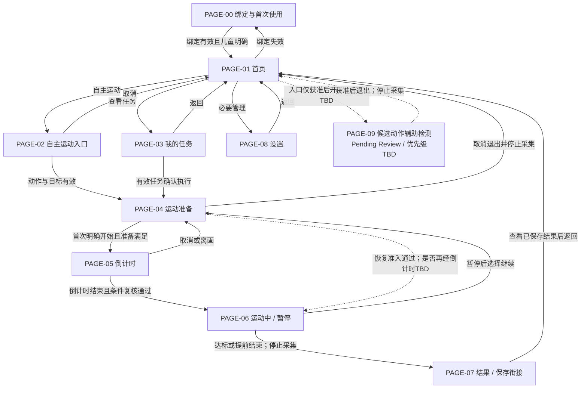

# Teamo MVP设备端UE信息架构 v0.3

> 设计输入候选版 / Pending Review · 2026-10-12 · v0.4功能大纲配套附录A

### Document Control

| 字段 | 内容 |
|---|---|
| Document Type | UE Information Architecture |
| Current Version | v0.3.0（业务版本v0.3） |
| Status | Review（设计输入候选版 / Pending Review） |
| Owner | 待确认；项目协调魏子奇，不等同文档批准人 |
| Reviewer | 待指派 |
| Created Date | 2026-10-12，沿用输入标识，待Owner核实 |
| Last Updated | 2026-10-12 |

## 0 文档定位与规则

本文连接“功能大纲 → UE设计 → UI设计 → FR需求”，定义逻辑页面、用户任务、系统职责、业务状态及功能映射。不是UI设计稿，不规定视觉样式、控件布局、输入方式或硬件形态。逻辑页面不等于实体屏幕数量，页面清单不等于MVP已承诺功能。

依据：[v0.4功能大纲](Teamo_MVP_设备端软件功能大纲_v0.4_冻结候选_20261012.html)及[v0.2 UE信息架构](Teamo_MVP_设备端UE信息架构_v0.2_20261012.md)。保留PAGE-00至PAGE-09与原功能编号，不修改原P0/P1。v0.4仍未冻结，所有映射功能均为Pending Review；页面不独立获得功能优先级。

本次新增章节、名称和组织结构是文档优化，不新增产品能力。所有未确认的能力或独立入口统一标记“候选能力 / Pending Review / 优先级TBD”。已有功能的输入、阈值、承载形式等未决细节标TBD，不据此新增功能号。后续FR应同时引用PAGE号、功能号、业务状态及正式评审结论；当前可作为UI设计输入，不能代替范围冻结。

保留儿童数据最小化与原始摄像帧不持久化边界；未授权、隐私关闭或状态未知时禁止采集。不得扩展开放聊天、成长体系、姿态评分、医疗分析或视频监控，也不通过“AI陪伴”名称追加能力。

本版新增用户旅程、导航地图、业务状态模型、异常矩阵和设计交接规范，仅服务产品经理、UE/UI设计师、算法、客户端、硬件及平台团队沟通。新增状态标签、旅程与异常描述不是新功能。交付链路：功能大纲v0.4 → UE IA v0.3 → UI Flow → FR → Test Case；范围与契约尚待批准，引用版本不等于产品冻结。

功能提供行为及事实，PAGE组织用户任务与信息，业务状态决定当前允许行为；三者通过功能号、PAGE号及状态条件关联，不一一等同。本文不是交互稿，不定义具体控件、手势、操作时序或视觉样式。

## 1 用户旅程 User Journey

旅程是基于既有功能的设计输入，不代表已完成用户研究或实机验证。设计机会仅用于提升已有信息的理解，不新增产品能力。

### 1.1 儿童首次使用旅程

用户目标：在家长协助下了解设备可用状态、完成有效家庭与儿童上下文确认，开始一次运动并理解结果。触发条件：未绑定设备首次启动；恢复出厂后重走此旅程仅在该候选获准后适用。

| 阶段 / PAGE | 用户行为与目标 | 用户疑问 | 系统响应 / 关键状态 | 风险 | 设计机会 |
|---|---|---|---|---|---|
| 开机 / PAGE-00或01 | 儿童开机，家长协助；知道是否可用 | 能开始了吗？ | 初始化、检查网络及绑定，路由到首次使用或首页 | 不知道等待原因 | 区分正在初始化与需家长处理 |
| 连接与绑定 / PAGE-00 | 家长按确认方案操作，儿童等待 | 连网了吗？绑定成功了吗？ | 未绑定→等待→处理中→有效绑定；失败说明原因 | 把连网或扫码当绑定成功 | 区分连接、处理中、关系已确认；方案TBD |
| 当前儿童确认 / PAGE-00，承载TBD | 家长确认使用儿童 | 这次运动记给谁？ | 读取有效儿童上下文，不明确则待确认 | 成绩错归属 | 明确当前归属及未确认原因，不引入账号创建 |
| 选择运动 / PAGE-01→02或03 | 儿童选择自主目标或家长任务 | 做什么？做多少？ | 展示有效动作、目标、来源；无任务如实说明 | 两入口被误认为两套运动 | 相同动作/目标语言和共用准备入口 |
| 准备与开始 / PAGE-04→05 | 理解动作，站好并明确开始 | 为什么不能开始？何时开始？ | 隐私准入、入镜引导、条件满足后倒计时并复核 | 未授权采集、准备不足开练 | 给一个主要可处理原因，说明恢复路径 |
| 执行 / PAGE-06 | 运动，必要时暂停或结束 | 算了几次？为什么暂停？ | 可信计数与提示，暂停保留成绩 | 不确定计数、结束压力 | 区分识别状态与已确认进度，保留真实努力 |
| 结束 / PAGE-07→01 | 看结果并结束本次体验 | 达标了吗？保存了吗？家长收到了吗？ | 真实结果、保存状态、独立同步状态 | 把提前结束、保存、同步混淆 | 分开表达三种事实，不伪称达标或送达 |

联网与绑定先后、输入、说明媒体及儿童确认方式TBD；二维码不是默认技术方案。

### 1.2 日常运动旅程

触发条件：日常开机、查看任务或选择自主运动。目标：以正确儿童归属完成真实运动闭环，理解异常及记录状态。

| 用户任务 | 页面职责 / 路径 | 关键状态与系统响应 | 设计边界 |
|---|---|---|---|
| 恢复可用环境 | 初始化→PAGE-01；绑定失效转PAGE-00，儿童待确认承载PAGE-00/08，TBD | 恢复已保存任务、记录、隐私，不自动续计 | 断网不等于解绑，恢复范围TBD |
| 自主开练 | PAGE-01→02 | 选支持动作→确认允许目标；标记自主来源 | 不修改家长目标，不独立计数 |
| 执行家长任务 | PAGE-01→03 | 无任务/列表/详情→确认有效任务 | 任务到达不自动采集或开始 |
| 完成准备 | 两入口汇合PAGE-04→05 | 目标/归属有效，隐私允许，准备满足，儿童明确开始 | 无效条件阻断，倒计时不计数 |
| 运动及恢复 | PAGE-06；暂停继续回PAGE-04 | RUNNING/PAUSED，次数可信且保留 | 恢复是否再倒计时TBD，不绕过准入 |
| 理解结果 | PAGE-07→01 | FINISHED与保存/同步事实分别表达 | 已保存不等于已同步；补传不阻断允许本地运动 |

### 1.3 启动规则追溯

首次启动：初始化→检查绑定与网络→未绑定PAGE-00→按评审方案连接/绑定→当前儿童确认→PAGE-01。

日常启动：初始化→恢复已保存任务、记录与隐私状态→按绑定及儿童上下文路由。缺少当前儿童不得错误归属，绑定失效进入引导，断网保持有效关系；恢复范围与具体契约TBD。

## 2 页面信息架构 Navigation IA

### 2.1 逻辑页面总览

| 页面编号 | 页面名称 | 用户任务 / 系统职责 | 主要入口与出口 |
|---|---|---|---|
| PAGE-00 | 绑定与首次使用 | 了解并完成有效绑定与儿童确认 | 未绑定/绑定失效 → PAGE-01 |
| PAGE-01 | 首页 | 获知机器人可用状态并选择运动或管理入口 | 日常启动/流程返回 → PAGE-02/03/08 |
| PAGE-02 | 自主运动入口 | 选择支持动作并确认自主目标 | PAGE-01 → PAGE-04 |
| PAGE-03 | 我的任务 | 查看任务列表/详情并确认执行 | PAGE-01 → PAGE-04 |
| PAGE-04 | 运动准备 | 理解动作、完成入镜准备与采集准入检查 | PAGE-02/03/恢复 → PAGE-05 |
| PAGE-05 | 倒计时 | 明确开始时机并复核准入条件 | PAGE-04 → PAGE-06 |
| PAGE-06 | 运动中 | 呈现可信进度并处理暂停、继续与结束 | PAGE-05 → PAGE-04/07 |
| PAGE-07 | 结果 | 理解真实成绩与保存、同步状态 | 结束保存 → PAGE-01 |
| PAGE-08 | 设置 | 查看设备状态并执行已映射的必要管理 | PAGE-01 → 设置分组/返回 |
| PAGE-09 | 候选动作辅助检测 | 独立辅助用途待评审 | 入口TBD，获准后退出回PAGE-01 |

PAGE-01采用“首页”：角色回应、快速入口、设备状态共同构成职责，不能理解为仅有表情动画。PAGE-02以“自主运动入口”代替“快速运动页面”，动作与目标配置结束即进入共用运动流程。PAGE-09改名仅澄清候选边界，不批准独立检测。

### 2.2 Navigation Map 导航地图

实线为已有职责的候选导航关系，仍继承v0.4 Pending Review；虚线为条件/TBD路线或未批准候选。图中没有新增PAGE。所有“返回/取消”表示业务去向，不定义交互控件。



PAGE-03无任务不是必经步骤；任务列表/详情实体拆分TBD。PAGE-07保存失败为状态分支，不新增失败PAGE；保存前不能称已记录。PAGE-09无默认入口。同步在后台独立处理，不作为导航必经页面。

## 3 页面详细说明

### PAGE-00 绑定与首次使用

| 字段 | 说明 |
|---|---|
| 页面目标 | 帮助家长判断设备连接、绑定及儿童归属是否满足使用条件 |
| 用户进入原因 | 首次未绑定、绑定失效或需要完成有效儿童确认 |
| 页面负责能力 | 呈现绑定/连接状态、执行平台认可的绑定上下文与当前儿童确认；失败说明真实原因 |
| 关联功能编号 | 7.1.1、7.1.2、7.2.3；2.2.1、2.2.2支撑提示与操作确认 |
| 状态 | Pending Review，继承v0.4；未绑定、等待绑定、绑定处理中、绑定成功、儿童待确认、失败/异常 |
| 待确认项 | 绑定契约、联网顺序、配网责任端、儿童确认方式TBD；二维码与专门绑定帮助为候选能力 / Pending Review / 优先级TBD |

设备不创建账号，云端关系由平台管理，家长端发起有权限的绑定。扫码或发送请求不等于成功，收到平台有效关系后才称绑定成功。失败不静默解除已有有效关系。

### PAGE-01 首页

| 字段 | 说明 |
|---|---|
| 页面目标 | 让儿童理解机器人当前是否可用并快速开始运动 |
| 用户进入原因 | 日常启动完成、退出运动或返回主入口 |
| 页面负责能力 | 固定角色状态回应；自主运动、我的任务、设置入口；必要设备、网络与隐私状态 |
| 关联功能编号 | 2.1.1、2.1.2、2.2.1、7.1.2、8.1.2；5.2.2提供已有记录同步提示 |
| 状态 | Pending Review；可用、离线、隐私阻断、设备异常等业务状态；待同步是记录状态 |
| 待确认项 | 最小角色表情与触发深度TBD；今日任务数/完成摘要与PAGE-09入口均为候选能力 / Pending Review / 优先级TBD |

角色回应依附已有状态，不增加开放对话或独立陪伴系统。必要状态应让用户理解原因与可行去向，呈现方式留给UI设计。

### PAGE-02 自主运动入口

| 字段 | 说明 |
|---|---|
| 页面目标 | 形成可执行的自主动作与目标 |
| 用户进入原因 | 从首页选择快速运动/自主运动 |
| 页面负责能力 | 选择支持动作、确认允许次数目标，标记自主来源；交给PAGE-04执行 |
| 关联功能编号 | 2.1.1、3.1.4；2.2.2确认操作 |
| 状态 | Pending Review；待选动作、待确认目标、目标已确认、不可执行、取消 |
| 待确认项 | 目标范围、输入方式TBD；三动作与整体七动作关系继承v0.4待决结论 |

当前动作提议为开合跳、深蹲起、高抬腿。此页不计数、不保存另一套成绩，不把自主运动当作家长任务。

### PAGE-03 我的任务

| 字段 | 说明 |
|---|---|
| 页面目标 | 理解已接收家长任务并选择执行 |
| 用户进入原因 | 从首页查看任务或响应收到任务提示 |
| 页面负责能力 | 无任务状态、任务列表、任务详情、动作/目标/来源与执行状态；确认有效任务后交给PAGE-04 |
| 关联功能编号 | 3.1.3、3.1.4；3.1.1、3.1.2提供任务有效性与真实接收事实 |
| 状态 | Pending Review；无任务、列表、详情、执行确认；任务事实区分未开始、进行中、达标或提前结束 |
| 待确认项 | 列表与详情实体页面是否拆分TBD；任务名称/时间的必要性、撤销/过期/重复规则TBD |

收到任务不自动开启摄像头，不跳过儿童开始确认，不允许静默改家长目标。同步状态与执行状态独立。

### PAGE-04 运动准备

| 字段 | 说明 |
|---|---|
| 页面目标 | 让儿童理解动作并满足开始条件 |
| 用户进入原因 | 自主目标确认、任务执行确认或暂停后选择继续 |
| 页面负责能力 | 动作/安全说明、动作与目标确认、隐私准入检查、依据人体与画面结果进行站位引导 |
| 关联功能编号 | 3.2.1、3.2.2、4.1.1、8.1.1；3.3.2用于恢复 |
| 状态 | Pending Review；待准备、调整站位、准备满足、隐私阻断、取消/恢复准备 |
| 待确认项 | 准备完成标准、说明形式与跳过规则、多人处理TBD；视频预览/骨架显示为候选能力 / Pending Review / 优先级TBD |

隐私不允许时不采集，不累计成绩。独立动作辅助检测不能由此页能力自动推导。

### PAGE-05 倒计时

| 字段 | 说明 |
|---|---|
| 页面目标 | 给儿童明确开始时机 |
| 用户进入原因 | 儿童明确开始且准备条件满足 |
| 页面负责能力 | 倒计时及取消；结束复核准备、隐私和可用条件后进入PAGE-06 |
| 关联功能编号 | 3.2.3；4.1.1、8.1.1提供准入条件 |
| 状态 | Pending Review；倒计时中、取消、条件失效、完成 |
| 待确认项 | 时长、输入方式、恢复运动是否再次倒计时TBD |

倒计时不计数；离画回PAGE-04，隐私失效停止采集并阻断开始。

### PAGE-06 运动中

| 字段 | 说明 |
|---|---|
| 页面目标 | 完成运动并获得可信进度与适度反馈 |
| 用户进入原因 | 倒计时通过，或按确认规则恢复运动 |
| 页面负责能力 | 展示有效次数/目标与识别状态、短提示；暂停保留成绩、继续回准备、达标或提前结束 |
| 关联功能编号 | 3.3.1–3.3.3、4.1.1–4.1.3、4.2.1–4.2.3、5.1.1–5.1.2、8.1.1–8.1.2 |
| 状态 | Pending Review；运动中、暂停、识别异常、隐私阻断、结束 |
| 待确认项 | 有效动作规则、暂停超时、恢复确认、结束输入TBD |

暂停是本PAGE的逻辑状态，实体承载TBD；暂停不新增或清零成绩。恢复重新检查隐私和准备；不确定事件不计，低置信度不作确定纠错。结束停止采集并交给记录模块生成保存结果。

### PAGE-07 结果

| 字段 | 说明 |
|---|---|
| 页面目标 | 理解本次真实成绩及记录处理结果 |
| 用户进入原因 | 达标、主动提前结束或按确认规则结束后 |
| 页面负责能力 | 呈现动作、目标、实际次数、用时、达标/提前结束、适度完成鼓励及保存/同步状态 |
| 关联功能编号 | 5.1.3、5.2.1、5.2.2；6.1.1–6.3.2提供记录事实与恢复处理 |
| 状态 | Pending Review；结束保存、保存失败、已保存结果；待同步/同步成功/失败独立变化 |
| 待确认项 | 用时是否含暂停、保存失败恢复保证、基础运动星/PB深度TBD；不扩展成长体系 |

“结束保存/失败”是衔接状态，其实体承载TBD；保存前不能称已记录。正常结果展示以真实已保存结果为依据；提前结束不能称达标。补传沿用原记录标识，不重复生成结果或奖励。

### PAGE-08 设置

| 字段 | 说明 |
|---|---|
| 页面目标 | 让家长或使用者获知设备状态并执行必要管理 |
| 用户进入原因 | 从首页查看状态、处理连接/身份/隐私或必要重启 |
| 页面负责能力 | 按下表组织已有状态与管理职责；不承接账号管理 |
| 关联功能编号 | 1.2.3、1.2.5、7.1.1–7.1.2、7.2.3、8.1.1–8.1.2；8.2.2–8.2.3仅按既有责任提供支撑 |
| 状态 | Pending Review；设置概览、分组查看、操作确认、处理结果/异常 |
| 待确认项 | 分组实体承载、家长确认、配网入口、数据删除和提醒设置责任端TBD；候选项见下表 |

| 一级分组 | 已有职责 / 内容 | 未决范围 |
|---|---|---|
| 设备状态 | 软件版本1.2.3、绑定状态7.2.3 | 状态表达TBD，不据此新增诊断功能 |
| 网络连接 | 网络状态7.1.2、必要联网配置7.1.1 | 配网入口与责任端TBD；更换网络/专门检测入口为候选能力 / Pending Review / 优先级TBD |
| 当前儿童 | 当前儿童确认7.2.3 | 多儿童切换流程TBD；设备不负责账号管理，不默认人脸识别 |
| 隐私控制 | 真实摄像头状态、授权允许/阻断状态、停止采集8.1 | 本地开关形式TBD；授权由家长端/平台管理；8.2.2本地删除执行不等于已确定设备端删除入口 |
| 系统设置 | 必要重启1.2.5 | 重启触发与确认TBD；恢复出厂为候选能力 / Pending Review / 优先级TBD |
| 关于设备 | 基础设备说明的候选归类 | 设备名称/SN与说明内容为候选能力 / Pending Review / 优先级TBD；可与设备状态合并，TBD，不重复新增版本能力 |

声音控制不作为默认一级分组或MVP入口：音量、提示音开关均为候选能力 / Pending Review / 优先级TBD。8.2.3已有提醒时段/频率约束继续有效，但不等于设备端声音设置获准。软件更新仅保留v0.4第9章追踪；检查更新入口为候选能力 / Pending Review / 优先级TBD。

家庭身份变更、解绑、授权及删除需有效家长权限，确认方式TBD。恢复出厂不等于云端解绑或账号注销；本地数据清理与平台关系变更应分别确认。

### PAGE-09 候选动作辅助检测

| 字段 | 说明 |
|---|---|
| 页面目标 | 独立于运动任务的辅助检测用途待评审，不预设分析结果 |
| 用户进入原因 | 仅在候选能力获准后主动进入；当前无默认入口 |
| 页面负责能力 | 候选的人体在场、画面可用性与站位辅助；独立范围尚未确定 |
| 关联功能编号 | 4.1.1与3.2.2仅为可复用依据，8.1为隐私约束；无已批准独立功能号 |
| 状态 | 候选能力 / Pending Review / 优先级TBD；以下状态仅供评审 |
| 待确认项 | 是否纳入、独立采集意图、授权、开始/退出规则、提示范围TBD；骨架显示与动作辅助提示均为候选能力 / Pending Review / 优先级TBD |

4.1.1“人体与画面可用性检测”和3.2.2“入镜准备引导”已在运动流程中映射，不等于独立姿态分析。名称不暗示医疗、健康评分、体态或身材分析。若获准，采集仍须满足隐私准入，退出停止采集，原始帧不持久化；不得扩展未验证纠正能力。

## 4 共用运动流程

自主运动：PAGE-01首页 → PAGE-02自主运动入口（选择动作 → 确认目标）→ PAGE-04准备 → PAGE-05倒计时 → PAGE-06运动 → 结束保存 → PAGE-07结果 → PAGE-01。

家长任务：PAGE-01首页 → PAGE-03任务列表 → 任务详情 → 确认执行 → PAGE-04准备 → 同一PAGE-05/06/07流程 → PAGE-01。

两种入口仅提供不同来源的动作、目标与归属上下文，共用准入、识别计数、暂停恢复、结果生成、保存与同步。返回页面不得重建运动记录、修改家长目标或递增成绩。

PAGE-06暂停 → 继续 → PAGE-04重新准备 → 按评审规则恢复PAGE-06；是否经PAGE-05再次倒计时TBD。暂停结束进入结束保存。保存失败进入相应恢复分支，不能伪称已保存。同步是记录的独立状态，不阻断已允许的本地运动。

## 5 Business State Model 业务状态模型

英文标签仅是设计/研发沟通用语，均为Pending Review，不定义客户端枚举、接口字段、存储结构或算法实现。绑定、运动执行、保存和同步是不同状态维度；PAGE负责呈现与操作确认，不创造事实。

### 5.1 Exercise Session State 运动会话状态

INIT、READY、COUNTDOWN、RUNNING、PAUSED、FINISHED描述会话执行；SAVED描述结果保存；SYNCING、SYNCED描述同一记录的同步。后面三个状态不替代会话状态，也不要求用户停留在结果页。

| 状态 | 进入条件 | 可执行行为 | 退出条件 / 去向 | 关联PAGE |
|---|---|---|---|---|
| INIT | 已进入自主选择或任务确认上下文；不等于设备开机 | 确认儿童、来源、支持动作与目标；返回 | 上下文有效进入准备；取消退出，记录创建时机TBD | PAGE-02/03，儿童确认PAGE-00/08 |
| READY | 有效动作、目标和归属进入准备阶段 | 看说明、隐私检查、必要时调整站位、明确开始或取消 | 条件满足且明确开始→COUNTDOWN；不足停留；恢复路线TBD | PAGE-04 |
| COUNTDOWN | 开始意愿明确且准备满足 | 等待、取消；禁止计数 | 完成后复核通过→RUNNING；取消/离画→READY；隐私失效阻断 | PAGE-05 |
| RUNNING | 初次开始或恢复获准，隐私及准备有效 | 可信计数与反馈、暂停、提前结束 | 暂停/判定异常→PAUSED；达标或明确结束→FINISHED | PAGE-06 |
| PAUSED | 主动暂停或离画/识别异常已判定需暂停 | 保留次数，说明原因，继续或结束；不累计 | 继续→READY重新检查；结束→FINISHED；超时TBD | PAGE-06→04 |
| FINISHED | 达标、主动结束或已确认中断规则生效 | 停止采集/计数，生成真实结果并交给保存 | 执行事实保持结束；保存成功增加SAVED事实，失败走异常分支 | PAGE-06→07保存衔接 |
| SAVED | 6.2.1确认本地结果保存成功 | 看真实结果、返回首页；允许时后台上传 | 已保存事实保持；同步进SYNCING，或离线待同步 | PAGE-07；PAGE-01提示承载 |
| SYNCING | 已保存且正在上传/补传，尚未获平台业务接收确认 | 查看状态；按契约重试，沿用原记录标识 | 业务确认→SYNCED；失败→待补传；重试参数TBD | PAGE-07/01；后台状态 |
| SYNCED | 平台确认接收同一结果记录 | 查看已同步状态，不重复生成结果或奖励 | 终态事实保持；冲突处理契约TBD | PAGE-07/01；后台状态 |

READY包含准备阶段，并不单凭该标签允许开始；必须另有“准备满足、隐私允许、儿童明确开始”条件。INIT的标签不承诺记录已创建，创建时机仍按6.1.1待确认。

```text
[INIT] -> [READY：检查隐私与准备] -> [COUNTDOWN] -> [RUNNING]
             ^                         |            |     |
             | 取消/离画                |            |     +-> [FINISHED]
             +-------------------------+            v
             +-- 选择继续并重新准入 ------------ [PAUSED]
                                                     +-------> [FINISHED]
恢复是否再次经过COUNTDOWN：TBD。
```

隐私关闭、撤权或状态未知时立即阻断采集；不强行归入可继续计数状态，具体异常状态承载与撤权响应时限TBD。未确认事件不计，低置信度不作确定纠错。

### 5.2 Binding State Model 绑定状态

未绑定 → 等待绑定 → 绑定处理中 → 绑定成功 → 当前儿童确认 → 正常使用（PAGE-01）。正常使用可因有效解绑事实或绑定异常进入相应分支，不把解绑/异常当必经结束步骤。

| 状态 | 业务含义 / 允许去向 | 约束与TBD |
|---|---|---|
| 未绑定 | 无有效家庭绑定上下文，进入PAGE-00 | 不创建账号，不虚构关系 |
| 等待绑定 | 等待家长发起有权限操作 | 联网依赖、绑定方式TBD |
| 绑定处理中 | 请求已发起但尚未收到有效关系确认 | 不把扫码/请求发送称绑定成功；超时、取消契约TBD |
| 绑定成功 | 设备收到平台认可的有效绑定状态 | 当前儿童仍须明确；成功确认契约TBD |
| 当前儿童确认 | 绑定有效，确认当前使用儿童；未明确不分配成绩 | 确认方式与PAGE-00/08承载TBD，不默认人脸识别 |
| 正常使用 | 有效绑定、当前儿童明确，按各能力条件使用 | 断网不自动解绑；隐私准入独立检查 |
| 解绑状态 | 收到经授权确认的解绑事实，按规则回未绑定 | 家长端发起/平台管理；设备处置与离线规则TBD，不承诺本机解绑入口 |
| 异常状态 | 绑定失败、状态失效或上下文不可确认 | 说明原因并按契约恢复；不擅自解除已有有效关系 |

具体状态枚举、超时、恢复和跨端一致性TBD。二维码及过期重取路径为候选能力 / Pending Review / 优先级TBD，需与整体绑定方案联合评审，不默认二维码技术方案。设备只执行有效上下文，平台维护云端关系。

### 5.3 Recording State Model 记录状态

完成运动 ≠ 已保存；已保存 ≠ 已同步。三个维度可同时存在，例如“提前结束 / 已保存 / 待同步”，不能用单一“完成”覆盖。

| 维度 | 业务状态 | 事实依据 | 页面表达与约束 |
|---|---|---|---|
| 执行 | 准备、倒计时、运动、暂停、结束 | 第3章执行规则与第4章有效事件 | PAGE-04–07；结束区分达标/提前结束，其他中断口径TBD |
| 保存 | 待保存/保存处理中、保存失败、已保存SAVED | 第6.2章本地保存结果 | PAGE-07保存衔接；失败如实说明，恢复保证TBD |
| 同步 | 待同步、SYNCING、失败待补传、SYNCED | 第6.3章平台业务确认 | PAGE-07/01必要提示；网络发送成功不等于业务接收 |

```text
[FINISHED：真实结束]
          |
          v
[生成结果 -> 本地保存] --失败--> [未保存 / 恢复重试，保证TBD]
          |成功                        | 按确认规则重试
          v                            +----> 本地保存
[SAVED：已保存] -> [待同步] -> [SYNCING] -> [SYNCED]
                    ^             |
                    +-- 失败待补传+
页面可返回首页；后台处理沿用同一记录标识。
```

未保存结果不按已保存记录同步；补传不重建结果。退出页面不改变成绩、来源或同步事实。重启只恢复已可恢复事实，不自动续计，恢复频率与断电保证TBD。任务接收状态与本次运动记录状态也需分别表达。

### 5.4 PAGE状态线框追溯

以下只描述业务状态与入口关系，名称不是控件或实体屏幕。全表为Pending Review，转移条件继承v0.4第11章；新增独立分支均为候选能力 / Pending Review / 优先级TBD。

### PAGE-00

```text
[ 未绑定 ]
    |
    v
[ 等待绑定 ]
    |
    v
[ 绑定处理中 ]
    |
    v
[ 绑定成功 ]
    |
    v
[ 当前儿童确认 ]
    |
    v
[ PAGE-01 ]
```

失败/连接异常 → 原因与恢复状态；儿童未明确不分配成绩

### PAGE-01

```text
[ 首页 ]
    |
    v
[ 自主运动PAGE-02 / 我的任务PAGE-03 / 设置PAGE-08 ]
```

PAGE-09等候选入口仅评审获准后出现；离线与隐私状态不隐瞒

### PAGE-02

```text
[ 选择动作 ]
    |
    v
[ 确认目标 ]
    |
    v
[ PAGE-04 ]
```

无效动作/目标不能开始；取消回PAGE-01

### PAGE-03

```text
[ 无任务 ↔ 任务列表 ]
    |
    v
[ 任务详情 ]
    |
    v
[ 确认执行 ]
    |
    v
[ PAGE-04 ]
```

无任务不是必经阶段；有效任务到达后进入列表；返回列表/首页，实体拆分TBD

### PAGE-04

```text
[ 待准备 / 必要时调整站位 ]
    |
    v
[ 准备满足 ]
    |
    v
[ 明确开始 ]
    |
    v
[ PAGE-05 ]
```

准备不足停留；隐私阻断不采集；取消退出并停止采集

### PAGE-05

```text
[ 倒计时中 ]
    |
    v
[ 完成并复核条件 ]
    |
    v
[ PAGE-06 ]
```

取消/离画回PAGE-04；隐私失效阻断

### PAGE-06

```text
[ 运动中 ]
    | 仅在主动暂停或已判定异常时
    v
[ 暂停 ]
    |
    v
[ 重新准备PAGE-04 ]
    |
    v
[ 恢复运动 ]
```

达标/提前结束 → 结束保存；异常按原因暂停或阻断；不新增不确定成绩

### PAGE-07

```text
[ 结束保存 ]
    |
    v
[ 已保存 ]
    |
    v
[ 结果查看 ]
    |
    v
[ PAGE-01 ]
```

保存失败 → 恢复/重试（保证TBD）；同步状态独立，不把同步失败当未完成

### PAGE-08

```text
[ 设置概览 ]
    |
    v
[ 分组查看 ]
    |
    v
[ 必要操作确认 ]
    |
    v
[ 处理结果 ]
```

返回设置/首页；家长权限不满足不执行受限管理

### PAGE-09

```text
[ 候选：主动进入 ]
    |
    v
[ 隐私准入 ]
    |
    v
[ 辅助检测 ]
    |
    v
[ 退出 ]
```

候选能力 / Pending Review / 优先级TBD；退出停止采集，异常与承载TBD


任务执行状态、页面导航状态、绑定状态及记录同步状态分别维护业务事实；不能用“返回首页”改变已确认成绩或用“离线”推导解绑。

## 6 Exception Handling Matrix 异常处理矩阵

以下整理已有异常职责，均继承Pending Review，不新增诊断能力。提示必须表达已判定原因、当前影响和可行去向；不能确定原因时如实说明不可确认状态，不虚构具体故障。文案示意不作为冻结交互稿。

| 异常 / 原因 | 发生阶段 | 用户影响 | 页面 / 功能依据 | 用户反馈 | 处理与恢复路径 |
|---|---|---|---|---|---|
| 初始化或必要运行服务不可用 | 启动/运行 | 无法进入可用状态 | PAGE-00/01；1.1、1.2.2 | 说明当前启动/服务不可用，具体原因可确认才显示 | 约定重试/返回/必要重启→重新初始化；故障范围/时限TBD |
| 网络断开 | 首页/任务/结果 | 新任务获取或结果同步受影响 | PAGE-01/03/07/08；7.1、6.3 | 说明离线与记录真实同步状态 | 保留有效绑定；继续允许的缓存/本地能力；连接恢复按契约补传 |
| 绑定请求失败或关系不可确认 | 首次使用/启动 | 无法完成有效绑定准入 | PAGE-00；7.2.3 | 区分未绑定、处理中失败、关系失效；不称成功 | 回等待/引导或既有有效关系状态；恢复契约TBD，不静默解绑 |
| 当前儿童归属不明确 | 任务/自主确认 | 不能正确关联成绩 | PAGE-00/08，承载TBD；7.2.3、6.1.1 | 说明儿童未确认，需完成归属确认 | 按有效上下文确认后回原任务/自主准备；不默认人脸识别 |
| 动作/目标/任务有效条件不满足 | 选择/任务详情 | 无法开始该运动 | PAGE-02/03；3.1.1、3.1.3、3.1.4 | 给出已验证的不支持动作、目标无效或任务无效原因 | 自主重新选择允许目标，任务返回列表；撤销/过期细则TBD，不静默改家长目标 |
| 隐私关闭、未授权、撤权或状态未知 | 准备/倒计时/运动 | 无法采集或继续识别 | PAGE-04/05/06/08；8.1 | 真实说明采集已阻断/停止及对应隐私原因 | 停止采集和新增成绩；有效授权及本地条件恢复后重新准备并确认，响应时限TBD |
| 无人、身体不完整或画面不可用 | 准备/倒计时 | 未满足开始条件 | PAGE-04/05；4.1.1、3.2.2 | 给一个主要站位/入镜原因 | 调整后重新检查；倒计时离画回PAGE-04，不提前计数 |
| 离画、遮挡或识别不可用需暂停 | 运动中 | 暂停新增成绩 | PAGE-06；4.1.3、3.3.1、5.1.2 | 说明已判定原因及成绩保留 | 暂停→调整→选择继续→PAGE-04重新准入；可按原规则结束 |
| 单个动作事件不完整/不确定 | 运动中 | 该事件不计 | PAGE-06；4.1.2、5.1.2 | 必要时说明当前无法确认，不作确定纠错 | 不计该事件，不必一律暂停；若判定识别异常，按暂停分支处理；阈值TBD |
| 本地保存失败 | 结束保存 | 结果尚未可靠记录 | PAGE-07；6.2.3、5.2.2 | 说明尚未保存，不能称已记录 | 保留可恢复结果供重试；成功后展示已保存，失败恢复保证/退出规则TBD |
| 上传失败或缺少业务接收确认 | 同步 | 家长端尚未确认收到 | PAGE-07/01；6.3、5.2.2 | 保持已保存，说明待同步/失败待补传 | 按契约重试，沿用原记录标识；平台去重，不阻断允许本地运动 |
| 重启/断电后恢复范围不足 | 日常启动 | 本次进度或记录可能不完整 | PAGE-01/06/07，承载TBD；1.1.2、6.2.2 | 仅说明可恢复真实成绩和不能确认部分 | 恢复已保存事实，不自动续计或伪造完成；不可恢复处理TBD |
| 家长权限不满足/不可确认 | 受限设备管理 | 不能执行该管理操作 | PAGE-08；7.2.3、8.2.2 | 说明需有效家长权限，未执行 | 保持原有效状态，按责任端重新完成权限确认；入口及方式TBD |
| 候选绑定二维码凭据失效 | 仅二维码获准后 | 无法继续该绑定路径 | PAGE-00；候选能力 / Pending Review / 优先级TBD | 区分凭据过期与已有关系失败 | 按获准方案重取或替代路径；当前不承诺此技术方案 |

异常不得触发未经授权采集、清零已确认成绩、虚假达标、重复结果或错误解绑。PAGE-09若获准必须补齐独立场景的异常与恢复规则，当前仅为候选能力 / Pending Review / 优先级TBD。

## 7 功能-PAGE映射矩阵

功能名称沿用v0.4。映射表示页面消费事实或触发已有行为，不把后台功能变成独立页面。范围级编号用于索引，FR应下钻到稳定功能点。除PAGE-09可复用依据外，以下均继承v0.4的Pending Review与原优先级。

| 功能编号 | 功能名称 | 页面 / 关系 |
|---|---|---|
| 1.1.1、1.1.2 | 开机与初始化；恢复启动状态 | PAGE-00/01启动路由支撑，无新增启动PAGE |
| 1.2.1、1.2.2 | 设备运行状态管理；设备故障处理 | PAGE-00–08状态与异常支撑 |
| 1.2.3 | 查看设备软件版本 | PAGE-08设备状态 |
| 1.2.4 | 故障信息记录 | 后台记录支撑，无独立页面承诺 |
| 1.2.5 | 设备重启 | PAGE-08系统设置 |
| 2.1.1 | 运动入口 | PAGE-01/02/03 |
| 2.1.2 | 显示角色状态表情 | PAGE-01；PAGE-04–07按已有运动事件回应，承载TBD |
| 2.2.1、2.2.2 | 设备状态提示；操作接收与确认 | PAGE-00–08通用支撑 |
| 3.1.1、3.1.2 | 接收并检查运动任务；反馈任务接收结果 | PAGE-03消费后台接收事实，不新增接收页面 |
| 3.1.3 | 展示任务内容与执行状态 | PAGE-03 |
| 3.1.4 | 动作与目标确认 | PAGE-02/03 |
| 3.2.1 | 动作说明 | PAGE-04 |
| 3.2.2 | 入镜准备引导 | PAGE-04；PAGE-09仅候选复用依据 |
| 3.2.3 | 开始确认与倒计时 | PAGE-04/05 |
| 3.3.1、3.3.2 | 暂停与成绩保留；恢复运动 | PAGE-06/04；再次经过PAGE-05与否TBD |
| 3.3.3 | 达标与提前结束 | PAGE-06 → PAGE-07 |
| 4.1 | 识别状态与有效计数 | PAGE-04/05/06；下钻4.1.1–4.1.3 |
| 4.1.1 | 人体与画面可用性检测 | PAGE-04/05/06；PAGE-09仅候选复用依据 |
| 4.1.2、4.1.3 | 有效动作计数；判定运动识别异常 | PAGE-06，异常准备原因由PAGE-04承接 |
| 4.2.1–4.2.3 | 开合跳、深蹲起、高抬腿动作判定 | PAGE-06计数依据，不新增动作范围 |
| 5.1.1、5.1.2 | 次数与进度反馈；动作反馈与调整提示 | PAGE-06 |
| 5.1.3 | 完成鼓励 | PAGE-07 |
| 5.2 | 结果查看与保存提示 | PAGE-07；5.2.2必要同步状态可在PAGE-01提示 |
| 6.1.1、6.1.2 | 记录创建与归属；生成运动结果记录 | PAGE-02/03/06/07共用事实支撑，无重复记录系统 |
| 6.2.1–6.2.3 | 本地保存；已保存记录恢复；保存失败处理 | PAGE-01/03/06/07消费保存恢复事实；后台处理 |
| 6.3.1、6.3.2 | 上传结果并更新同步状态；补传失败结果并防重复 | PAGE-07/01消费独立同步状态，后台处理 |
| 7.1.1、7.1.2 | 网络连接管理；联网状态提示 | PAGE-00/08；PAGE-01必要状态提示 |
| 7.2.1 | 设备状态同步 | 后台同步支撑，非独立页面 |
| 7.2.3 | 绑定状态与当前儿童确认 | PAGE-00/08；PAGE-01使用有效上下文 |
| 8.1 | 摄像头使用控制 | PAGE-08；PAGE-04/05/06准入与关闭约束 |
| 8.1.1、8.1.2 | 检查授权并阻断不允许的采集；摄像头状态提示与关闭 | PAGE-04/05/06/08，PAGE-01必要提示；PAGE-09获准后亦须遵守 |
| 8.2.2 | 处理设备数据权限与删除请求 | 后台执行与回执；PAGE-08设备端入口TBD |
| 8.2.3 | 提醒时段与频率控制 | PAGE-01/06/07等提示输出约束；PAGE-08设置入口TBD，不等于声音控制 |
| 8.3（约束） | 贯穿全部功能的约束 | 全部PAGE；不是新功能点 |
| 无已批准独立编号 | 候选动作辅助检测 | PAGE-09：候选能力 / Pending Review / 优先级TBD |

历史7.2.2已合并6.3.1、8.2.1已移为8.3约束，保持Deprecated，不重复实现或新建PAGE。OTA等第9章追踪不因设置分组进入MVP。

## 8 Design Handoff 设计交接规范

“必须表达”指既有业务信息与状态需可理解，不要求同时常驻、指定控件或新增媒体资源。以下交接仍为Pending Review；UI Flow可细化方案但不能批准候选能力。

### 8.1 逐PAGE设计输入

| PAGE | 设计必须表达 | 状态 / 操作结果必须区分 | 禁止默认纳入 / 待确认 |
|---|---|---|---|
| PAGE-00 | 当前连接与绑定阶段、需家长完成的下一步、有效儿童归属 | 连接成功/绑定成功/儿童明确；处理中/失败/异常 | 设备创建账号、二维码默认方案；二维码/帮助仍候选 |
| PAGE-01 | 机器人固定状态回应、自主/任务/设置入口、必要设备可用性 | 离线、隐私阻断及待同步记录的不同原因 | 仅有表情而缺入口；今日摘要/独立检测默认入口；开放聊天 |
| PAGE-02 | 支持动作、待确认自主目标及来源 | 未选择/已确认/不可执行/取消 | 不支持动作可开练、任意目标；不建立第二套流程 |
| PAGE-03 | 无任务、任务动作/目标/来源与执行状态，列表/详情逻辑 | 接收事实/执行状态/同步状态，能否确认执行 | 静默改家长目标、自动开采集；页面拆分TBD |
| PAGE-04 | 当前动作与目标、经审核说明、准备原因、隐私允许/阻断 | 待准备/必要调整/准备满足/开始意愿 | 未满足直接开始；视频预览/骨架仍候选 |
| PAGE-05 | 开始时机、取消或条件失效的结果 | 倒计时中/完成复核/回准备 | 倒计时计数、失效条件下继续；时长TBD |
| PAGE-06 | 当前动作、有效次数、目标进度、识别状态及必要短提示 | 运动/暂停，暂停原因与成绩保留，继续/结束结果 | 医疗、身材评价、成长等级、未确认AI能力；不确定计数 |
| PAGE-07 | 动作、目标、实际次数、用时、达标或提前结束、完成鼓励及保存/同步事实 | 结束/保存失败/已保存/待同步/业务确认 | 提前结束称达标、发送称送达；运动星/PB深度TBD |
| PAGE-08 | 设备状态、网络连接、当前儿童、隐私、必要重启的职责分组 | 查看信息/操作已接受/执行结果/需家长权限 | 账号管理、云端注销；声音/恢复出厂/更新/关于新增项仍候选 |
| PAGE-09 | 仅获准后表达用途、主动进入、采集准入、真实辅助状态与退出 | 独立场景开始/停止及异常规则仍TBD | 当前不纳入默认页面交付范围；不做姿态/医疗/健康评分 |

### 8.2 各团队交接输入与输出

| 团队 | 需使用 / 提供的信息 | 交接边界 |
|---|---|---|
| 产品经理 | 功能大纲版本、范围依据、未决项及评审结论 | 批准与候选分开；具体Owner/Reviewer待指派 |
| UE设计师 | 旅程、PAGE职责、导航与异常，形成后续UI Flow候选 | 不改功能号，不用交互方案改变范围 |
| UI设计师 | 逐PAGE必需信息、状态差异、可用显示/输入约束 | 不推导硬件、不创造默认候选入口；未指定品牌时跟随系统配色 |
| 算法团队 | 人体/画面可用性、有效动作事件、识别异常及证据 | 不确定事件不计、低置信度不确定纠错；阈值/多人规则TBD |
| 客户端 / 设备研发 | 操作确认、状态转移、唯一记录、保存恢复及真实反馈 | UI不独立生成成绩；英文状态不是冻结实现枚举 |
| 硬件团队 | 实际显示/输入条件、摄像头及本地隐私状态可用性 | 本文不决定屏幕数量、比例或输入器件 |
| 家长端 / 平台团队 | 有效绑定/儿童、任务有效性、授权与业务接收确认 | 平台管理关系，设备执行；不远程强制采集、不伪造成绩 |
| 测试团队 | 功能号+PAGE+状态条件+异常路径及批准口径 | 未决阈值不得写成固定验收值；自检不是实机验证 |

### 8.3 后续UI Flow与FR引用要求

每项设计或FR至少标明：引用版本、PAGE、功能号、用户任务、前置条件、状态变化、允许/阻断行为、事实来源、异常恢复及关联UE-OQ。英文标签用于沟通，实际接口和数据结构留给正式FR/TR评审。

交付应覆盖正常、无内容、不可执行、处理中、成功/失败及返回路径中适用的既有状态。只有范围或行为经批准后才能冻结对应验收口径；未决项继续标TBD。UI视觉资产、控件布局、输入手势、尺寸及时间阈值不由本文决定。

## 9 评审问题

点击问题可展开背景、待确认内容、影响与所需输入。建议参与方不等于已指派Owner；全部结论仍待评审，描述不批准新能力。

<details>
<summary>UE-OQ-01 · 绑定方案、联网依赖、成功确认及失败恢复；是否采用二维码</summary>

关联范围：PAGE-00、绑定模型。状态：TBD。

**问题背景**：首次使用需要获得有效家庭绑定与儿童上下文，但现稿没有选定绑定技术方案；扫码、联网成功与绑定成功是不同事实。

**具体待确认内容**：明确联网与绑定的先后依赖、配网责任端、绑定凭据来源、有效关系确认条件；若采用二维码，确认有效期、失效恢复与替代路径；定义失败、取消、超时和绑定失效后设备回到哪个状态。二维码仍是候选，不能先当默认方案。

**影响与边界**：影响PAGE-00状态转移及首次启动准入。契约未明确时，UI可以探索引导，但FR不能将某一种绑定方式或超时值写成已批准要求。

**评审所需输入 / 建议参与方**：建议产品、设备端、家长端与平台共同提供绑定链路及失败案例；具体Owner待指定。需要正常、断网、凭据失效与已有绑定关系的业务确认依据。

**应形成的结论**：记录绑定方案、跨端职责、成功依据、异常去向和是否采用二维码；未决项分别登记TBD，不以一次“绑定方案通过”覆盖所有分支。

</details>

<details>
<summary>UE-OQ-02 · 列表/详情及设置分组是否拆分；操作输入和屏幕承载</summary>

关联范围：PAGE-00–08。状态：TBD；不决定硬件。

**问题背景**：PAGE号定义逻辑职责，并没有确定显示硬件、输入方式或实际页面数量。任务列表/详情和设置分组可能合并，也可能分步承载。

**具体待确认内容**：确认哪些信息需要同时理解、哪些需要逐步确认；任务列表与详情是否拆分，设置分组如何进入/返回；在已选硬件条件下，选择、开始、暂停、继续和结束操作能否完成。触控、按键或其他方式仍TBD。

**影响与边界**：影响PAGE-00–08承载与导航。不能由逻辑页面数量推导实体屏幕数量，也不能以信息架构倒推已经选定触控硬件。

**评审所需输入 / 建议参与方**：建议产品、UX、硬件与设备研发提供实际显示/输入约束和儿童操作场景，评审远距可理解性与关键操作可达性；验证方法及标准TBD。

**应形成的结论**：形成逻辑PAGE到实体承载的对应关系，记录输入方式、返回路径及硬件约束；PAGE编号保持稳定。

</details>

<details>
<summary>UE-OQ-03 · 自主目标范围与三/七动作关系</summary>

关联范围：PAGE-02/06、v0.4 OQ-01。状态：TBD。

**问题背景**：v0.4将开合跳、深蹲起、高抬腿列为当前提议，整体PRD存在七动作口径；自主次数目标的允许范围也尚未确认。

**具体待确认内容**：明确三动作是演示切片还是产品MVP范围，以及其他动作的去向；逐动作确认允许目标范围、默认值是否需要及无效目标处理。高抬腿单侧/双侧计数口径需与目标和结果一致，不在本稿填入数值。

**影响与边界**：影响PAGE-02可选动作和目标、PAGE-06计数理解及后续FR验收；范围未确认不能把七动作直接加入，也不能宣称其他动作已删除。

**评审所需输入 / 建议参与方**：建议产品负责人结合算法与体育专业的有效规则证据确认，引用v0.4 OQ-01及OQ-03；若改变PRD范围，需另行旧口径—新证据—建议修改变更单。

**应形成的结论**：分别记录动作清单、产品/演示适用范围、每动作目标与计数单位及批准依据；保留未决动作的追踪去向。

</details>

<details>
<summary>UE-OQ-04 · 任务撤销/过期/重复、多儿童及归属确认</summary>

关联范围：PAGE-00/03/08。状态：TBD。

**问题背景**：任务接收、执行、撤销与同步各自有事实来源；多儿童时还需保证任务及成绩归属于正确儿童。当前尚未定义全部有效性规则。

**具体待确认内容**：确认撤销/过期在未开始、准备和运动中分别如何处理；重复投递如何识别并维持同一接收结果；当前儿童如何确认、多儿童切换何时允许，已有任务和记录如何保持归属。不得默认人脸识别或让儿童修改家长目标。

**影响与边界**：影响PAGE-00/03/08状态与任务执行入口，并影响记录归属。规则缺失可能使已失效任务仍可开始或成绩被分配给错误儿童。

**评审所需输入 / 建议参与方**：建议设备端与平台提供任务标识、有效条件、撤销事实及当前儿童上下文契约，由产品确认业务规则；Owner与具体契约TBD。

**应形成的结论**：按任务阶段列出有效/无效处理和身份切换条件，注明跨端事实来源；执行状态与同步状态分别记录。

</details>

<details>
<summary>UE-OQ-05 · 准备条件、说明跳过、暂停超时及恢复倒计时</summary>

关联范围：PAGE-04/05/06。状态：TBD。

**问题背景**：准备、开始与恢复共用准入检查，但准备满足标准、说明跳过规则及暂停恢复细节未冻结。

**具体待确认内容**：确认身体完整、画面可用与多人情况怎样形成可开始状态；动作与安全说明是否允许跳过及适用条件；主动暂停、离画和识别异常的恢复条件；暂停超时是否结束，继续前是否再次倒计时。各阈值与时长TBD。

**影响与边界**：影响PAGE-04/05/06转移和取消/恢复分支。恢复始终重新检查隐私与准备，保留成绩，不在未满足条件时继续计数。

**评审所需输入 / 建议参与方**：建议产品、算法、设备研发与体育专业提供准备条件及异常证据；硬件提供隐私状态可用性。需覆盖首次开始和暂停后恢复两种情形。

**应形成的结论**：输出准备准入、可跳过规则、暂停原因—恢复条件、超时及倒计时适用关系；未确认参数不进入验收值。

</details>

<details>
<summary>UE-OQ-06 · 保存失败承载、断电恢复、用时及同步确认契约</summary>

关联范围：PAGE-07、记录模型。状态：TBD。

**问题背景**：运动结束、本地保存和平台接收是三个独立事实。现稿已要求真实成绩，但保存失败、断电恢复和用时口径仍待确认。

**具体待确认内容**：确认保存中/失败信息由哪个逻辑状态承载、如何重试及可恢复保证；断电后可恢复哪些已确认事实；用时是否包含暂停；平台业务确认与发送完成如何区分，补传与冲突怎样沿用原记录标识。

**影响与边界**：影响PAGE-07结果可信度、恢复路由与家长端一致性；保存失败不得称已记录，发送完成不得称家长已收到，同步失败不得改写达标事实。

**评审所需输入 / 建议参与方**：建议设备端和平台提供记录、保存、恢复与接收确认契约，由产品确认时间定义；存储保留范围、失败保证和冲突策略TBD。

**应形成的结论**：分别记录结束、保存、同步状态及责任端，明确恢复范围和用时定义；保存失败的实体承载可保留TBD但不能丢失分支。

</details>

<details>
<summary>UE-OQ-07 · 角色表情与基础完成鼓励深度</summary>

关联范围：PAGE-01/07。状态：Pending Review；不改P0。

**问题背景**：角色状态表情与完成鼓励已有功能依据及P0口径，但最小资源、触发事件和运动星/PB深度尚未明确。

**具体待确认内容**：确认待机、准备、暂停、达标及提前结束需要哪些固定回应；表情与短提示的触发、频率及一致性；基础运动星/PB是否属于本轮最小范围。不能由此增加成长体系、开放聊天或新AI陪伴能力。

**影响与边界**：影响PAGE-01/07及运动状态回应；当前P0保持，不因视觉表达丰富程度自行升降级。未达标结果不能通过鼓励表达成达标。

**评审所需输入 / 建议参与方**：建议产品与UX结合v0.4 OQ-05提供最小事件—回应清单和必要性依据；涉及运动内容由相关专业审核，具体OwnerTBD。

**应形成的结论**：记录最小回应范围、适用状态和后置资源，运动星/PB另列结论；保持事实反馈与表现深度的区分。

</details>

<details>
<summary>UE-OQ-08 · 独立动作辅助检测是否纳入及其授权/退出边界</summary>

关联范围：PAGE-09。状态：候选能力 / Pending Review / 优先级TBD。

**问题背景**：运动准备中的人体/画面检测与入镜引导已经映射，但没有证据说明脱离运动任务的独立检测属于MVP。PAGE-09仅为候选。

**具体待确认内容**：先确认独立用户任务及必要性，再决定是否纳入；若纳入，明确主动进入、采集授权、允许输出、异常、退出停止采集与是否需要动作选择。骨架显示和辅助提示分别评审，不默认姿态评分、体态分析或医疗判断。

**影响与边界**：影响PAGE-09及首页候选入口。未批准前不能列为默认入口、承诺独立功能号或用已有4.1.1/3.2.2证明纳入。

**评审所需输入 / 建议参与方**：建议产品、UX、算法和设备研发提供用途、复用边界及隐私检查；OwnerTBD。独立场景需自己的范围依据，不以技术可复用代替产品批准。

**应形成的结论**：记录纳入/延期/不纳入的评审结论、理由和条件；若纳入需同步功能大纲与FR。当前保持候选能力 / Pending Review / 优先级TBD。

</details>

<details>
<summary>UE-OQ-09 · 首页摘要、绑定帮助、预览/骨架、关于信息、声音、出厂恢复、更新等是否需要</summary>

关联范围：相关候选分支。状态：候选能力 / Pending Review / 优先级TBD。

**问题背景**：首页摘要、专门绑定帮助、预览/骨架、关于信息、声音、恢复出厂和更新入口均为未批准的呈现或能力提议，不能整组视为必需。

**具体待确认内容**：逐项确认用户问题、必要性和已有功能依据：首页摘要的聚合口径，绑定帮助的内容责任，预览/骨架的隐私及可理解性，设备名称/SN的用途，声音与必要提醒的关系，恢复出厂的本地清理/云端解绑区别，以及OTA是否纳入。

**影响与边界**：影响相关候选分支、资源及跨端契约；不以设置分组或页面示意把候选加入MVP，关于设备也不自动新增诊断工具。

**评审所需输入 / 建议参与方**：建议各候选由产品牵头分别收集UX、硬件、设备端和平台证据，必要时引用v0.4第9章；责任人与优先级均TBD。

**应形成的结论**：每项单独登记纳入/延期/不纳入、功能依据、影响与责任人，不能一条“设置通过”批量批准。全部保持候选能力 / Pending Review / 优先级TBD直至有效评审。

</details>

<details>
<summary>UE-OQ-10 · 配网、授权、删除、提醒设置及家长确认的责任端与入口</summary>

关联范围：PAGE-00/08。状态：TBD；保持v0.4跨端责任。

**问题背景**：设备执行隐私与身份上下文，家长端负责有权限的管理，平台维护云端关系；已有责任不等于所有设置都应由设备发起。

**具体待确认内容**：确认配网、授权、数据删除与提醒设置由哪端发起，设备负责哪些状态与回执；家长确认如何生效，离线或权限不明时如何处理；本地停止采集不能被远程任务绕过，设备删除不等于账号注销或云端全量删除。

**影响与边界**：影响PAGE-00/08的可执行操作与跨端提示。范围未确认时仅保留必要状态及TBD入口，不能让儿童无授权完成受限管理。

**评审所需输入 / 建议参与方**：建议产品、设备端、家长端与平台共同提供发起—校验—执行—回执职责链及离线处理依据，沿用v0.4第12章；具体人员TBD。

**应形成的结论**：逐操作记录责任端、权限依据、设备入口是否需要、失败回执与数据处置边界；不由本稿更改账号或平台职责。

</details>

<details>
<summary>UE-OQ-11 · 正式评审Owner、批准记录与后续FR引用版本</summary>

关联范围：全文。状态：TBD。

**问题背景**：文档处于Review，现有PAGE与功能映射可支持FR草拟，但尚缺具体评审Owner、批准证据和未决项处理记录。

**具体待确认内容**：指定每项问题的具体责任人和审核人；确认FR引用的功能大纲/UE版本、可冻结范围、延期条件与未决事项；确定结论如何回写和追踪，不能将文档自检或AI产出当作人工签核。

**影响与边界**：影响全文追溯及后续FR验收依据。Pending Review/TBD不能被直接转成确定的实现或验收要求。

**评审所需输入 / 建议参与方**：由项目Owner组织产品、UX、研发、算法、硬件及平台评审，具体文档Owner与Reviewer待指定；需要明确评审记录而非推断批准。

**应形成的结论**：每项结论记录确认人、日期、证据、影响功能/PAGE、状态及延期理由；批准后按版本规范更新，未经批准继续Review。

</details>

## 10 文档自检

| 检查项 | 文档检查结果 |
|---|---|
| 保留PAGE-00–PAGE-09 | 已保留；未新增PAGE，PAGE-09继续候选 |
| 保留功能编号与映射 | 继承v0.2映射及v0.4功能点；7.2.2/8.2.1保持Deprecated |
| 不新增MVP能力 | 新增内容仅组织既有用户任务、事实及沟通要求 |
| 候选状态与优先级不提高 | 候选能力均保持Pending Review / 优先级TBD，原P0/P1不变 |
| 页面、状态、功能关系清晰 | 功能提供事实/行为，PAGE消费事实，状态决定准入和操作 |
| 自主与家长任务共用流程 | 共用PAGE-04–07及同一识别、记录与同步职责 |
| 运动/保存/同步分离 | FINISHED不等于SAVED；SAVED不等于SYNCED；后台同步不阻断允许本地运动 |
| 首次/日常启动区分 | 有效绑定断网不解绑；缺儿童归属需确认；恢复不自动续计 |
| 异常包含原因、反馈、恢复 | 已按已有责任整理；未确认恢复保证与参数继续TBD |
| 可交付UI设计团队 | 可作为设计输入候选；实体承载与输入约束仍需评审 |
| 支持后续FR | 提供PAGE/功能/状态/异常引用；未决项不得当冻结验收标准 |
| 未定义UI/交互/硬件形态 | 保留信息与职责层，不规定控件、手势、尺寸、协议或器件 |

以上为文档一致性自检，不等于产品签核、算法有效性验证或实机测试。任何范围变化必须另行“旧口径—新证据—建议修改”审批，不静默回写PRD或功能大纲。

## 11 版本记录

| 版本 | 日期 | 变更 | 状态 |
|---|---|---|---|
| v0.1 | 2026-10-12 | 初建设备UE附录，区分首次/日常及共用运动流程 | Pending Review |
| v0.2 | 2026-10-12 | 规范PAGE名称和字段、设置层级、页面/绑定状态与功能映射 | 评审版 / Pending Review |
| v0.3 | 2026-10-12 | 新增用户旅程、导航地图、业务状态模型、异常矩阵、设计交接规范；不新增产品能力 | 设计输入候选版/Pending Review |

### Version History

| Version | Date | Author | Status | Change Summary |
|---|---|---|---|---|
| v0.2.0 | 待核实 | 原作者待核实 | 待核实 | 沿用输入文档登记的现存业务基线，不补造历史批准 |
| v0.2.1 | 2026-10-12 | Codex（AI） | Review | 增加文档控制与治理记录，保留业务正文 |
| v0.2.2 | 2026-10-12 | Codex（AI） | Review | 页面状态改为线框说明，保留条件与TBD |
| v0.2.3 | 2026-10-12 | Codex（AI） | Review | 11项评审问题增加可展开背景、确认内容、影响与结论要求 |
| v0.3.0 | 2026-10-12 | Codex（AI，执行用户指令） | Review | 增加旅程、导航、业务状态、异常与设计交接章节；保留PAGE、映射、线框及展开式问题，不变更产品范围 |

### Change Impact

旧版本：v0.2.3。新版本：v0.3.0（业务显示v0.3）。类型：Minor，依据是用户明确要求的文档结构升级，不是产品功能扩张。

新增第1、2.2、5.1、5.3、6、8章；原页面状态线框迁至5.4、绑定模型迁至5.2、展开式评审问题迁至9、自检与记录迁至10–11。第3章PAGE说明、第4章共用流程、第7章功能映射保留原业务约束。

受影响交付：本Markdown及后续引用它的UI Flow/FR/Test Case。v0.2、v0.4及其他既有资料保持原样，原HTML链接仍为v0.2，不自动替代。风险Low；未决参数和候选仍需评审。

[独立变更单](../../governance/CHANGE-UE-IA-V03-20261012.md) · [输入备份SHA256](../../governance/backups/ue-ia-v03-20261012/sha256.json)。

### Decision Log

本次无产品范围、功能取舍、硬件形态或账号体系决策。新增结构来自用户本次升级要求，业务内容仍为设计输入候选版 / Pending Review。Owner、Reviewer与正式批准证据TBD；文档完善不等于产品能力获批。
