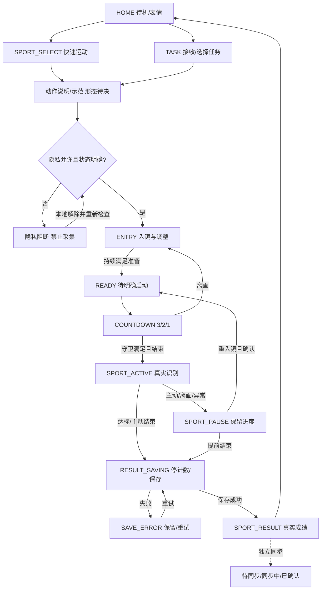

> **旧路径兼容快照（2026-10-12）**：后续维护请使用[Teamo_Device_Requirement_Baseline_v0.1.1.md](Teamo_Device_Requirement_Baseline_v0.1.1.md)。下方保留迁移前正文及历史，不作为独立维护入口。

# Document Control

| 字段 | 内容 |
|---|---|
| Document Type | Feature Specification / UX Flow |
| Current Version | v0.1.1 |
| Status | Review |
| Owner | 待确认（项目协调：魏子奇；不等同文档审批责任人） |
| Reviewer | 待指派 |
| Created Date | 2026-10-10 |
| Last Updated | 2026-10-12 |

> 文档控制版本以本表为准；原文件名和正文版本标识保留为历史业务版本。Draft/Review 为本次治理提交状态，非产品审批结论。创建日期取自原标识，待 Owner 核实。

# 设备端需求基线 · 评审稿 V0.1

日期：2026-10-10。状态：REVIEW，待团队共同确认。目标展示节点：2026-11-15。

## 1. 用途与依据

本文件回答设备有什么功能、用户如何触发、系统在各状态做什么、异常如何恢复、如何验证，并把这些要求传递给UI、ID、算法、硬件和软件架构。需求讨论未闭环前，不把漂亮效果图、候选器件或可点击模拟器当成实现决定。

输入及证据级别：

- 现行产品边界、[PRD V3.0](03_儿童AI运动陪伴机器人_PRD_V3.0.html)、[硬件V2.0](../../hardware/儿童AI运动陪伴机器人_MVP硬件技术需求说明书_V2.0.html)为既有要求，冲突显式登记。
- 用户2026-10-10提供的会议解读为本轮对齐输入；未提供对应原始会议转写，不据此补造参会人、决策签名或确认日期。67 × 92 mm按用户当前说明记为设计包络，轴含义、厚度及带壳/裸机范围仍需确认。
- [C端推演V0.2](../../../AI运动伙伴/00_现行研究与规范_20260918/AI运动伙伴_C端用户流程与一体换装硬件框架_V0.2.md)提出本地示范资源包和较大屏幕，但其状态是独立推演，不能覆盖像素屏或成为已批准规格。
- [PRD对应矩阵](../planning/PRD到1115演示功能对应矩阵_V0.1_20261010.md)保留全部九模块、七动作和家校要求；11/15是待确认切片，不能称完整第一版已交付。

产品定义：面向6–15岁家庭，通过明确运动目标、视觉识别、可信计数/计时和适度陪伴，帮助儿童开始、完成并再次运动；家长管理任务、权限和结果。陪伴服务运动，不发展为开放聊天或家庭远程监控。

顺序：需求对齐 → 用户与系统Flow → 状态及UI → ID尺寸区间 → 器件与空间验证 → 外观尺寸收敛 → 精确结构。软件接口和PoC可并行验证，但未决能力必须保留可替换边界，不能自行冻结方案。

## 2. 通用规则

1. 运动执行事实由设备会话维护，算法提供有效事件，UI只呈现；家长端不能自行递增次数。
2. 一次完整有效周期只计一次；平板支撑累计有效保持秒数，不能把运动总用时充当成绩。
3. 已同步任务断网继续本地识别、暂停、完成和保存，是PRD已有要求；新任务未送达不能显示已接收。
4. 隐私关闭或硬件状态未知禁止采集；退回待机关闭本轮运动采集。体态观察是另行授权的场景。
5. 产品原始摄像帧不持久化；动作示范素材是教学内容，与儿童采集视频是两种数据。媒体缓存决策不允许放宽儿童影像边界。
6. 暂停保留已确认努力，恢复重新检查站位并重置半周期；主动结束保存真实未达标结果，不伪称完成。
7. 运动结束、本地保存、后台同步分别确认；成功保存前不能播报“记录好了”。
8. 提示优先表达一个可处理原因；语音仲裁/冷却、文字和表情保持一致，运动中数字与状态优先。

## 3. 功能需求

下列ID是设备需求追踪号。对应S/R见[PRD矩阵](../planning/PRD到1115演示功能对应矩阵_V0.1_20261010.md)。每条都要进一步绑定实现Owner、接口版本、线框节点与测试证据；现阶段尚无实机通过记录。

### FR-DEVICE-001 首页与启动恢复

|字段|需求|
|---|---|
|触发/前置|上电、重启或结束流程返回；先恢复已保存任务、未同步结果及真实隐私状态。|
|系统行为|呈现角色待机、可执行任务/快速运动入口、必要的异常；不预设触屏或多级菜单。未完成会话进入恢复提示，不直接标完成。|
|输入与输出|输入启动/存储/隐私/网络状态；输出当前可操作状态及一个主要提示。|
|用户操作|任务、快速运动、允许的表情互动、必要设置；操作形式依OPEN-006确定。|
|异常/退出|恢复失败提示处理；离线可看本地状态；选择任务/动作进入目标确认；隐私关闭不采集。|
|验收/对应|重启不重复建结果；HOME不暗中开启运动采集。PRD §04/06/13/17；S01/S04/S13，R01/R13/R32。|

### FR-SPORT-001 快速运动与动作选择

|字段|需求|
|---|---|
|触发/前置|儿童从HOME选择快速运动；可用儿童身份及本地支持动作明确。|
|系统行为|展示可执行动作、目标与单位，确认后创建自主来源会话/目标，进入隐私及站位检查。七动作是PRD第一版范围，11/15开放名单待D02决定。|
|用户选择|动作、目标、确认或返回；不支持动作不得伪装可开始。没有远距屏幕菜单时，需近距操作或已验证替代。|
|输入与输出|输入动作能力表/目标；输出source=自主、action/ruleVersion、target/unit、childId及会话归属。|
|异常/退出|无身份/无可用动作/非法目标提供原因；离线支持本地允许的自主运动；返回不生成完成记录。|
|验收/对应|选择→确认→站位可走通；不把自主目标伪装成家长任务。PRD §06/09/16/17；S14，R09/R31。是否必演待决，不能默认删除。|

### FR-TASK-001 接收、选择与执行任务

|字段|需求|
|---|---|
|触发/前置|后台下发或儿童打开已缓存任务；来源、动作、目标、权限和有效窗口可校验。|
|系统行为|持久化后回执已接受；展示来源与目标；儿童明确启动才进入运动流程，收到任务不自动开启摄像头。|
|输入与输出|taskId/version/source/publisher/childId/action/target/unit、任务窗口与提醒；命令有效期单独定义。输出接收/接受/拒绝/开始回执。|
|用户操作|查看/开始/返回；延后、取消、编辑按发布方权限与范围决定，不由设备静默改目标。|
|异常/退出|重复任务幂等；运动中新任务忙碌拒绝或排队须冻结；撤销不继续提醒；已缓存任务断网可执行。|
|验收/对应|等待确认不等于成功；重复只一条；执行快照使用启动时的任务版本。PRD §05/09/19；S02/S03/S16，R09–R11/R20/R41。|

### FR-SPORT-002 动作说明与示范

|字段|需求|
|---|---|
|触发/前置|选定动作后，在开始前提供儿童可理解的动作说明；是否每次播放、首次播放或可跳过待OPEN-001决定。|
|系统行为|可以是静态图、简化动画或视频；媒体形态/位置/缓存未冻结。示范动作内容须动作/体育专业审核，不以AI生成图作为有效动作标准。|
|输入与输出|action/ruleVersion、说明文案、经审核资源清单/版本；输出示范/加载/失败状态。|
|用户操作|查看、重播、跳过或返回；哪些操作存在取决于最终媒体方案。|
|异常/退出|无网络/缺资源/解码失败给明确说明；若教学是安全前置则不能跳过后开练，需明确规则。不得让流媒体故障破坏已承诺的离线运动。|
|验收/对应|离线资源可用性与审核版本可追踪；停止教学后进入站位。运动中是否持续示范待决，大数字优先。用户新输入+C端推演；R01/R13，新增S25候选，OPEN-001。|

### FR-SPORT-003 隐私检查、入镜与准备

|字段|需求|
|---|---|
|触发/前置|有明确目标或已接受任务；硬件隐私允许且可确认。|
|系统行为|识别无人、过近/远、身体不完整、偏移、遮挡/暗光/采集失败；连续满足准备条件后进入READY。具体光照/FOV/稳定时间实测冻结。|
|显示/声音|一个主要调整原因，方向/状态符号与短语音；轮廓/实时姿态图是否显示待OPEN-003，不默认需要视频预览。|
|用户操作|调整站位、返回；READY中的确认方式待OPEN-006。|
|异常/退出|隐私关闭进入隐私阻断；状态不明不得采集；调整失败允许返回。|
|验收/对应|条件不足不开始；动作伸展也在允许视场内。PRD §06/07/17/19；硬件F02/F07；S04/S05，R01/R27/R32/R40。|

### FR-SPORT-004 开始与倒计时

|字段|需求|
|---|---|
|触发/前置|儿童启动意愿明确、任务有效、入镜准备和隐私满足；确认方式冻结。|
|系统行为|播报并显示3、2、1；结束时再次检查守卫，创建/激活本次运动会话，初始确认成绩0。 |
|用户操作|取消；若先近距按键，需给返回站位机会，不在靠近机身时强行开始。|
|异常/退出|离画退ENTRY；隐私关闭阻断；采集失败不进入ACTIVE；取消不产生虚假成绩。|
|验收/对应|Ready前不倒计时，Countdown前不计数。PRD §06/07/13；S06，R01/R14/R28。|

### FR-SPORT-005 识别、计数/计时与运动反馈

|字段|需求|
|---|---|
|触发/前置|倒计时正常结束或恢复完成；算法版本与动作规则明确。|
|系统行为|接收动作阶段/有效事件，一周期一次；保持动作按有效秒数。显示实际/目标、识别状态，运动用时如展示需定义是否排除暂停。|
|显示/声音|大数字与目标/单位、识别/暂停状态、节制反馈；持续示范或骨架图属于待决表达，不默认加入或提高屏幕规格。|
|用户操作|运动、主动暂停、提前结束；不能要求运动中阅读细字或频繁操作屏幕。|
|异常/退出|半程、不确定、过期或重复事件不计；低置信度持续多久转暂停待D07；达标停止接收计数，进入结束保存；断网保持本地执行。|
|验收/对应|逐事件人工真值对照；App/UI计数来自设备，单位正确，不造数。PRD §07/08/16；硬件F03/F04；S07/S08/S14，R02–R08/R29/R30。|

### FR-SPORT-006 暂停、异常与恢复

|字段|需求|
|---|---|
|触发/前置|主动暂停、离画、隐私关闭或采集/算法异常。|
|系统行为|保留已确认成绩与暂停原因，停止确认新动作；重入镜并检查准备，明确恢复后重置半周期。|
|显示/声音|已完成、主要原因、一个恢复动作；音频不持续催促。|
|用户操作|恢复或结束；远距操作待OPEN-006，不能假设语音/手势已存在。|
|异常/退出|隐私或采集仍异常不恢复；长时未回来按冻结超时策略提示保存；重启按持久化策略恢复暂停或中断。|
|验收/对应|12/20暂停后下次有效动作为13；暂停不累加，有效时长动作不归零。PRD §06/07/19；硬件F05；S09/S13，R01/R40。|

### FR-SPORT-007 结束、成绩与结果同步

|字段|需求|
|---|---|
|触发/前置|达到目标、主动提前结束或按约定中断策略结束。|
|系统行为|停止识别计数、保存Session及唯一recordId、入同步队列；成功落盘后显示结果，联网后幂等补传。|
|显示/声音|动作、目标、实际次数/有效秒数、用时、达标/提前结束、保存与同步状态；设备简洁表达，家长查看完整结果。|
|用户操作|查看、返回HOME、如纳入可重练/奖励；保存失败保留数据并重试。|
|异常/退出|写失败不能说记录已保存；断网已保存不等于已回传；重复结束不重复建记录；奖励不能在重传时重复发。|
|验收/对应|真实成绩一致且主记录唯一；HOME关闭运动采集；运动结束与同步状态独立。PRD §05–07/15/16；硬件F06；S10–S12/S17，R16/R29/R31。|

### FR-DEVICE-002 提醒、角色与激励

|字段|需求|
|---|---|
|触发/前置|真实任务提醒、开始、阶段、暂停、保存成功等事件；家长时段/音量控制有效。|
|系统行为|固定表情/短话术映射；提醒可延后，夜间不打扰；运动星/PB/成就依真实Session规则触发。本次深度需D12逐项裁剪。|
|用户操作|允许延后、关闭提醒、必要的表情互动；装扮不阻断主流程。|
|异常/退出|任务撤销不再提醒；事件重放不重复奖励；音频按优先级串行与冷却。|
|验收/对应|无无运动点击刷星、无公开羞辱/付费诱导/开放聊天。PRD §09/13；S08/S15/S17，R13–R17。|

### FR-POSTURE-001 姿态表达与独立体态陪伴

|字段|需求|
|---|---|
|触发/前置|先区分三种需求：站位引导、运动动作提醒、非运动体态陪伴；最后一种需独立授权与场景。|
|系统行为|站位依FR-SPORT-003；运动提醒依FR-SPORT-005且不遮计数；体态观察采用持续确认→提醒→冷却→结构化记录。|
|显示/数据|“姿态展示”可能是方向图标、轮廓、骨架或视频，表达形式待OPEN-003；不默认传家庭视频到家长端。体态事件与Session成绩独立。|
|异常/退出|低置信度不做确定纠错；撤权停止观察；运动中不启用打断性久坐/趴桌提醒。|
|验收/对应|非医疗表达、授权与冷却有效；本轮是否含非运动体态由D12决定。PRD §12/15/17；S05/S14/S21，R18/R39。|

### FR-DEVICE-003 设置、维护与数据控制

|字段|需求|
|---|---|
|触发/前置|家长或获授权维护方进行音量/权限/绑定/删除/更新操作，儿童只接触必要操作。|
|系统行为|显示真实设备与固件状态；允许控制按决定落实；断电恢复、升级回滚、权限撤回/解绑/删除策略不只写入口。|
|输入/输出|授权版本、device/childId、控制命令和真实回执；诊断仅必要结构化状态，日志不含儿童原始视频。|
|异常/退出|远程隐私请求不能绕过物理开关；离线删除需阻止旧队列复活；错误升级/恢复保留明确步骤。|
|验收/对应|越权拒绝、状态时效、撤权停止新回传、删除及升级失败行为可验；本轮具体交付范围逐项决定。PRD §10/17/19；硬件维护/存储要求；S13/S20/S23，R22/R34/R41。|

## 4. Flow与状态驱动UI

本图是评审候选；恢复经READY后是否再次3秒倒计时需OPEN-006确认。ACTIVE中隐私关闭先暂停并禁止采集；倒计时/准备期间隐私关闭转阻断。返回/取消路径遵循每条FR，不能仅按图中可见箭头实现。网络状态与任务状态并行，不把断网等同暂停。

UI交付每个状态卡包含：FR/R/S编号、进入条件、显示/声音、输入、数据真源、守卫、返回/取消、异常与恢复、验收脚本。先评审状态卡，再挂线框；HOME、SELECT/TASK、示范、ENTRY/READY、COUNTDOWN、ACTIVE、PAUSE、SAVING/ERROR、RESULT、隐私/维护都要覆盖。

## 5. ID设计包络与硬件传导

67 × 92 mm是当前用户提出的设计包络，暂按正面两个尺寸理解供讨论；轴定义、厚度、是否含套件、最大/标称、公差未确认，不写入最终机械规格。此前60×90等口径保留为历史参考。屏幕外框/FPC/连接器、相机模组/镜头、滑片行程、音腔、天线净空、USB-C插线、防滑/重心、磁吸、防夹与散热空间均要在收敛前实测验证。

ID当前交付：有尺寸轴和比例的正面/侧面效果、真实屏幕与相机占位、隐私滑片开/关表达、机身体块/圆角/厚度候选、套件装卸及功能禁挡区。评价是否为陪伴角色且可操作，不以减少手机感牺牲数字辨认、隐私可见性或全身视场。现在不制作声称可制造的精确内部结构。

|上游需求|待推导参数/架构|验证与冻结条件|
|---|---|---|
|FR-SPORT-002 示范|媒体形态、显示有效区/分辨率/刷新、编解码、资源包与缓存容量|媒体决定→样例播放→显示辨认→采集/推理/音频并发；候选视频码率/数量未知，不填存储数值|
|FR-SPORT-003/005 动态全身识别|HFOV/VFOV、固定角度、输入帧率/曝光、ISP、推理RAM/NPU/CPU|身高×摆放高度×距离×动作伸展×光照；像素数/TOPS不能替代真实动作验收|
|FR-SPORT-004/006 远距操作|按键/触控/受控手势/语音输入、按键稳定性|孩子走近/回位/离画恢复全过程；输入未确认不强制触屏或Mic|
|FR-SPORT-007 记录/同步|持久化容量、写入频率/寿命、队列、网络恢复|保存/入队一致、断电、重试幂等、低空间策略；不存儿童原始帧|
|FR-DEVICE-002 表情/短语音|屏幕亮度/视角/资源、扬声器/功放/腔体、音量上限|1.5–3米核心数字与语音辨认，装壳重测，光噪环境定义|
|隐私守卫|遮挡/硬件断电、滑片位置检测、GPIO、电源联动、不可静默关闭的指示|实物开关状态与驱动一致；未知默认禁止；滑片防夹与到位测试|
|FR-DEVICE-003 OTA|镜像/资源版本、分区/回滚空间、网络、校验与恢复|更新失败/掉电可恢复；确切容量依镜像与资源体积，不直接选eMMC/TF|
|所有功能并发|峰值供电、散热、可触温升、天线净空、机械装配|实际板满负载及装壳复测；参数/候选/验证/冻结分别记录|

固定相机是硬件V2.0方向；用户列可旋转属于需要提出替代理由的选项，不自动重开/覆盖既有需求。NPU/RAM即使文字写“初步确定”，仍需精确板型号、模型、SDK和并发实测证据。

## 6. 评审与出口

优先讨论OPEN-001示范媒体、OPEN-003姿态表达、OPEN-004屏幕、OPEN-006操作/恢复，以及D02动作范围；其结果连同设计包络决定UI与硬件成本。完整问题、ADR候选和决策状态集中维护在[决策台账](../planning/MVP关键问题与决策台账_V0.1_20261010.md)，不另建冲突答案。

汇报顺序：产品定义 → 本文件FR → Flow → 状态卡 → 对应UI → 67×92设计包络ID → 需求/参数映射 → 待决问题。示范视频、本地资源、姿态骨架都不能在评审前写成既定实现。

团队确认后升级为V1.0：每条FR有范围决定、Named Owner、操作与数据契约、验收口径；关键未知有验证负责人/期限。11/15纳入/延后逐项记录，动作阈值及技术路线凭联合实测冻结。需求基线评审通过、工程实现、实机验收是三个不同状态。当前只完成评审稿与对应关系。

---

# Version History

| Version | Date | Author | Status | Change Summary |
|---|---|---|---|---|
| v0.1.0 | 待核实 | 原作者待核实 | 待核实 | 登记导入前现存正文基线；已有版本标识，既有版本记录仍保留在正文；不推断历史修改或批准 |
| v0.1.1 | 2026-10-12 | Codex（AI，执行用户指令） | Review | 新增 Document Control、标准 Version History、Change Impact 与 Decision Log；保留既有业务正文及历史记录 |

> 本表仅登记已验证的现存基线与本次修改。历史日期、作者和状态待核实；原有版本记录是补录证据入口，不能据文件名编造缺失版本。

# Change Impact

### Modified Sections

- Section: 文档顶部与治理附录。
- Before: 缺少统一的文档控制表和标准版本记录。
- After: 增加控制表、基线与 Patch 历史、影响分析和决策记录入口；原业务正文保留。

### Impact Scope

Affected:
- 本文及引用本文的项目文档；本次无业务要求变更。
- 逐文件版本、备份和修改报告见 docs/governance/CHANGELOG-20261012.md。

### Risk

Low。Owner、Reviewer、历史审批状态仍待确认；本次结构治理不冻结产品需求。

# Decision Log

本次未修改产品方向、功能取舍或系统架构。既有决策及待决事项保留在正文，尚未逐条验证迁入；后续涉及这些事项时按 docs/governance/DOCUMENT_VERSION_POLICY.md 记录，建议与已批准决策必须区分。
